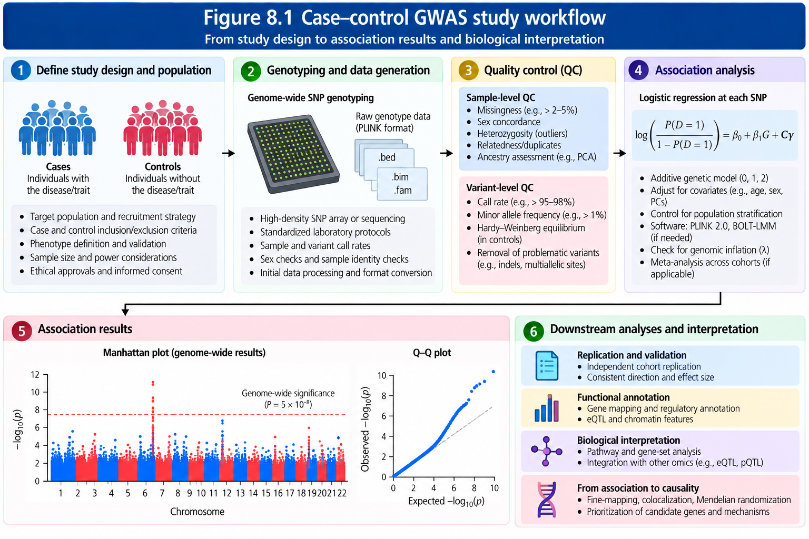
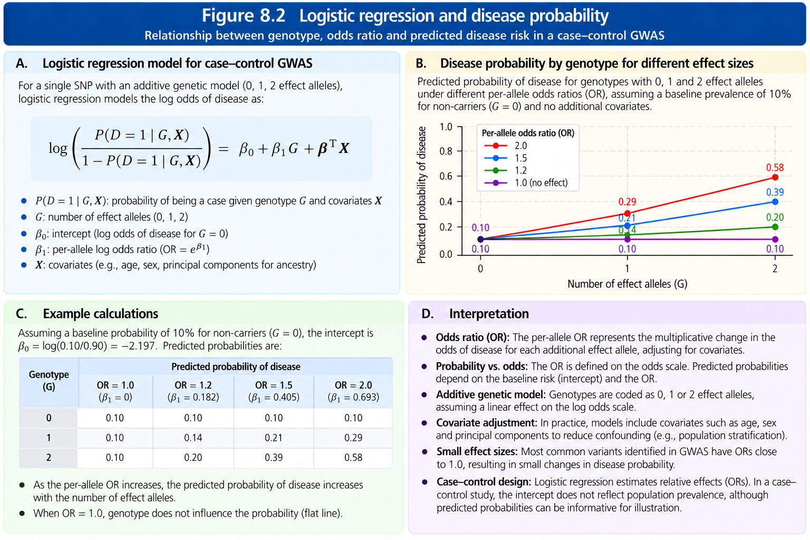
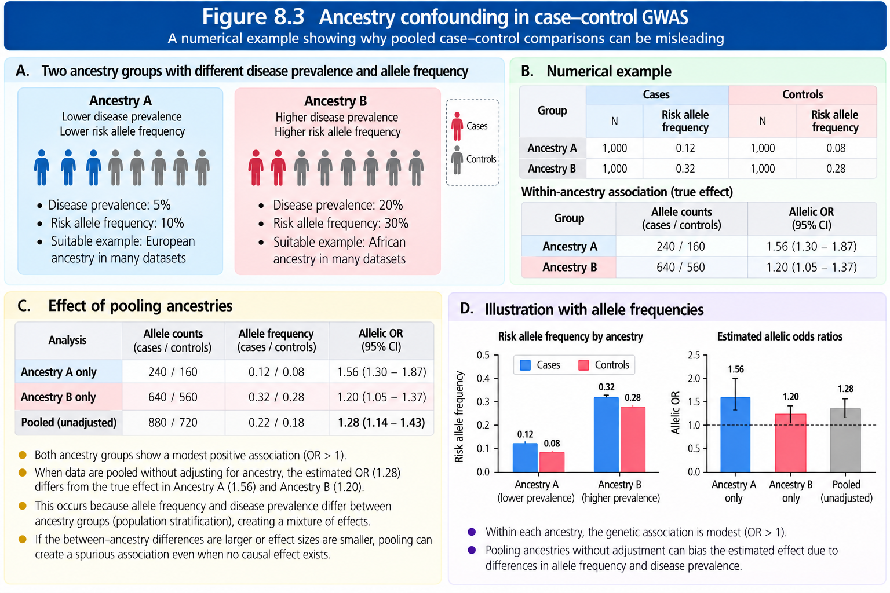

Case–Control Genome-Wide Association Studies
================

## 8 What is a case–control GWAS?

A **case** is a participant who meets a prespecified definition of a
disease or binary outcome. A **control** is a participant who does not
meet that definition and is eligible to represent the source population
from which cases arose. A **single-nucleotide polymorphism (SNP)** is a
genomic position at which a single nucleotide varies. A case–control
GWAS compares genetic variation between cases and controls across many
variants, typically using a regression model adjusted for relevant
covariates.

A **phenotype** is an observed characteristic, such as schizophrenia
diagnosis or diabetes status. A **genotype** is the pair of alleles
carried at a diploid locus; for a biallelic autosomal SNP, effect-allele
dosage is commonly coded 0, 1, or 2. A **covariate** is a variable
included in the statistical model, such as age, genotyping batch, or
genetic ancestry principal components (PCs).

A case–control design is efficient when the disease is uncommon, because
we can deliberately recruit sufficient cases. However, the recruited
fraction of cases is generally not the disease prevalence in the
underlying population.

<figure>


<figcaption>

<strong>Figure 8.1. Case–control GWAS study workflow.</strong> The
design begins with a defined source population, validated disease
classification, genotype and sample quality control, and an appropriate
association model. Recruitment, missingness, ancestry, and batch effects
must be evaluated throughout.
</figcaption>

</figure>

## 8.1 Designing a valid case–control comparison

### 8.1.1 Source population and ascertainment

**Ascertainment** is the process through which participants are
identified and recruited. Cases and controls should be drawn from
compatible source populations. Hospital cases paired with unusually
healthy volunteer controls may differ systematically in exposures,
ancestry, or access to healthcare. Such differences can induce
**selection bias** even when genotype measurement is accurate.

We should document the disease definition, diagnostic codes and
validation, recruitment dates and locations, age range, exclusions,
consent, sample overlap, and whether controls were screened or merely
lacked a recorded diagnosis. The distinction matters for late-onset
disease: a young control may develop the disease later.

### 8.1.2 Phenotype errors

**Sensitivity** is the probability that a true case is classified as a
case. **Specificity** is the probability that a true non-case is
classified as a control. Misclassification can attenuate associations
under some nondifferential-error models, but the direction of bias is
not universal, particularly when errors differ by genotype, recruitment
site, or other variables.

### 8.1.3 Genetic and technical comparability

Cases and controls should undergo comparable genotype processing. A
**batch effect** is a systematic difference caused by technology,
processing date, laboratory, or analytical pipeline rather than biology.
We should inspect case/control proportions by genotyping array,
missingness, imputation quality, and allele frequency, and document any
batch-associated variants. Quality-control decisions must avoid
selectively removing genuine disease associations.

## 8.2 Genotypes, alleles, and a 2 × 2 association table

Suppose an illustrative biallelic SNP has alleles A and G. We define G
as the effect allele and count 0, 1, or 2 copies of G per participant.

| Genotype | Cases | Controls | G alleles in cases | G alleles in controls |
|----|---:|---:|---:|---:|
| AA | 40 | 60 | 0 | 0 |
| AG | 45 | 35 | 45 | 35 |
| GG | 15 | 5 | 30 | 10 |
| **Total participants** | **100** | **100** | **75** | **45** |

Each diploid individual contributes two alleles, so there are 200
observed alleles in each group. The illustrative G-allele frequencies
are 75/200 = **0.375** in cases and 45/200 = **0.225** in controls. The
A-allele counts are 125 in cases and 155 in controls. An unadjusted
**allelic odds ratio** is

$$OR_{allelic}=\frac{75/125}{45/155}=\frac{75\times155}{125\times45}\approx2.067.$$

This is an odds ratio for the **allele-count table**, not necessarily
the coefficient from an individual-level additive logistic regression.
Alleles from the same participant are correlated, and an allelic
chi-square analysis does not substitute for covariate-adjusted
individual-level modeling. When association is evaluated with genotype
dosage, the primary estimand should be stated explicitly.

## 8.3 Odds, risk, and odds ratios

**Risk** is the probability of an event. **Odds** are the probability of
an event divided by the probability of its absence:

$$\mathrm{odds}=\frac{p}{1-p}.$$

If disease probability is 0.20, odds = 0.20/0.80 = 0.25. If probability
is 0.10, odds = 0.10/0.90 = 0.111. The odds ratio is 0.25/0.111 =
**2.25**, while the risk ratio is 0.20/0.10 = **2.00**. They are not
interchangeable. In a case–control sample, sampling fractions usually
prevent us from directly estimating population disease risk or risk
ratios from the observed case proportions.

An OR above 1 indicates higher disease odds per specified allele or
genotype contrast; below 1 indicates lower odds; equal to 1 indicates no
odds association. The direction depends on **which allele is counted**.
Swapping the effect allele reverses the sign of the log-OR and
reciprocates the OR.

## 8.4 Logistic regression: the primary additive model

For participant *i*, let $Y_i=1$ for a case and $Y_i=0$ for a control,
$G_i\in\{0,1,2\}$ be effect-allele dosage, and $X_i$ represent selected
covariates. We model

$$\log\left(\frac{P(Y_i=1\mid G_i,X_i)}{1-P(Y_i=1\mid G_i,X_i)}\right)
=\beta_0+\beta_GG_i+\boldsymbol\gamma^T X_i.$$

Here $\beta_0$ is the intercept; $\beta_G$ is the change in **log odds**
per additional effect allele; and $\exp(\beta_G)$ is the conditional
per-allele OR. The additive assumption is linearity in **log odds**, not
in disease probability. For example, if
$\beta_G=\log(1.5)\approx0.4055$, the per-allele OR is 1.5 and the
contrast of two additional copies has OR $1.5^2=2.25$.

<figure>


<figcaption>

<strong>Figure 8.2. Effect-allele dosage and logistic disease
probability.</strong> Curves use the explicitly specified model logit(p)
= −2 + log(OR) × dosage. Lines between genotype values are visual
interpolation only; actual observed diploid genotypes have integer
dosage values.
</figcaption>

</figure>

### 8.4.1 A hand-calculated confidence interval

Suppose a fitted model returns $\hat\beta_G=0.4055$ with standard error
$SE=0.10$. An approximate Wald 95% interval on the log-OR scale is
$0.4055\pm1.96(0.10)$, or \[0.2095, 0.6015\]. Exponentiating gives an OR
of approximately **1.50** with 95% CI **\[1.23, 1.83\]**. A Wald Z
statistic is 0.4055/0.10 = 4.055, yielding a two-sided p-value of
approximately 5 × 10⁻⁵. This is **not** genome-wide significant at the
conventional 5 × 10⁻⁸ threshold.

### 8.4.2 Model assumptions and limitations

We should consider (a) correct phenotype and genotype coding, (b) an
appropriate conditional mean model, (c) independent observations or a
method accounting for relatedness, (d) sufficient information and no
severe separation, (e) covariate measurement and overlap, and (f)
calibration under population structure and case/control imbalance. A low
p-value does not establish causality.

**Separation** occurs when genotype and/or covariate combinations almost
perfectly predict case status; standard maximum-likelihood logistic
estimates can become unstable or fail. Firth penalized likelihood is one
remedy, although study-wide calibration and relatedness still require
attention.

## 8.5 Confounding by ancestry and recruitment

**Population stratification** occurs when ancestry-related
allele-frequency differences coincide with ancestry-related phenotype
differences. This can produce a pooled association even if the variant
has no association within either ancestry group. Genetic PCs and
appropriate mixed-model or stratified approaches help, but they do not
guarantee removal of all confounding.

Consider an **illustrative example** with 400 cases and 400 controls.
Group A contains 300 cases and 100 controls; Group B contains 100 cases
and 300 controls. Within each group, the G-allele frequency is identical
in cases and controls: 0.80 in Group A and 0.20 in Group B. Pooled
across groups, however, the G frequency is (300 × 0.8 + 100 × 0.2)/400 =
**0.65** in cases and (100 × 0.8 + 300 × 0.2)/400 = **0.35** in
controls. The difference is due entirely to different group compositions
in this constructed example.

<figure>


<figcaption>

<strong>Figure 8.3. Ancestry confounding in pooled case–control allele
frequencies.</strong> All frequencies are computed from the stated
illustrative group sizes and within-group frequencies. Equal frequencies
within each group do not prevent a misleading pooled comparison when
group proportions differ.
</figcaption>

</figure>

## 8.6 Sample size, power, and genome-wide significance

**Statistical power** is the probability that a specified test rejects
the null when a specified alternative is true. Case–control GWAS power
depends on effect size, effect-allele frequency, case/control numbers,
model, imputation quality, and significance threshold. The smaller group
often constrains effective information. A conventional common-variant
genome-wide threshold is p \< 5 × 10⁻⁸, but it is not universal across
all variant classes, ancestry structures, or multiple-phenotype designs.

The **effective sample size** often used as a rough case–control summary
is

$$N_{eff}=\frac{4N_{case}N_{control}}{N_{case}+N_{control}}.$$

For 1,000 cases and 9,000 controls, $N_{eff}=3,600$, substantially below
the total of 10,000. This is a useful approximation, **not** a
replacement for a study-specific power calculation, and alternative
conventions exist in meta-analysis and summary-statistic resources.

## 8.7 Practical R exercise: inspect the illustrative genotype table

The following code uses only base R and reproduces the table in Section
8.4.

``` r
counts <- matrix(c(40,45,15,60,35,5), nrow=3,
                 dimnames=list(c('AA','AG','GG'), c('Cases','Controls')))
counts
```

    ##    Cases Controls
    ## AA    40       60
    ## AG    45       35
    ## GG    15        5

``` r
n <- colSums(counts)
g_count <- counts['AG',] + 2 * counts['GG',]
g_freq <- g_count / (2*n)
a_count <- 2*n - g_count
allelic_or <- (g_count['Cases'] * a_count['Controls']) /
              (a_count['Cases'] * g_count['Controls'])
print(g_freq)
```

    ##    Cases Controls 
    ##    0.375    0.225

``` r
print(allelic_or)
```

    ##    Cases 
    ## 2.066667

``` r
stopifnot(n['Cases']==100, n['Controls']==100,
          isTRUE(all.equal(unname(g_freq), c(.375,.225))),
          isTRUE(all.equal(unname(allelic_or), 75*155/(125*45))))
```

### 8.7.1 Individual-level logistic regression in R

For a **teaching-only** genotype dataset expanded from the counts, we
can fit a logistic model. Since these are constructed counts, the
estimates are not biological findings.

``` r
cases <- rep(c(0,1,2), counts[, 'Cases'])
controls <- rep(c(0,1,2), counts[, 'Controls'])
d <- data.frame(case=c(rep(1L,length(cases)),rep(0L,length(controls))),
                dosage=c(cases,controls))
fit <- glm(case ~ dosage, data=d, family=binomial())
summary(fit)
```

    ## 
    ## Call:
    ## glm(formula = case ~ dosage, family = binomial(), data = d)
    ## 
    ## Coefficients:
    ##             Estimate Std. Error z value Pr(>|z|)   
    ## (Intercept)  -0.4212     0.1957  -2.152  0.03140 * 
    ## dosage        0.7109     0.2269   3.133  0.00173 **
    ## ---
    ## Signif. codes:  0 '***' 0.001 '**' 0.01 '*' 0.05 '.' 0.1 ' ' 1
    ## 
    ## (Dispersion parameter for binomial family taken to be 1)
    ## 
    ##     Null deviance: 277.26  on 199  degrees of freedom
    ## Residual deviance: 266.82  on 198  degrees of freedom
    ## AIC: 270.82
    ## 
    ## Number of Fisher Scoring iterations: 4

``` r
exp(coef(fit)['dosage'])
```

    ##  dosage 
    ## 2.03575

``` r
exp(confint.default(fit)['dosage',]) # approximate Wald CI
```

    ##    2.5 %   97.5 % 
    ## 1.305019 3.175646

``` r
stopifnot(nrow(d)==200, all(d$dosage %in% 0:2))
```

The model OR need not equal the allelic-table OR: the estimands and
likelihoods differ. A case/control sample proportion of 50% in this
constructed dataset is **not** evidence that population disease
prevalence is 50%.

## 8.8 Practical GWAS workflow with PLINK 2.0

We assume a **previously QC-checked**, appropriately imputed or
genotyped PLINK 2.0 dataset named `qc_binary.{pgen,pvar,psam}`, a
phenotype file `case_control.pheno`, and a covariate file
`covariates.tsv`. The genotype dataset and phenotype/covariate records
must be aligned by participant identifiers. These filenames are
placeholders, not verified study files.

### 8.8.1 Phenotype coding

PLINK 2.0 recognizes case/control phenotypes encoded as **1 = control, 2
= case** (and documented alternative conventions). Do not assume that a
0/1 file is interpreted as intended without checking the program’s log
and phenotype summary. A phenotype file can have a header such as:

``` default
#FID IID DISEASE
F1 S1 2
F1 S2 1
```

Covariates should have matching FID/IID identifiers and named columns,
for example `AGE`, `SEX`, `PC1`–`PC10`, and `BATCH`, when scientifically
justified. We should verify which variables are categorical, how missing
values are encoded, and whether covariate collinearity is present.

### 8.8.2 Association command

``` bash
plink2 \
  --pfile qc_binary \
  --pheno case_control.pheno --pheno-name DISEASE \
  --covar covariates.tsv \
  --covar-name AGE,SEX,PC1,PC2,PC3,PC4,PC5,PC6,PC7,PC8,PC9,PC10 \
  --glm hide-covar firth-fallback \
  --ci 0.95 \
  --out case_control_gwas
```

**Important:** `BATCH` is not included in this example command; if batch
adjustment is required, it must be correctly encoded and explicitly
added. `SEX` coding and X-chromosome analysis require additional care;
this example targets a conventional autosomal analysis. PLINK 2.0’s
`--glm` performs variant-wise logistic regression for binary outcomes,
with Firth fallback for selected problematic fits. Output naming and
columns depend on the program version and selected modifiers. Always
inspect the `.log` and association file headers instead of assuming a
fixed suffix.

For **related samples, highly unbalanced traits, or difficult population
structure**, ordinary variant-wise logistic regression may be
insufficiently calibrated. We should consider a validated mixed-model or
saddlepoint-based workflow appropriate to the cohort (for example, SAIGE
or REGENIE), and document the choice rather than silently changing
methods.

### 8.8.3 Interpret the results

For each variant, check chromosome and position, variant ID, tested
allele (`A1`), other allele, observation count, `BETA` or `OR`, standard
error, test identifier, p-value, and any error code. PLINK 2.0 may
report whether Firth regression was used. We should retain genome
assembly, effect-allele direction, allele frequencies, imputation
quality, and software version for downstream meta-analysis or
replication.

## 8.9 Diagnostics and what can go wrong

| Problem | Diagnostic evidence | Response and caveat |
|----|----|----|
| Case/control phenotype reversed | Unexpected case counts; discordance with clinical records | Confirm encoding and recalculate counts before association |
| Ancestry confounding | PCs associated with phenotype; ancestry imbalance; QQ inflation | Investigate ancestry structure, recruitment and modeling; do not blindly overcorrect |
| Batch artifact | SNP missingness or frequency associated with case-enriched batch | Review assay provenance, missingness, imputation, and batch adjustment |
| Sparse genotypes/separation | Very low allele counts, extreme coefficients, convergence errors | Review allele counts; consider Firth or suitable alternative model |
| Related participants | Unexpected pairwise kinship or duplicated samples | Remove duplicates; account for relatives using a justified model |
| Covariate collinearity | Regression errors, large variance inflation, unstable coefficients | Audit covariates and design matrix; avoid arbitrary deletion |
| Genomic inflation | QQ plot departure; lambda GC | Distinguish polygenicity, confounding, sample size and technical artifacts |
| Misaligned alleles | Reversed effect direction in replication | Harmonize genome build, reference/alternate alleles, effect allele, strand and frequencies |

**Quality-control principle:** Do not equate all departures from
Hardy–Weinberg equilibrium in cases with genotyping error; a genuinely
associated variant can depart from HWE in cases. Control-group HWE
checks also need ancestry, sample size, and technical context.

## 8.10 Methods record and troubleshooting log

For every real analysis, record the date, command, PLINK version, input
checksums, genome build, initial and final case/control counts, excluded
individuals and reasons, number of tested variants, missingness and
imputation thresholds, covariates, relatedness/ancestry strategy,
warnings, failed tests, corrective action, rerun command, and
independently verified outputs. Keep the original log alongside
corrected runs.

| Field | Current chapter status |
|----|----|
| Data | Illustrative counts only; no study cohort analyzed |
| Figure 8.1 | Schematic generated programmatically |
| Figure 8.2 | Deterministic logistic curves from stated formula |
| Figure 8.3 | Deterministic allele frequencies from stated group sizes |
| PLINK association run | Template only; not executed |
| Scientific results | None claimed |

## 8.11 Review exercises

1.  Define a case, control, phenotype, genotype, and effect allele.
2.  Why must controls represent an appropriate source population?
3.  Calculate the G-allele frequency among cases in Section 8.4.
4.  Derive the unadjusted allelic OR from the 2 × 2 allele table.
5.  Explain why an allelic OR need not equal an additive
    logistic-regression OR.
6.  Interpret $\beta_G=-0.30$ in terms of the per-allele OR.
7.  Explain why OR is not generally the same as a risk ratio.
8.  Why does the observed case fraction not estimate population
    prevalence?
9.  Describe one pathway by which genotyping batch creates a spurious
    association.
10. Explain why adjusting for ancestry PCs can be necessary but
    insufficient.
11. What is separation in logistic regression, and how can Firth
    regression help?
12. Calculate $N_{eff}$ for 2,000 cases and 2,000 controls.
13. What should be checked before interpreting a PLINK 2.0 association
    output?
14. Which methods-record fields are necessary to reproduce a real
    analysis?

## 8.12 Chapter summary

Case–control GWAS identifies genotype–disease associations by comparing
participants with and without a defined outcome. Its validity depends on
careful ascertainment, phenotype coding, genetic QC, ancestry and batch
control, an appropriate regression model, and reproducible reporting.
The effect allele and estimand must be stated explicitly. A
statistically significant SNP is not automatically causal, and a
case–control sample does not directly estimate population prevalence.

## Selected references

1.  Purcell S, et al. (2007). PLINK: a tool set for whole-genome
    association and population-based linkage analyses. *American Journal
    of Human Genetics* 81:559–575. <https://doi.org/10.1086/519795>
2.  Chang CC, et al. (2015). Second-generation PLINK: rising to the
    challenge of larger and richer datasets. *GigaScience* 4:7.
    <https://doi.org/10.1186/s13742-015-0047-8>
3.  Marees AT, et al. (2018). A tutorial on conducting genome-wide
    association studies: Quality control and statistical analysis.
    *International Journal of Methods in Psychiatric Research* 27:e1608.
    <https://doi.org/10.1002/mpr.1608>
4.  Price AL, et al. (2006). Principal components analysis corrects for
    stratification in genome-wide association studies. *Nature Genetics*
    38:904–909. <https://doi.org/10.1038/ng1847>
5.  Firth D. (1993). Bias reduction of maximum likelihood estimates.
    *Biometrika* 80:27–38. <https://doi.org/10.1093/biomet/80.1.27>
6.  Zhou W, et al. (2018). Efficiently controlling for case-control
    imbalance and sample relatedness in large-scale genetic association
    studies. *Nature Genetics* 50:1335–1341.
    <https://doi.org/10.1038/s41588-018-0184-y>
7.  PLINK 2.0 documentation. Association analysis.
    <https://www.cog-genomics.org/plink/2.0/assoc> (accessed 13 October
    2026).
8.  PLINK 2.0 documentation. File formats.
    <https://www.cog-genomics.org/plink/2.0/formats> (accessed 13
    October 2026).
9.  International Committee of Medical Journal Editors (ICMJE). Use of
    AI by Authors.
    <https://icmje.org/recommendations/browse/artificial-intelligence/ai-use-by-authors.html>
    (accessed 13 October 2026).

## AI assistance disclosure

OpenAI’s **ChatGPT** was used to assist with educational text drafting,
editorial organization, code preparation, and checking consistency of
figure captions and references. The numerical figures are generated by
reproducible Python code (`make_figures.py`) from explicitly stated
illustrative inputs, rather than by image synthesis. AI assistance does
not constitute scientific authorship; the human author remains
responsible for independently reviewing all claims, code, figures,
citations, and final publication content. This disclosure is consistent
with ICMJE guidance on transparency in AI-assisted writing.
