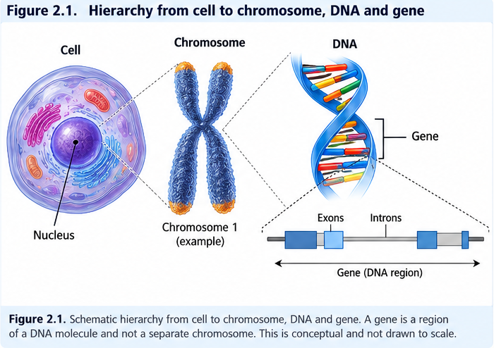
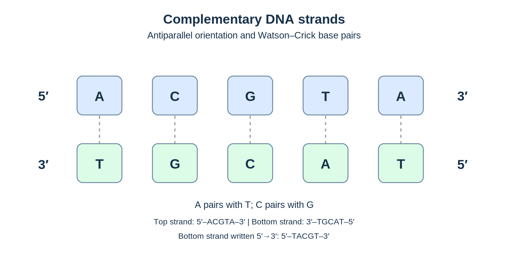
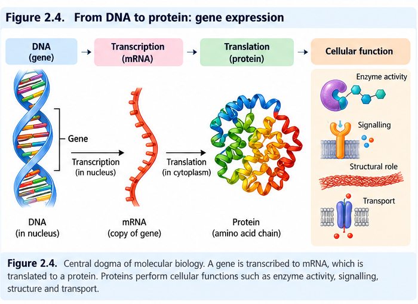
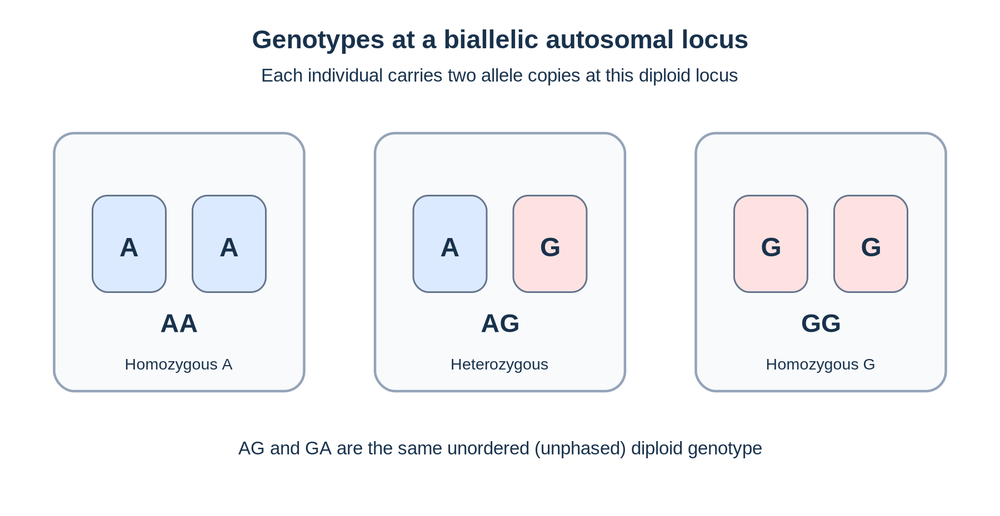
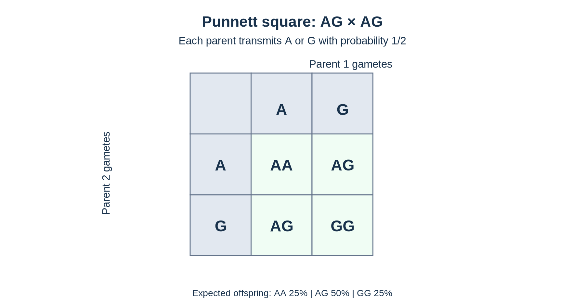
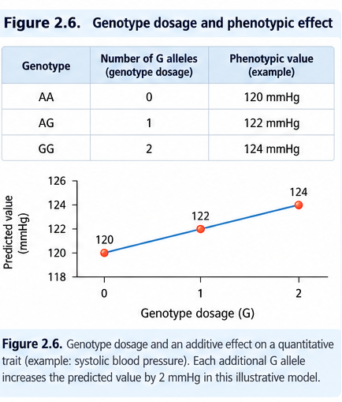

Essential Genetics for GWAS
================

## 2.1 From cells to chromosomes

Most human cells contain a **nucleus** that houses chromosomes, which
are long DNA molecules packaged with proteins. DNA is the chemical
material that carries hereditary sequence information. A **gene** is a
genomic region that contributes to a functional product, such as an RNA
or protein; not all DNA belongs to protein-coding genes. A **genome**
comprises an organism’s genetic material. In human GWAS, we ordinarily
study variation in nuclear DNA, although mitochondrial variation may
also be relevant.

In a typical human somatic cell, there are **46 nuclear chromosomes**,
organized as **23 pairs**: 22 pairs of autosomes and one pair of sex
chromosomes. One chromosome of each autosomal pair is inherited from
each biological parent. This is a useful starting model, but chromosome
number and sex-chromosome complement can vary, and mature red blood
cells lack nuclei.

<figure>

<figcaption aria-hidden="true">Figure 2.1. From cell to chromosome, DNA
and gene. Conceptual illustration, not to scale.</figcaption>
</figure>

*Figure 2.1. A gene occupies a region of DNA packaged into a
chromosome.*

### Autosomes and sex chromosomes

Autosomes are chromosomes 1–22. The X and Y chromosomes are termed sex
chromosomes. Autosomal genotype coding often assumes two copies per
person; X-chromosome analysis requires attention to ploidy,
pseudoautosomal regions, sex-chromosome complement and the specific
statistical model. We will revisit these complications in the sex-check
and association chapters.

## 2.2 What DNA is made of

DNA is a polymer of **nucleotides**. Each nucleotide contains a sugar
(deoxyribose), a phosphate group and one nitrogenous base: **adenine
(A), thymine (T), cytosine (C), or guanine (G)**. Two complementary DNA
strands typically form a double helix. A pairs with T, and C pairs with
G in standard Watson–Crick base pairing. DNA strands run in opposite
directions, described as **antiparallel** (5′→3′ and 3′→5′).

For example, if one strand is written 5′–A C G T A–3′, its complementary
strand is 3′–T G C A T–5′. If we write both strands 5′→3′, we must
reverse the order of the complementary sequence.

<figure>

<figcaption aria-hidden="true">Figure 2.2. Antiparallel DNA strands and
complementary base pairing.</figcaption>
</figure>

*Figure 2.2. A–T and C–G pairing on opposite-oriented strands.*

**Worked example.** Consider 5′–A T C G–3′. The complementary strand
aligned underneath is 3′–T A G C–5′. Written in its own 5′→3′ direction,
the complementary sequence is 5′–C G A T–3′. This distinction matters
when discussing reference alleles, strand orientation and variant
harmonization.

## 2.3 Genes, gene expression, and proteins

A gene may be transcribed into RNA. Protein-coding transcripts can be
translated into proteins; other genes produce functional non-coding
RNAs. Gene regulation determines where, when and how much of a gene
product is made. A **variant near a gene** can influence gene
regulation, but its proximity does not establish which gene it affects.

In a protein-coding gene, **transcription** uses a DNA template to
synthesize a complementary RNA transcript. In eukaryotes, the initial
pre-mRNA is commonly processed by splicing, which removes introns and
joins exons. **Translation** uses the mature mRNA sequence to assemble a
polypeptide at a ribosome. Protein folding and other processing then
contribute to protein function. In contrast, many noncoding RNA genes
produce functional RNA molecules that are not translated into proteins.

A variant in a promoter, enhancer, splice site, or untranslated region
may affect gene expression or RNA processing without changing a
protein-coding sequence. Such mechanisms help explain why GWAS signals
are frequently located outside coding exons.

A simplified information flow is DNA → RNA → protein. This is not a
claim that every gene makes a protein or that phenotype depends on a
single linear pathway. GWAS signals frequently fall outside
protein-coding exons, which is one reason that the nearest gene is not
automatically the causal gene.

<figure>

<figcaption aria-hidden="true">Figure 2.3. From DNA to RNA to protein
and cellular functions.</figcaption>
</figure>

*Figure 2.3. Simplified protein-coding gene-expression pathway; many
genes instead produce noncoding RNAs.*

## 2.4 Loci, alleles, and genotypes

A **locus** is a specified genomic position or region. An **allele** is
one of the alternative DNA sequences at that locus. A **genotype**
describes the allele combination carried by an individual at a locus. A
**phenotype** is an observed or measured characteristic, such as
systolic blood pressure or disease status.

Imagine a biallelic autosomal position with alleles A and G. Because
most individuals carry two copies of that autosome, the possible
unordered genotypes are **AA**, **AG**, and **GG**. AA and GG are
**homozygous**; AG is **heterozygous**. This example is intentionally
limited to a biallelic, diploid locus. Multiallelic loci, structural
variation, copy-number changes and sex chromosomes need additional
representation.

<table>

<thead>

<tr>

<th>

Term
</th>

<th>

Plain-language meaning
</th>

<th>

Example
</th>

</tr>

</thead>

<tbody>

<tr>

<td>

Locus
</td>

<td>

A position or region in the genome
</td>

<td>

A position on chromosome 6
</td>

</tr>

<tr>

<td>

Allele
</td>

<td>

A sequence alternative at that position
</td>

<td>

A or G
</td>

</tr>

<tr>

<td>

Genotype
</td>

<td>

The pair of alleles at a diploid locus
</td>

<td>

AG
</td>

</tr>

<tr>

<td>

Homozygous
</td>

<td>

Two copies of the same allele
</td>

<td>

AA or GG
</td>

</tr>

<tr>

<td>

Heterozygous
</td>

<td>

Two different alleles
</td>

<td>

AG
</td>

</tr>

<tr>

<td>

Phenotype
</td>

<td>

A measured characteristic
</td>

<td>

Blood pressure
</td>

</tr>

</tbody>

</table>

<figure>

<figcaption aria-hidden="true">Figure 2.4. AA, AG and GG genotypes at a
biallelic diploid locus.</figcaption>
</figure>

*Figure 2.4. Homozygous and heterozygous allele combinations.*

### A variant is not the same as a gene

A single-nucleotide variant changes one nucleotide relative to a
specified reference sequence. It may occur inside a gene, outside a
gene, or within a regulatory element. The term **SNP** is commonly used
for a single-nucleotide polymorphism in a population; we will
distinguish SNPs, SNVs, indels and structural variants systematically in
Chapter 3.

## 2.5 How diploid inheritance works

At an autosomal locus, offspring ordinarily receive one allele from each
biological parent. A **gamete** (egg or sperm) generally carries one
copy of each autosome. During **meiosis**, homologous chromosomes
segregate and recombination can exchange segments between them. This
explains why siblings can inherit different combinations of parental
alleles.

**Worked example: AG × AG.** Each parent can transmit A or G. The four
equally likely combinations under this simple Mendelian model are AA,
AG, GA and GG. Because AG and GA represent the same unordered genotype,
the expected probabilities are:

$$P(AA)=\frac14,\qquad P(AG)=\frac12,\qquad P(GG)=\frac14.$$

These are **expected probabilities for a particular cross**, not
observed genotype frequencies in a population. We must not confuse this
Punnett-square result with Hardy–Weinberg equilibrium, which we will
develop in Chapter 4.

<figure>

<figcaption aria-hidden="true">Figure 2.5. A complete 2 by 2 Punnett
square for AG by AG.</figcaption>
</figure>

*Figure 2.5. The expected genotype probabilities are 1/4 AA, 1/2 AG and
1/4 GG.*

## 2.6 Genotype dosage: connecting genetics to GWAS

GWAS software often converts a diploid biallelic genotype into the
number of copies of a designated **effect allele**. Suppose G is the
effect allele:

<table>

<thead>

<tr>

<th>

Genotype
</th>

<th>

Number of G alleles
</th>

<th>

Dosage (G)
</th>

</tr>

</thead>

<tbody>

<tr>

<td>

AA
</td>

<td>

0
</td>

<td>

0
</td>

</tr>

<tr>

<td>

AG
</td>

<td>

1
</td>

<td>

1
</td>

</tr>

<tr>

<td>

GG
</td>

<td>

2
</td>

<td>

2
</td>

</tr>

</tbody>

</table>

If we instead count A, the coding reverses: AA = 2, AG = 1, GG = 0.
**The dosage coding depends on the allele chosen; it does not by itself
imply that an allele is harmful or protective.** An effect allele is
simply the allele relative to which a statistical coefficient is
defined.

For an individual with genotype AG, the G dosage is 1 because exactly
one of the two alleles is G. For GG, it is 2. In an additive model, a
coefficient multiplies this allele count. The interpretation of the
coefficient depends on the outcome and statistical model, which we will
derive in Chapters 6 and 38.

``` r
genotype <- c("AA", "AG", "GG", "AG", "AA")
g_dosage <- c(0L, 1L, 2L, 1L, 0L)
data.frame(sample=paste0("S", seq_along(genotype)), genotype, g_dosage)
```

    ##   sample genotype g_dosage
    ## 1     S1       AA        0
    ## 2     S2       AG        1
    ## 3     S3       GG        2
    ## 4     S4       AG        1
    ## 5     S5       AA        0

``` r
stopifnot(all(g_dosage %in% 0:2))
```

<figure>

<figcaption aria-hidden="true">Figure 2.6. Illustrative genotype dosage
and quantitative-trait prediction.</figcaption>
</figure>

*Figure 2.6. A hypothetical additive effect, not a prediction from the
HapMap data.*

### Why dosage is not always 0, 1, or 2

The simple coding above applies to **hard-called diploid biallelic
genotypes**. Imputed genotypes may be represented by expected allele
dosages between 0 and 2, such as 1.37. Haploid regions, copy-number
variants, and multiallelic sites require different treatment. We will
return to these cases when we discuss data formats, sex chromosomes and
imputation.

## 2.7 Reference alleles, alternate alleles, and strand orientation

A **reference genome** provides a coordinate system and a reference
nucleotide or sequence at each position. In VCF, **REF** denotes the
reference allele and **ALT** an alternate allele relative to that
reference. These labels are not equivalent to major/minor alleles or
automatically to the effect/non-effect alleles in an association result.

For example, a position might have REF=A and ALT=G, while an association
analysis reports the effect of A rather than G. It is essential to track
which allele a reported coefficient refers to. Moreover, A/T and C/G
variants can be strand-ambiguous without additional information. Chapter
18 will cover genome builds and allele harmonization in detail.

## 2.8 Genotype is not destiny

A genetic variant can affect a phenotype, but a person’s measured
phenotype also reflects other variants, developmental processes,
environmental exposures, age, measurement error and chance. For complex
traits, many variants may each contribute small effects. Even a genuine
GWAS association does not imply that all carriers develop a disease, nor
does it prove that the tested variant itself is causal.

**Example.** Two individuals with the same genotype at a
blood-pressure-associated locus can have different blood-pressure
measurements because of other genetic and non-genetic factors. Our
interpretation must distinguish a population-level association from an
individual-level prediction.

## 2.9 Common misunderstandings

<table>

<thead>

<tr>

<th>

Misunderstanding
</th>

<th>

Correction
</th>

</tr>

</thead>

<tbody>

<tr>

<td>

A gene and an allele are the same thing.
</td>

<td>

A gene is a genomic region; an allele is a sequence alternative at a
locus.
</td>

</tr>

<tr>

<td>

Every variant lies in a protein-coding gene.
</td>

<td>

Many variants occur in non-coding or intergenic regions.
</td>

</tr>

<tr>

<td>

A heterozygote carries two different genes.
</td>

<td>

At a diploid locus, it carries two different alleles.
</td>

</tr>

<tr>

<td>

The effect allele must increase disease risk.
</td>

<td>

Its estimated effect may be positive, negative or null.
</td>

</tr>

<tr>

<td>

REF always equals the non-effect allele.
</td>

<td>

Reference and effect labels serve different purposes.
</td>

</tr>

<tr>

<td>

A genotype uniquely determines a complex phenotype.
</td>

<td>

Complex phenotypes generally reflect many genetic and non-genetic
influences.
</td>

</tr>

</tbody>

</table>

## 2.10 Practical checkpoint and reproducibility

This chapter uses **illustrative sequences, fictional genotypes, and
base-R diagrams**. It does not perform QC, read the Hapmap files, or
report newly computed results from the real GWAS dataset. The R examples
require only base R; figure outputs will be written under
`figures/ch02-` when the chapter is knitted.

For reproducibility, record the R version and render command used in the
local environment:

``` r
R.version.string
```

    ## [1] "R version 4.5.3 (2026-03-11 ucrt)"

To preserve mathematics, inspect the generated `.md` before publishing.
In display equations, subscripts must appear as `_{...}`, **not**
`\_{...}`. The final rendered Markdown should also be checked for
generated PNG figure paths and their corresponding files.

## Chapter summary

DNA is organized into chromosomes; genes are regions of DNA, and alleles
are alternative sequences at loci. At a diploid biallelic autosomal
locus, individuals can be homozygous or heterozygous. In GWAS, these
genotypes are commonly represented as effect-allele counts of 0, 1 or 2.
This coding links biological inheritance to statistical association
models, but it does not imply causality or deterministic prediction.

## Concept checks

1.  How do a chromosome, DNA molecule, gene, locus and allele differ?
2.  What is the complementary strand to 5′–A G T C–3′, written both in
    aligned and 5′→3′ orientations?
3.  Why are AG and GA ordinarily treated as the same unphased diploid
    genotype?
4.  In an AG × GG cross, what genotypes and probabilities are expected
    under simple Mendelian inheritance?
5.  If A is the effect allele, what dosages correspond to AA, AG and GG?
6.  Why can an imputed dosage be 1.37 instead of an integer?
7.  Why must we not equate REF with the effect allele?
8.  Why can two individuals carrying the same SNP genotype have
    different phenotypes?

## References and further reading

1.  National Human Genome Research Institute. *Talking Glossary of
    Genomic and Genetic Terms.*
    <https://www.genome.gov/genetics-glossary>
2.  National Human Genome Research Institute. *Deoxyribonucleic Acid
    (DNA) Fact Sheet.*
    <https://www.genome.gov/about-genomics/fact-sheets/Deoxyribonucleic-Acid-Fact-Sheet>
3.  National Human Genome Research Institute. *Genome-Wide Association
    Studies Fact Sheet.*
    <https://www.genome.gov/about-genomics/fact-sheets/Genome-Wide-Association-Studies-Fact-Sheet>
4.  Marees AT, de Kluiver H, Stringer S, et al. A tutorial on conducting
    genome-wide association studies: Quality control and statistical
    analysis. *Int J Methods Psychiatr Res.* 2018;27:e1608.
    <https://doi.org/10.1002/mpr.1608>

**Next chapter:** Chapter 3 — Genetic Variation and Genetic Architecture
(SNPs, indels, structural variants, allele frequency classes, effect
sizes and polygenicity).
