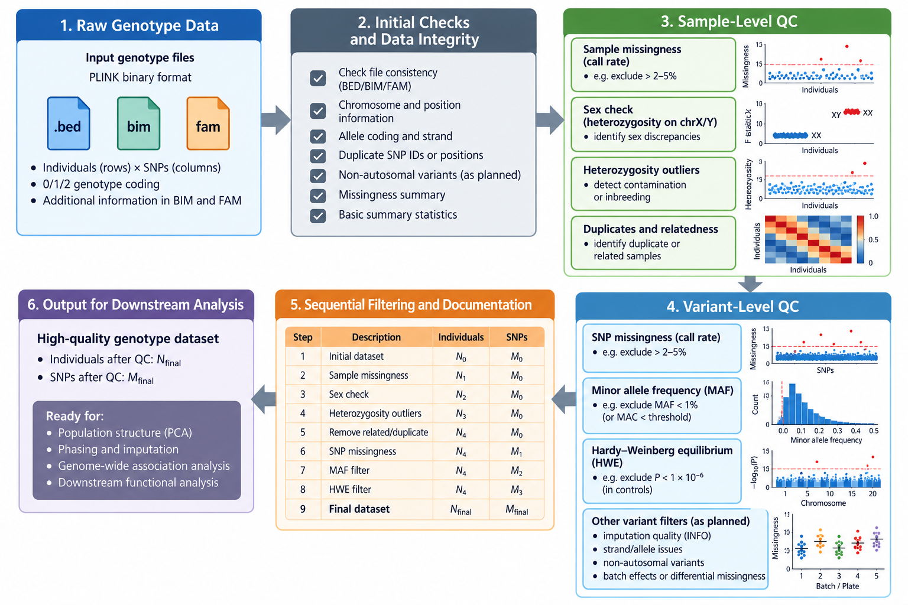
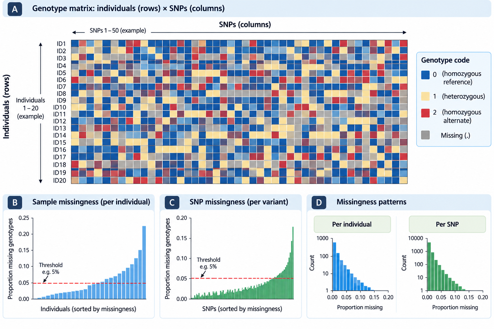
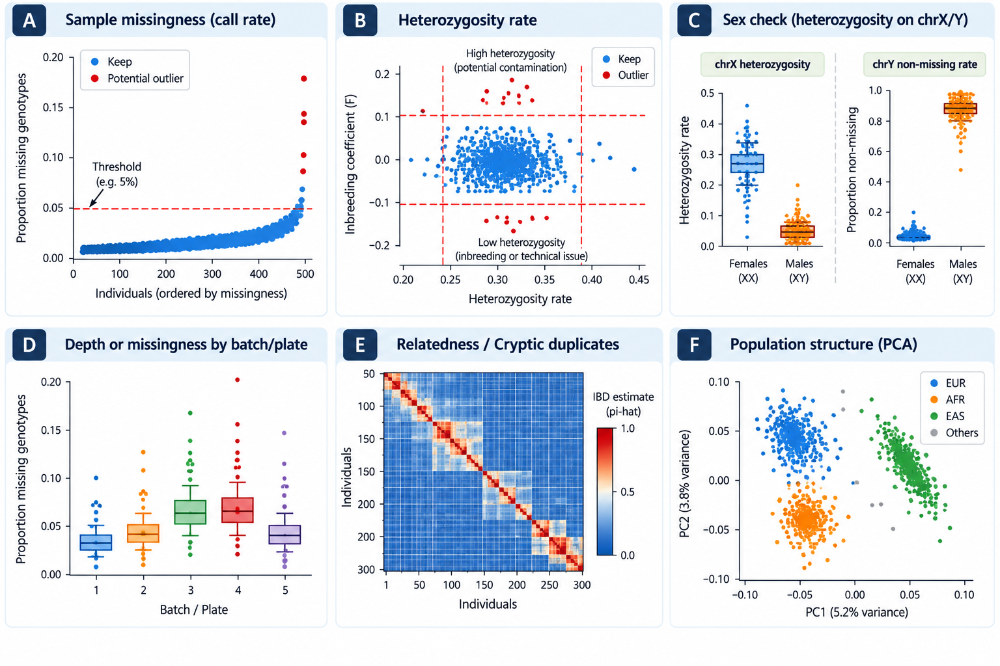
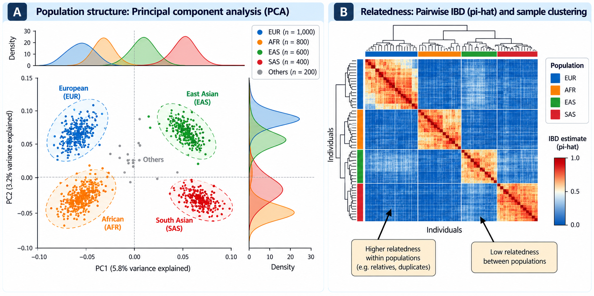
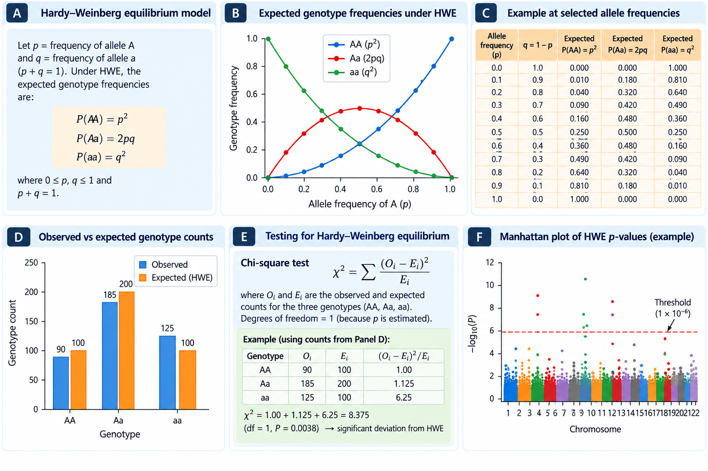
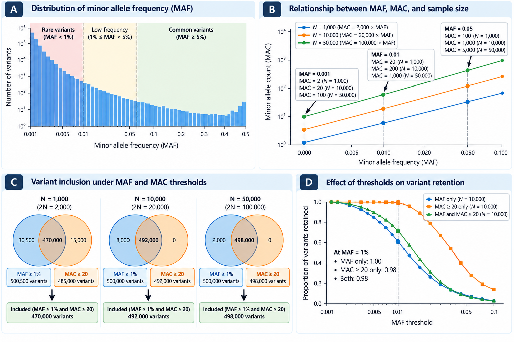
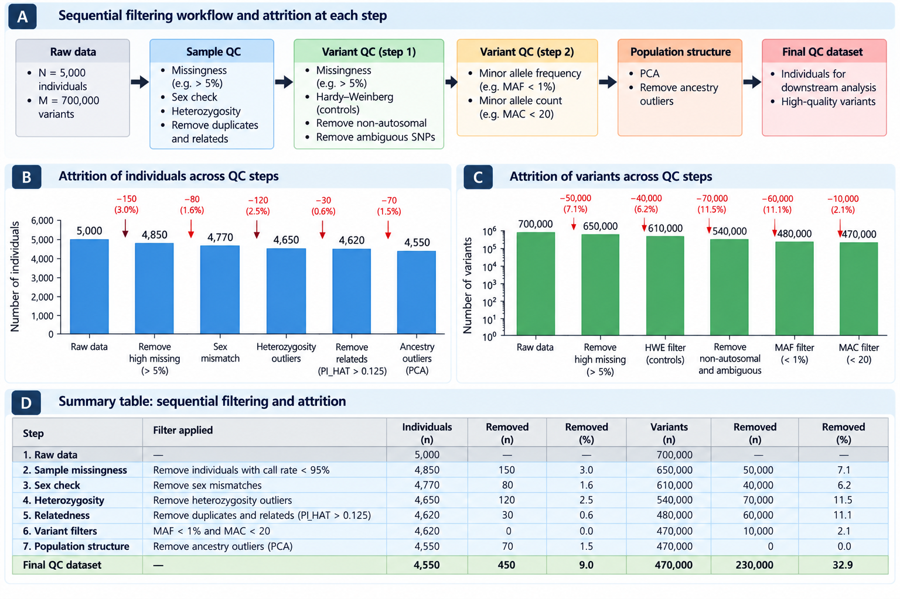
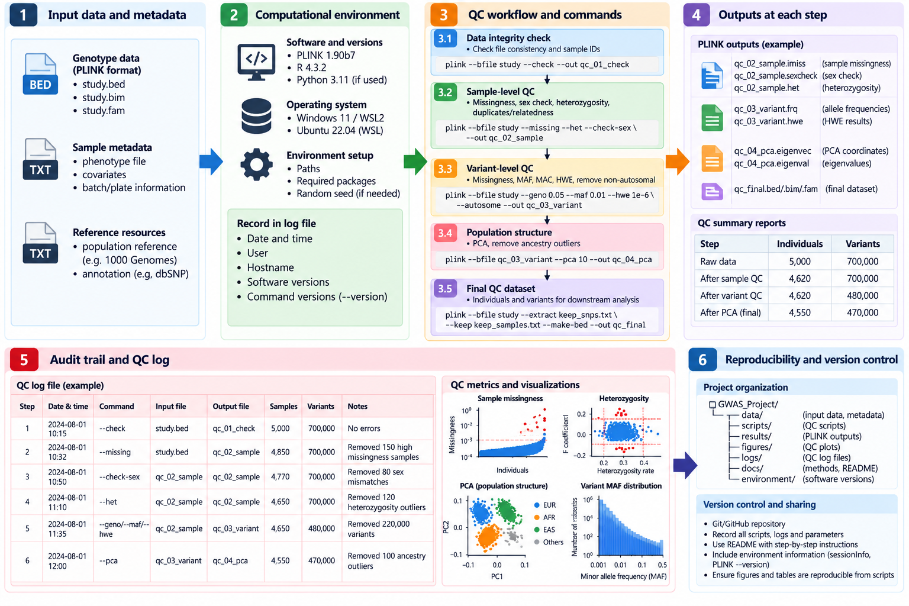

# Genotype Data Quality Control: Principles, Metrics, and Analytical Strategy

## 10.1 Introduction: why genotype quality control matters

Genome-wide association studies (GWAS) test associations between genetic
variation and phenotypes. Even a correctly specified regression model
cannot compensate for systematic genotype error, mislabeled samples,
nonrandom missingness, or unmodeled population structure. Genotype
quality control (QC) is therefore part of the scientific design, not
merely a preliminary technical cleanup. In this chapter we distinguish
*data integrity*, *sample-level QC*, *variant-level QC*, and
*association-model diagnostics*. Each addresses a different source of
potential bias or loss of statistical power \[1–4\].

**Learning objectives.** After completing this chapter, we should be
able to (i) identify common QC metrics and their denominators; (ii)
distinguish technical failure from biological variation; (iii) explain
why QC order and ancestry matter; (iv) design a reproducible,
study-specific QC strategy; and (v) interpret PLINK diagnostic outputs
without treating generic thresholds as universal standards.

<figure>


<figcaption>

<strong>Figure 10.1.</strong> Conceptual genotype QC workflow.
Sample-level and variant-level assessments interact and may require
iteration. No empirical filtering results are represented.
</figcaption>

</figure>

## 10.2 Genotype data integrity and provenance

Before filtering, we establish the provenance of the genotype files,
reference genome build, allele conventions, sample identifiers,
genotyping platform, processing batch, phenotype linkage, and any
previous QC. The unit of observation is crucial: a variant count is not
a genotype count, and a sample count is not an allele count. A dataset
with $N$ individuals and $M$ autosomal diploid variants has at most
$N\times M$ genotype calls and $2N\times M$ observed allele copies,
before accounting for missingness. These quantities are not
interchangeable.

We record whether files contain hard-called genotypes, genotype
probabilities, or imputed dosages. A dosage is an expected allele count
and should not be mistaken for an observed hard call. Genotype array QC
and imputation quality control have distinct metrics; detailed
imputation procedures belong to later chapters.

**Initial checks:** verify file existence, checksums when supplied,
chromosome naming, coordinate build, unique variant/sample identifiers,
allele encodings, sample–phenotype correspondence, and whether all
expected files refer to the same cohort. Do not infer the genome build
solely from chromosome-position values.

## 10.3 PLINK BED, BIM and FAM files

PLINK 1 binary datasets commonly consist of a `.bed` genotype file,
`.bim` variant metadata, and `.fam` sample metadata \[3\]. These are a
coordinated triplet. `.bim` contains chromosome, variant ID, genetic-map
position, base-pair position, and two allele fields. `.fam` contains
family ID, individual ID, paternal ID, maternal ID, sex code, and
phenotype code. The meaning of an allele field depends on PLINK version
and processing history; **never assume that `.bim` allele 1 is always
the minor allele or the reference allele**.

``` bash
# Illustrative commands; replace TUTORIAL_INPUT with a verified prefix.
plink --bfile TUTORIAL_INPUT --freq --out qc00_frequency
plink --bfile TUTORIAL_INPUT --missing --out qc00_missingness
```

The commands above generate descriptive files but do **not** perform
filtering. We first inspect the `.log` and output headers to verify the
software version, sample and variant counts, and available statistics.
File paths and counts must be filled in from executed analyses, not
invented.

## 10.4 Sample-level versus variant-level QC

Sample-level QC asks whether an individual’s genotype profile is
reliable and appropriate for the study: high missingness, unusual
heterozygosity, sex-chromosome discrepancies, contamination, duplicate
samples, and unexpected relatedness are common checks. Variant-level QC
asks whether a marker is reliably measured across individuals: high
missingness, unusual Hardy–Weinberg departures, low allele count,
differential missingness, and technical batch effects are examples. A
variant-level problem can inflate a sample’s missingness and vice versa;
this is why the workflow is sometimes iterative \[1,2\].

| Level | Example metric | Primary concern | Caution |
|:---|:---|:---|:---|
| Sample | Missing genotype proportion | Poor DNA or assay quality | May depend on batch and ancestry |
| Sample | Autosomal heterozygosity | Contamination, inbreeding, assay problems | Compare within ancestry and after LD pruning |
| Sample | Sex-chromosome metrics | Sample mix-up or atypical chromosome complement | Interpret with clinical and biological context |
| Sample pair | Kinship/IBD | Duplicates, relatives, dependence | Family designs may intentionally retain relatives |
| Variant | Missingness | Unreliable marker calling | Test case–control and batch differences |
| Variant | HWE departure | Technical artifacts or population structure | Cases and controls differ in interpretation |
| Variant | MAF/MAC | Low information or unstable estimates | MAC is sample-size dependent |

## 10.5 Missing genotypes and call rates

Let $M_{ij}=1$ when the genotype for individual $i$ at variant $j$ is
missing, and $0$ otherwise. With $N$ individuals and $J$ assessed
variants, the sample missingness rate and variant missingness rate are

$$m_i=\frac{1}{J}\sum_{j=1}^{J}M_{ij},\qquad m_j=\frac{1}{N}\sum_{i=1}^{N}M_{ij}.$$

Call rate is $1-m$. Denominators must refer to the set of samples and
variants actually being assessed. Missingness thresholds such as 0.02 or
0.05 are frequently encountered in tutorials, but their appropriateness
depends on platform, genotyping era, study size, ancestry, and phenotype
ascertainment. **A threshold is a decision requiring justification, not
a universal biological constant** \[1,2\].

<figure>


<figcaption>

<strong>Figure 10.2.</strong> Simulated genotype matrix (0, 1, 2 and
missing) and sample missingness. Data were generated independently for
teaching; no study participants or observed genotypes are shown.
</figcaption>

</figure>

``` r
# Hypothetical example: genotype columns are variants; rows are samples.
G_demo <- matrix(c(0, 1, NA, 2,
                   1, NA, 1, 0,
                   2, 2, 1, 0), nrow = 3, byrow = TRUE)
rownames(G_demo) <- paste0("S", 1:3)
colnames(G_demo) <- paste0("rs", 1:4)
sample_missing <- rowMeans(is.na(G_demo))
variant_missing <- colMeans(is.na(G_demo))
stopifnot(isTRUE(all.equal(unname(sample_missing), c(.25, .25, 0))))
stopifnot(isTRUE(all.equal(unname(variant_missing), c(0, 1/3, 1/3, 0))))
sample_missing
variant_missing
```

PLINK 1.9 `--missing` produces `.imiss` (per-sample) and `.lmiss`
(per-variant) summaries. We should inspect the actual columns (notably
`F_MISS`) before applying filters. For a real dataset, case–control
differential missingness may be assessed using `--test-missing` with an
appropriate test option; a low P-value is a warning to investigate, not
an automatic diagnosis of genotyping error.

## 10.6 Sex discrepancies and sex-chromosome considerations

Recorded sex and genotype-derived sex-chromosome patterns may disagree
because of sample swaps, metadata mistakes, technical issues,
sex-chromosome aneuploidies, mosaicism, or differences between recorded
variables and chromosomal complement. This should be investigated rather
than automatically treated as proof of mislabeling. PLINK `--check-sex`
behavior depends on version and the X-chromosome data supplied; it is
not meaningful when chromosome X has not been properly prepared or when
sex-chromosome handling is inappropriate \[3\].

``` bash
# Diagnostic template only; review X-chromosome handling and thresholds first.
plink --bfile TUTORIAL_INPUT --check-sex --out qc_sexcheck
```

An appropriate audit considers the source of the recorded variable, X
heterozygosity, Y coverage when available, phenotype relevance, consent,
and privacy. Exclusion criteria must be prespecified or transparently
documented. Autosomal QC does not require inferring a person’s gender
identity from genotypes.

## 10.7 Heterozygosity, inbreeding and contamination

Autosomal heterozygosity is the fraction of eligible nonmissing
genotypes that are heterozygous. Excess heterozygosity can arise from
contamination or technical artifacts; low heterozygosity can arise from
inbreeding, ancestry, or other causes. A common inbreeding statistic is

$$F=\frac{O(\mathrm{HOM})-E(\mathrm{HOM})}{N(\mathrm{NM})-E(\mathrm{HOM})},$$

where $O(\mathrm{HOM})$ and $E(\mathrm{HOM})$ are observed and expected
homozygote counts, and $N(\mathrm{NM})$ is the number of nonmissing
autosomal genotypes considered. The expectation depends on estimated
allele frequencies and reference population. `--het` provides related
quantities, but the output must be interpreted using the actual PLINK
documentation and selected marker set.

Heterozygosity outlier assessment is often performed on **LD-pruned
autosomal variants**, within reasonably homogeneous ancestry groups.
Applying a single mean ±3 SD rule to an ancestrally mixed cohort can
incorrectly flag legitimate samples. Thresholds are illustrative until
validated for the study \[1,2\].

<figure>


<figcaption>

<strong>Figure 10.3.</strong> Illustrative sample missingness histogram
and heterozygosity–missingness scatterplot. Dashed lines are teaching
examples, not recommended universal exclusion thresholds.
</figcaption>

</figure>

``` bash
# Example marker pruning, followed by a heterozygosity diagnostic.
plink --bfile TUTORIAL_INPUT --indep-pairwise 50 5 0.2 --out qc_prune
plink --bfile TUTORIAL_INPUT --extract qc_prune.prune.in --het --out qc_het
```

The pruning parameters are *illustrative*; sample composition, ancestry
and long-range LD regions must be considered. `--het` alone does not
identify the cause of an outlier.

## 10.8 Duplicates, cryptic relatedness and independence

Close relatives violate the independence assumption of many simple
association models. However, relatedness is not inherently an error:
family-based studies may be designed to retain relatives, and mixed
models can account for dependence. Duplicates or unexpected sample pairs
warrant investigation of IDs, phenotype consistency and genotyping
provenance.

PLINK can estimate identity by descent (IBD) using `--genome` in
appropriate settings; kinship estimators such as KING are also widely
used \[5\]. Relatedness inference is affected by ancestry, LD, marker
selection and estimator assumptions. Do not apply a fixed relatedness
cutoff without specifying the estimator and the intended design. For an
unrelated-sample analysis, removal decisions should maximize sample
retention while protecting case–control balance and ancestry
representation.

## 10.9 Population structure and ancestry

Allele frequencies and phenotypes may vary across populations for
reasons unrelated to a causal effect of the tested SNP. Population
stratification can therefore produce spurious associations. Principal
component analysis (PCA) summarizes axes of genetic variation and can
assist with ancestry description and covariate construction \[6\]. PCs
do not guarantee elimination of all confounding, and genetic ancestry is
not equivalent to race or ethnicity.

PCA should generally use appropriately selected and LD-pruned variants,
with careful handling of long-range LD regions. Study samples and
reference populations may require projection rather than naive pooling.
Exclusion of ancestry outliers is not the only valid strategy:
stratified analyses, covariate adjustment and mixed models can be more
appropriate depending on the scientific question and cohort composition.

<figure>


<figcaption>

<strong>Figure 10.4.</strong> Simulated PCA groups and illustrative
kinship matrix. PCA and relatedness answer distinct questions; neither
panel contains empirical genotype results.
</figcaption>

</figure>

``` bash
# Illustrative PCA template after suitable variant pruning and review.
plink --bfile TUTORIAL_INPUT --extract qc_prune.prune.in --pca 10 --out qc_pca
```

## 10.10 Hardy–Weinberg equilibrium

Under random mating and additional idealized assumptions, a biallelic
locus with allele frequencies $p$ and $q=1-p$ has expected genotype
frequencies $p^2$, $2pq$ and $q^2$. Hardy–Weinberg equilibrium (HWE)
testing compares observed and expected genotype counts, and marked
departures can suggest assay problems. They can also arise from
population structure, inbreeding, selection, or true disease association
\[1,2\].

<figure>


<figcaption>

<strong>Figure 10.5.</strong> Theoretical HWE expectations for the three
diploid genotypes as a function of allele frequency $p$. These are
mathematical curves, not empirical observations.
</figcaption>

</figure>

``` r
p <- 0.3
expected <- c(AA = p^2, Aa = 2*p*(1-p), aa = (1-p)^2)
stopifnot(isTRUE(all.equal(sum(expected), 1)))
expected
```

In case–control GWAS, HWE checks are commonly emphasized in **controls**
because a genuine disease-associated locus may deviate from HWE among
cases. Exact tests can be preferable to asymptotic tests for sparse
genotype categories \[7\]. A very small HWE P-value is a diagnostic
signal requiring context, not automatic proof of error. Sex chromosomes
require special treatment; the simple autosomal diploid formulas should
not be applied indiscriminately.

``` bash
# Diagnostic output; do not filter before reviewing study-specific criteria.
plink --bfile TUTORIAL_INPUT --hardy --out qc_hwe
```

## 10.11 Minor allele frequency and minor allele count

For $N$ diploid individuals with complete calls, the minor allele
frequency (MAF) is the smaller of the two allele frequencies. The minor
allele count (MAC) is the observed number of copies of the minor allele.
For fully observed diploid genotypes,

$$\mathrm{MAC}=2N\times\mathrm{MAF}.$$

When genotypes are missing, replace $N$ with the number of nonmissing
diploid genotypes at that variant. In a case–control analysis, overall
MAF can obscure differences in genotype information across groups. Rare
variants may yield unstable single-variant regression estimates,
particularly under case–control imbalance. A minimum MAC is sometimes
more informative than a fixed MAF cutoff when sample sizes differ \[4\].

<figure>


<figcaption>

<strong>Figure 10.6.</strong> Expected MAC at selected MAF values for
two hypothetical sample sizes, assuming complete diploid calls. The
logarithmic axis is used to show the broad range of counts.
</figcaption>

</figure>

``` r
maf <- 0.01
mac_500 <- 2 * 500 * maf
mac_5000 <- 2 * 5000 * maf
stopifnot(mac_500 == 10, mac_5000 == 100)
c(MAC_N500 = mac_500, MAC_N5000 = mac_5000)
```

## 10.12 Batch effects and differential missingness

Genotyping plate, laboratory, recruitment center, array version and
processing date may correlate with phenotype or ancestry. Such
confounding can create apparent genetic associations even after simple
missingness filters. We should inspect missingness and allele frequency
patterns across batches, and assess whether a variant has different
missingness rates in cases and controls. Differential missingness is
particularly concerning when technical missingness tracks phenotype
status.

A batch association does not necessarily imply an invalid SNP; it
requires assessment of sample allocation, technical controls, cluster
plots when available, and whether the effect persists under
appropriately adjusted or stratified analyses. Statistical filtering
should not replace investigation of the assay and study design.

``` bash
# PLINK 1.9 diagnostic example for case-control missingness.
# The binary phenotype and sample IDs must be verified before execution.
plink --bfile TUTORIAL_INPUT --test-missing --out qc_diff_missing
```

## 10.13 Why the order of QC operations matters

Sample and variant filters change one another’s denominators. A marker
with high missingness may increase missingness for many samples;
removing that marker can change the sample missingness distribution.
Conversely, removing low-quality samples can improve per-marker call
rates. A defensible workflow records an explicit order, may use
preliminary permissive filters to remove gross failures, and then
reassesses key metrics. There is no universally optimal order for every
study \[1,2\].

<figure>


<figcaption>

<strong>Figure 10.7.</strong> Illustrative sample attrition workflow.
$N_0$–$N_5$ are placeholders, not observed sample counts; each actual
transition must be documented with exclusions and retained IDs.
</figcaption>

</figure>

A practical QC log should distinguish: (a) assessed, (b) flagged for
review, (c) excluded, and (d) retained. These are not equivalent
categories. For example, a relative pair may be flagged but retained
when a mixed model is planned.

## 10.14 PLINK QC workflow overview

The following is an **inspection-only starting template**, not a
completed pipeline. It intentionally avoids chained exclusions until
dataset metadata and QC distributions have been reviewed.

``` bash
plink --version
plink --bfile TUTORIAL_INPUT --missing --out 10_01_missing
plink --bfile TUTORIAL_INPUT --freq --out 10_02_freq
plink --bfile TUTORIAL_INPUT --hardy --out 10_03_hwe
plink --bfile TUTORIAL_INPUT --indep-pairwise 50 5 0.2 --out 10_04_prune
plink --bfile TUTORIAL_INPUT --extract 10_04_prune.prune.in --het --out 10_05_het
plink --bfile TUTORIAL_INPUT --extract 10_04_prune.prune.in --pca 10 --out 10_06_pca
```

Before execution, confirm the input prefix, phenotype coding,
autosomal/X chromosome treatment, ancestry composition, PLINK build,
file formats and available memory. PLINK 1.9 and 2.0 options and outputs
are not fully interchangeable. In particular, downstream chapters will
establish a verified version-specific command sequence for the actual
tutorial dataset.

## 10.15 Selecting thresholds and sensitivity analyses

Published GWAS tutorials often provide example cutoffs, but their
portability is limited. The appropriate cutoff depends on platform
quality, marker density, sample size, ancestry, disease status,
genotyping batch, imputation strategy and planned statistical model. QC
should balance removal of unreliable data against avoidable loss of
power and representativeness.

| Criterion | Illustrative diagnostic | Decision principle |
|:---|:---|:---|
| Sample missingness | Distribution of `F_MISS` | Investigate tails and batch patterns |
| Variant missingness | Distribution of `F_MISS` | Evaluate assay quality and case–control differences |
| Heterozygosity | Ancestry-stratified outliers | Inspect possible contamination or inbreeding |
| HWE | Control-based test | Investigate extreme departures; do not assume causation |
| MAF/MAC | Frequency and observed count | Match filtering to inferential stability and study size |
| Relatedness | Kinship/IBD estimate | Match independence assumption to study design |
| PCA | Population structure visualization | Use ancestry-aware interpretation and model adjustment |

A sensitivity analysis may compare reasonable alternative thresholds and
report whether retained sample sizes, variant counts and association
signals materially change. Such analyses should be prespecified when
possible, and departures should be documented.

## 10.16 Reproducibility and methods record

A QC methods record is the bridge between an executable script and a
publishable Methods section. We should preserve both commands and their
consequences. Every operation needs a traceable input, software version,
output, threshold rationale and verification.

<figure>


<figcaption>

<strong>Figure 10.8.</strong> Conceptual audit trail linking provenance,
software, QC decisions and retained outputs. The figure is a reporting
framework, not evidence that analyses were executed.
</figcaption>

</figure>

| Field           | What we record                                           |
|:----------------|:---------------------------------------------------------|
| Step ID         | Unique, ordered identifier                               |
| Input           | Exact files, build, checksums if available               |
| Software        | PLINK version and command line                           |
| Starting counts | Individuals, variants, and relevant genotype calls       |
| Metric          | Output column, units, and denominator                    |
| Threshold       | Value and scientific rationale                           |
| Decision        | Flag, retain, or exclude; exceptions                     |
| Output          | File prefix and expected output filenames                |
| Retained counts | Verified individuals and variants                        |
| Problems        | Warnings, errors, investigation and resolution           |
| Validation      | Checksums, counts, log review and reproducibility checks |

``` r
# An illustrative methods-record skeleton, NOT results from a dataset.
qc_record <- data.frame(
  step = c("input_review", "missingness_review"),
  input_prefix = c("TUTORIAL_INPUT", "TUTORIAL_INPUT"),
  software = c("PLINK 1.9 (verify build)", "PLINK 1.9 (verify build)"),
  n_samples_before = c(NA_integer_, NA_integer_),
  n_variants_before = c(NA_integer_, NA_integer_),
  threshold = c("not applicable", "to be justified"),
  n_samples_after = c(NA_integer_, NA_integer_),
  n_variants_after = c(NA_integer_, NA_integer_),
  status = c("not executed", "not executed")
)
qc_record
```

## 10.17 Common misconceptions and corrections

| Misconception | Correction |
|:---|:---|
| A single QC threshold works for all cohorts | QC is study-, ancestry-, platform- and analysis-dependent |
| Every HWE departure is genotyping error | Disease association, structure and inbreeding can also contribute |
| A low MAF is always a low MAC | MAC depends on observed allele copies and sample size |
| Ancestry PCs completely remove stratification | Residual confounding may remain |
| Relatives must always be excluded | Family designs and mixed models can retain relatives |
| A sex-check mismatch proves sample swapping | Biological, technical and metadata explanations exist |
| An outlier is automatically an exclusion | Flagging, investigation and exclusion are separate decisions |
| Imputed dosage equals observed genotype | Dosage is an expectation incorporating uncertainty |
| Filtering produces an unbiased cohort automatically | Selection can change representativeness and introduce bias |
| A command running without error validates the analysis | Logs, denominators, counts and assumptions still require verification |

## 10.18 Practice exercises

**Conceptual:** (1) Distinguish sample and variant missingness. (2)
Explain why ancestry-specific heterozygosity summaries may be needed.
(3) Give two nontechnical causes of HWE departure. (4) Explain why
relatedness is not necessarily a reason for exclusion. (5) Distinguish
MAF from MAC.

**Calculations:** (6) A sample has 80 missing calls among 4,000 assessed
variants. Calculate missingness and call rate. (7) A variant has 12
missing genotypes among 600 samples. Calculate variant missingness. (8)
For $p=0.2$, calculate the three HWE genotype frequencies. (9) Calculate
MAC when MAF is 0.01 and 800 diploid samples have nonmissing genotypes.
(10) Explain why MAC changes if 200 samples are missing at that variant.

**Practical planning:** (11) Propose a minimal QC audit table. (12)
Identify PLINK output files for `--missing`, `--freq`, and `--hardy`.
(13) Describe what additional evidence is required before removing a
heterozygosity outlier. (14) Draft a paragraph distinguishing a
simulated teaching figure from an empirical QC result. (15) Explain why
a case-only HWE filter may discard a genuine association.

### Worked solutions and checks

1.  Sample missingness summarizes across variants for one individual;
    variant missingness summarizes across individuals for one
    variant. 2. Allele-frequency distributions differ by ancestry and
    affect expected heterozygosity. 3. Population structure and
    inbreeding; selection is another possible cause. 4. Relatedness may
    be expected and modeled. 5. MAF is a proportion; MAC is a count. 6.
    Missingness = $80/4000=0.02$; call rate = 0.98. 7. $12/600=0.02$. 8.
    $p^2=0.04$, $2pq=0.32$, $q^2=0.64$. 9. $2\times800\times0.01=16$
    minor alleles. 10. The number of observed allele copies decreases;
    at the same MAF among 600 nonmissing samples, MAC would be 12.
    Exercises 11–15 require written justifications rather than one
    numerical answer.

``` r
stopifnot(80/4000 == 0.02,
          1-80/4000 == 0.98,
          12/600 == 0.02,
          isTRUE(all.equal(c(.2^2, 2*.2*.8, .8^2), c(.04,.32,.64))),
          2*800*.01 == 16)
```

## 10.19 Chapter summary

Genotype QC is a set of evidence-based decisions about data reliability
and study validity. Missingness, heterozygosity, HWE, allele counts,
relatedness, ancestry and batch effects describe different dimensions of
the data. No single statistic can certify an analysis-ready cohort. A
defensible GWAS workflow links each decision to an explicit rationale, a
verified file, and a reproducible methods record. The next chapters
develop these QC procedures using the actual tutorial genotype data,
with observed counts and verified outputs recorded at each step.

## 10.20 References

1.  Marees AT, de Kluiver H, Stringer S, et al. A tutorial on conducting
    genome-wide association studies: Quality control and statistical
    analysis. *Int J Methods Psychiatr Res*. 2018;27:e1608.
    <doi:10.1002/mpr.1608>.
2.  Anderson CA, Pettersson FH, Clarke GM, et al. Data quality control
    in genetic case-control association studies. *Nat Protoc*.
    2010;5:1564–1573. <doi:10.1038/nprot.2010.116>.
3.  Purcell S, Neale B, Todd-Brown K, et al. PLINK: A tool set for
    whole-genome association and population-based linkage analyses. *Am
    J Hum Genet*. 2007;81:559–575. <doi:10.1086/519795>. Documentation:
    <https://www.cog-genomics.org/plink/1.9/>.
4.  Chang CC, Chow CC, Tellier LC, et al. Second-generation PLINK:
    Rising to the challenge of larger and richer datasets.
    *GigaScience*. 2015;4:7. <doi:10.1186/s13742-015-0047-8>.
5.  Manichaikul A, Mychaleckyj JC, Rich SS, et al. Robust relationship
    inference in genome-wide association studies. *Bioinformatics*.
    2010;26:2867–2873. <doi:10.1093/bioinformatics/btq559>.
6.  Price AL, Patterson NJ, Plenge RM, et al. Principal components
    analysis corrects for stratification in genome-wide association
    studies. *Nat Genet*. 2006;38:904–909. <doi:10.1038/ng1847>.
7.  Wigginton JE, Cutler DJ, Abecasis GR. A note on exact tests of
    Hardy–Weinberg equilibrium. *Am J Hum Genet*. 2005;76:887–893.
    <doi:10.1086/429864>.

### AI-assistance disclosure

ChatGPT (OpenAI) assisted with educational drafting, example-code
preparation, figure design and editorial organization. The figures and
numerical examples in this chapter are theoretical, hypothetical or
simulated; no actual Marees genotype QC was executed here. Scientific
interpretation, final validation and editorial responsibility remain
with the author.

### Reproducibility and validation record

- **Actual genotype dataset processed in Chapter 10:** None.
- **Empirical exclusions or sample/variant counts:** None; all workflow
  counts are placeholders.
- **Illustrations:** Eight separately stored 300-DPI PNGs; theoretical,
  schematic or fixed-seed simulated data.
- **R examples:** Base R calculations with `stopifnot()` validation
  checks.
- **PLINK commands:** Illustrative templates only; not executed on a
  genotype dataset.
- **Figures:** Generated separately in Python/Matplotlib; knitting the
  chapter does not regenerate them.
- **Software versions:** Record actual local versions when the Rmd is
  rendered and real PLINK analysis begins.
- **Next step:** Begin a real-data QC methods log in the subsequent
  practical chapter.

``` r
sessionInfo()
```

    ## R version 4.5.3 (2026-03-11 ucrt)
    ## Platform: x86_64-w64-mingw32/x64
    ## Running under: Windows 11 x64 (build 26200)
    ## 
    ## Matrix products: default
    ##   LAPACK version 3.12.1
    ## 
    ## locale:
    ## [1] LC_COLLATE=English_United States.utf8 
    ## [2] LC_CTYPE=English_United States.utf8   
    ## [3] LC_MONETARY=English_United States.utf8
    ## [4] LC_NUMERIC=C                          
    ## [5] LC_TIME=English_United States.utf8    
    ## 
    ## time zone: Asia/Calcutta
    ## tzcode source: internal
    ## 
    ## attached base packages:
    ## [1] stats     graphics  grDevices utils     datasets  methods   base     
    ## 
    ## loaded via a namespace (and not attached):
    ##  [1] compiler_4.5.3    fastmap_1.2.0     cli_3.6.6         tools_4.5.3      
    ##  [5] htmltools_0.5.9   rstudioapi_0.19.0 yaml_2.3.12       rmarkdown_2.31   
    ##  [9] knitr_1.51        xfun_0.57         digest_0.6.39     rlang_1.2.0      
    ## [13] evaluate_1.0.5
