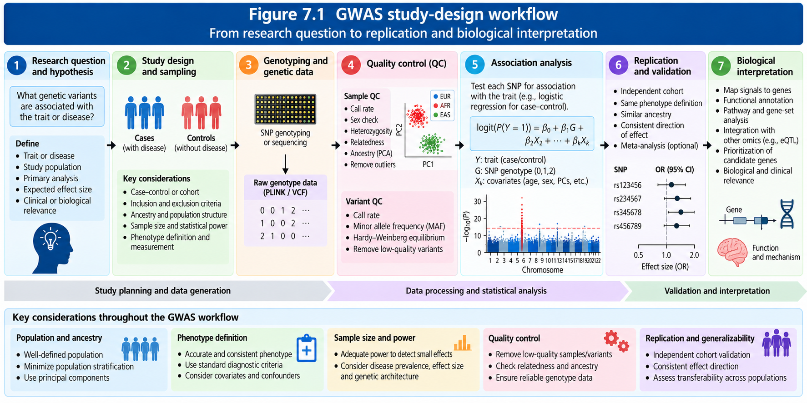
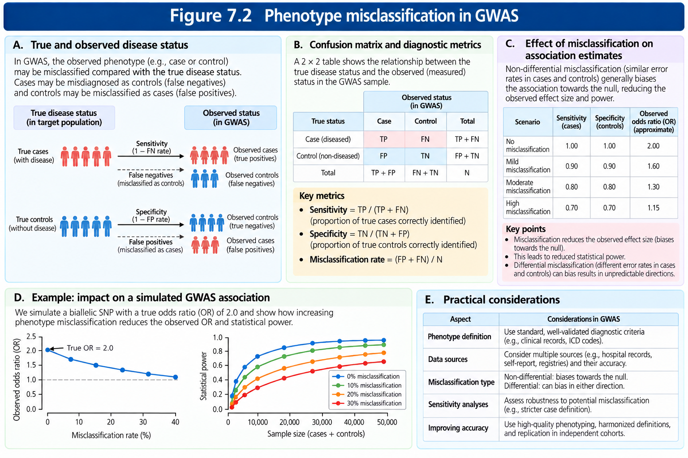
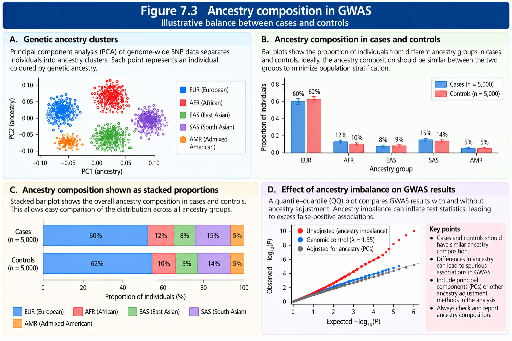
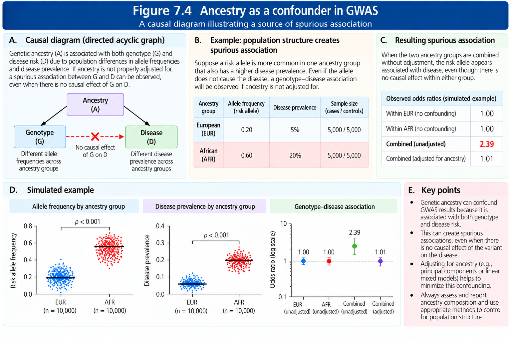
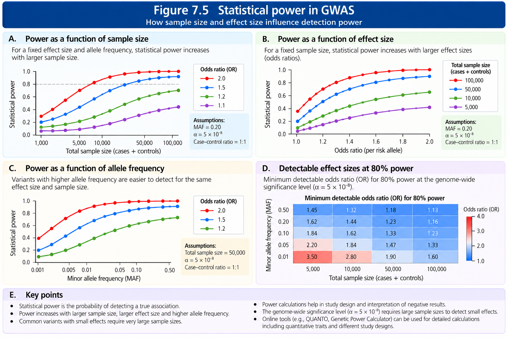
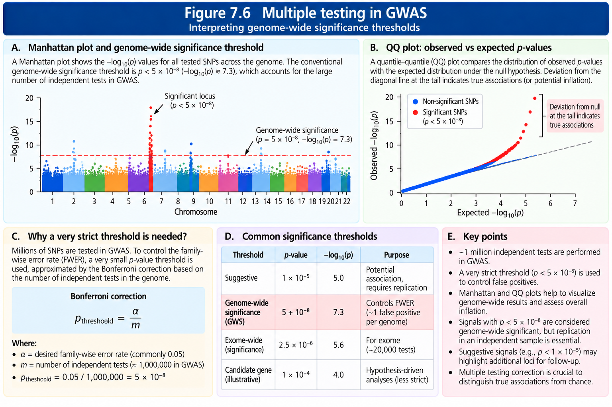

How to Design a GWAS
================

## 7.1 Why study design precedes statistical analysis

A genome-wide association study (GWAS) evaluates associations between
genetic variants and a defined phenotype across the genome. A
technically correct regression analysis cannot repair an ambiguous
phenotype, biased sampling, or unrecognized confounding. We therefore
begin with a written protocol specifying the target population, primary
outcome, covariates, inclusion criteria, genotype data, statistical
model and planned quality checks.

<figure>

<figcaption aria-hidden="true"><strong>Figure 7.1. GWAS Study-Design
Workflow</strong>. Overview of the major stages of a genome-wide
association study, from defining the research question and selecting
participants to genotyping, quality control, association testing,
replication and biological interpretation.</figcaption>
</figure>

## 7.2 Formulating a research question and estimand

A strong research question identifies the phenotype, target population,
genetic exposure and quantity to be estimated. For example: *Among
adults of a specified recruitment population, what is the
per-effect-allele association between common autosomal variants and
measured systolic blood pressure, adjusted for age, sex and relevant
ancestry covariates?*

The **estimand** is the quantity the analysis aims to estimate. In a
quantitative-trait GWAS, this may be the change in mean phenotype per
additional effect allele, conditional on selected covariates. In a
binary-trait case–control GWAS, this is often a conditional log odds
ratio per effect allele. An association estimand is not automatically a
causal effect.

Before starting, we should specify a primary analysis and separate
secondary analyses (e.g., sex-stratified models or ancestry-specific
analyses). Multiple exploratory outcomes require explicit
multiple-testing considerations.

## 7.3 Choosing the study design

| Design | Recruitment or observation | Typical strength | Important limitation |
|----|----|----|----|
| Population-based cohort | Enroll participants and observe outcomes or measurements | Broad phenotypes and potential temporal information | Attrition, selection and substantial resource needs |
| Case–control | Sample individuals with and without a defined disease | Efficient for less-common binary outcomes | Ascertainment affects prevalence interpretation; potential selection bias |
| Cross-sectional biobank | Analyze phenotypes and genotypes available at one period | Large sample and many traits | Timing and phenotype validity may be unclear |
| Family-based | Recruit relatives or trios | Some protection from population-stratification confounding in within-family tests | Lower effective sample size and different estimand |

**Key distinction:** GWAS tests genetic associations within the chosen
design. Random allocation of genotype is not performed by the
investigator; germline inheritance does not remove confounding,
assortative mating, family effects or selection bias.

## 7.4 Defining the target population and eligibility

We should document the source population, recruitment locations,
calendar period, age range, consent procedures, inclusion and exclusion
rules, and reasons for exclusion. We should distinguish the *target
population* from the *analyzed sample*. This matters because biobank
participation, survival, clinic attendance, genotype availability and QC
filtering may each change sample composition.

Ancestry should not be reduced to an assumed biological race category.
Genetic ancestry is inferred from patterns of genetic variation and
depends on reference populations, marker choice and method. Socially
defined categories may be useful for describing recruitment or
structural exposures but are not substitutes for genetic ancestry
adjustment.

## 7.5 Phenotype definition and measurement

For a binary phenotype, we must define diagnostic criteria,
ascertainment sources, date or window of diagnosis, exclusion of
ambiguous controls, and any validation procedure. For a quantitative
phenotype, we should define measurement instrument, units, timing,
repeated measurements, transformations and plausible-value rules.

**Example: systolic blood pressure.** Suppose two readings are 126 and
134 mmHg. Their mean is:

$$\bar{Y}=(126+134)/2=130\ \mathrm{mmHg}.$$

We should specify whether medication use is incorporated into the
phenotype or included as a covariate; these choices target different
questions and should be justified before analysis.

### Misclassification and missing phenotypes

Misclassification occurs when recorded phenotype status differs from
true status. For example, a sensitivity of 85% means 85% of true cases
are recorded as cases. A specificity of 90% means 90% of true non-cases
are recorded as controls. These percentages describe measurement
performance, not genetic effect sizes.

<figure>

<figcaption aria-hidden="true"><strong>Figure 7.2 — Phenotype
Misclassification in GWAS</strong>. Illustration of how incorrect
classification of cases and controls affects phenotype accuracy, genetic
association estimates and statistical power. The figure also highlights
sensitivity, specificity and strategies for reducing
misclassification.</figcaption>
</figure>

Missingness should be reported by phenotype, recruitment source and key
covariates. Complete-case analysis can be biased if missingness depends
on the outcome and explanatory variables; imputation strategies require
appropriate assumptions and must avoid information leakage.

## 7.6 Case and control selection

Cases and controls should arise from a well-defined source population,
with comparable ascertainment wherever feasible. Controls should not
inadvertently include undiagnosed cases or individuals with insufficient
follow-up to establish control status. We should report whether matching
was used and whether matching variables are handled correctly in the
model.

For a case–control study, sample case fraction is fixed by recruitment
and generally **does not estimate disease prevalence**. Logistic
regression can estimate odds ratios under appropriate sampling
assumptions, but the intercept cannot ordinarily be interpreted as
population disease risk without further information.

## 7.7 Genetic data and variant scope

Before association analysis, we should specify genotyping platform,
genome assembly, variant identifiers, imputation reference panel,
imputation software and quality thresholds. We should plan sample-level
checks for call rate, sex-chromosome consistency where appropriate,
heterozygosity, relatedness and ancestry, followed by variant-level
checks including missingness, allele frequency, Hardy–Weinberg tests and
imputation quality.

Thresholds must be justified in context rather than copied blindly. For
example, a stringent HWE filter applied to cases can remove real
disease-associated variants, and rare-variant testing may require
minimum allele counts and methods different from common-variant GWAS.

## 7.8 Population structure, relatedness and confounding

Population stratification can create spurious associations when genetic
ancestry relates both to allele frequencies and to phenotype
determinants. Principal components (PCs), mixed models, within-family
analyses and stratified meta-analysis can address different aspects of
this problem, but no single approach guarantees elimination of
confounding.

<figure>

<figcaption aria-hidden="true"><strong>Figure 7.3 — Ancestry Composition
in GWAS</strong>. Comparison of genetic ancestry distributions between
cases and controls using principal component analysis and ancestry
proportions. The figure demonstrates how ancestry imbalance can
introduce population stratification and potentially spurious genetic
associations.</figcaption>
</figure>

<figure>

<figcaption aria-hidden="true"><strong>Figure 7.4 — Ancestry as a
Confounder in GWAS</strong>. Causal illustration demonstrating how
differences in allele frequencies and disease prevalence across
ancestral populations can produce spurious genotype–phenotype
associations. Appropriate ancestry adjustment helps reduce this
confounding.</figcaption>
</figure>

Related participants violate the independence assumptions of simple
regressions. Depending on study design, we may remove selected relatives
or use a model that accounts for a genetic relationship matrix. The
decision should be documented because excluding relatives can change
representation and effective sample size.

## 7.9 Covariates: selection and interpretation

Common covariates include age, sex when relevant to the phenotype,
recruitment center, genotyping batch and ancestry PCs. Their inclusion
depends on the study design and causal question. We should not adjust
indiscriminately for variables that lie on a causal pathway or are
colliders. A covariate can improve precision without necessarily being a
confounder.

For an additive quantitative-trait GWAS:

$$Y_i=\beta_0+\beta_G G_i+\beta_A A_i+\sum_{k=1}^{K}\gamma_k PC_{ik}+\epsilon_i.$$

Here, $G_i\in\{0,1,2\}$ is effect-allele dosage, $A_i$ is age, $PC_{ik}$
are ancestry principal components and $\beta_G$ is the conditional
per-allele association. We would add other pre-specified covariates when
scientifically justified.

For a binary trait:

$$\log\left(\frac{P(Y_i=1)}{1-P(Y_i=1)}\right)=\beta_0+\beta_GG_i+\beta_AA_i+\sum_{k=1}^{K}\gamma_k PC_{ik}.$$

The per-allele odds ratio is $\exp(\beta_G)$. If $\beta_G=0.20$, then
$\mathrm{OR}=\exp(0.20)\approx1.22$. This is not the same as a 22%
increase in absolute disease probability.

## 7.10 Statistical power and sample size

Power is the probability that a specified analysis rejects the null
hypothesis when a specified non-null effect is true. It depends on
effect size, allele frequency, phenotype variability or prevalence,
case/control balance, significance threshold, imputation quality and
study design.

For intuition, a simplified additive quantitative-trait approximation
is:

$$\mathrm{SE}(\hat\beta_G)\approx\frac{\sigma}{\sqrt{N\,2p(1-p)}},$$

where $N$ is the number of independent participants, $p$ is
effect-allele frequency and $\sigma$ is residual standard deviation.
This expression assumes a well-measured genotype, approximately
Hardy–Weinberg genotype variance, no relevant loss from covariate
adjustment and an appropriate linear model. It is **not** a general
case–control power formula.

**Hand calculation.** For $N=10{,}000$, $p=0.20$ and $\sigma=1$:

$$2p(1-p)=2(0.20)(0.80)=0.32,$$

$$\mathrm{SE}(\hat\beta_G)\approx\frac{1}{\sqrt{10{,}000(0.32)}}\approx0.0177.$$

For a true standardized effect of $0.05$, the approximate noncentral
signal is $0.05/0.0177\approx2.83$, which is much smaller than the
two-sided genome-wide significance cutoff $|Z|\approx5.45$. Thus, large
sample sizes are often necessary for small genetic effects.

<figure>

<figcaption aria-hidden="true">Figure 7.5 — Statistical Power in GWAS.
Illustration of how sample size, genetic effect size and minor allele
frequency influence the probability of detecting genuine genetic
associations. Larger samples generally improve power, particularly for
variants with small effects.</figcaption>
</figure>

## 7.11 Significance thresholds and multiple testing

GWAS typically tests hundreds of thousands to millions of correlated
variants. A conventional threshold for common-variant European-ancestry
GWAS is $P<5\times10^{-8}$, historically motivated by the effective
number of independent common-variant tests. It is not universally
appropriate: rare-variant analyses, sequencing studies, ancestry
diversity and multiple phenotypes may require different corrections.

For one million *independent* tests, a Bonferroni family-wise threshold
at $\alpha=0.05$ would be:

$$\alpha_{\mathrm{Bonferroni}}=\frac{0.05}{1{,}000{,}000}=5\times10^{-8}.$$

The independence assumption is not literally true for nearby SNPs
because of linkage disequilibrium. A genome-wide significant association
is evidence against a null association model, not proof of a causal
variant.

<figure>

<figcaption aria-hidden="true"><strong>Figure 7.6 — Multiple Testing in
GWAS</strong>. Illustration of multiple-testing correction using
Manhattan plots, QQ plots and the Bonferroni principle. The figure
explains the conventional genome-wide significance threshold of <span
class="math inline"><em>p</em> &lt; 5 × 10<sup>−8</sup></span> and its
role in controlling false-positive findings.</figcaption>
</figure>

## 7.12 Discovery, replication and generalizability

Discovery analyses identify candidate associations; replication tests
them in an independent dataset with a comparable phenotype, correctly
harmonized effect alleles and an appropriate statistical model. We
should assess effect direction, uncertainty and between-study
heterogeneity, not only whether the replication $P$ value crosses a
threshold.

Generalizability may be limited by ancestry composition, age,
environmental exposures, clinical ascertainment and LD differences. A
marker that tags a causal allele well in one population may tag it
poorly in another. Cross-population analysis can also help fine-mapping
when designed carefully.

## 7.13 Reporting and reproducibility plan

Before running GWAS, our protocol should record: (1) hypotheses and
primary phenotype; (2) cohort inclusion/exclusion flow; (3) phenotype
algorithm and units; (4) consent and governance; (5) genome build and
genotyping/imputation provenance; (6) pre-specified QC thresholds and
rationale; (7) covariates and association model; (8) relatedness and
ancestry strategy; (9) power assumptions; (10) primary significance
criterion; (11) replication and sensitivity analyses; (12) software
versions and file checksums where possible.

We must also retain **a methods record** for every execution: exact
input/output filenames, sample and variant counts, command lines,
software versions, warnings, investigations, fixes and validated
results. A workflow should never silently overwrite a failed analysis
with an unverified rerun.

## 7.14 Practical R exercise 1 — Power intuition

The following base-R exercise illustrates how sample size, allele
frequency and standardized effect size influence an approximate Z
statistic. It is **not** a full study-specific power calculator.

``` r
n <- c(10000, 50000, 100000)
p <- 0.20
beta <- 0.05
sigma <- 1
se <- sigma / sqrt(n * 2 * p * (1 - p))
z <- beta / se
result <- data.frame(N = n, SE = round(se, 4), expected_Z = round(z, 2))
print(result)
```

    ##       N     SE expected_Z
    ## 1 1e+04 0.0177       2.83
    ## 2 5e+04 0.0079       6.32
    ## 3 1e+05 0.0056       8.94

``` r
stopifnot(all(diff(se) < 0), all(diff(z) > 0))
```

**Interpretation:** As sample size increases, uncertainty decreases and
the expected signal strengthens. This calculation assumes independent
samples and simplified genotype variance.

## 7.15 Practical R exercise 2 — Case/control ancestry balance

``` r
counts <- matrix(c(300, 300, 200, 200), nrow = 2,
                 dimnames = list(c('Cases', 'Controls'),
                                 c('Ancestry_A', 'Ancestry_B')))
print(counts)
```

    ##          Ancestry_A Ancestry_B
    ## Cases           300        200
    ## Controls        300        200

``` r
prop.table(counts, margin = 1)
```

    ##          Ancestry_A Ancestry_B
    ## Cases           0.6        0.4
    ## Controls        0.6        0.4

``` r
stopifnot(all(rowSums(counts) == 500))
```

The row proportions are identical, so this *illustrative* table is
balanced by ancestry category. Real ancestry analyses typically use
genome-wide PCs or related methods rather than relying on coarse
categories.

## 7.16 Practical R exercise 3 — Logistic effect interpretation

``` r
beta_g <- log(1.25)
se_g <- 0.08
odds_ratio <- exp(beta_g)
ci <- exp(beta_g + c(-1, 1) * 1.96 * se_g)
c(OR = odds_ratio, lower95 = ci[1], upper95 = ci[2])
```

    ##       OR  lower95  upper95 
    ## 1.250000 1.068594 1.462202

``` r
stopifnot(abs(odds_ratio - 1.25) < 1e-10)
```

The interval is a normal-approximation Wald interval for a hypothetical
coefficient and standard error. It does not represent a fitted model or
an actual variant.

## 7.17 Practical R exercise 4 — Protocol checklist

``` r
protocol <- c(
  phenotype_defined = TRUE,
  eligibility_documented = TRUE,
  ancestry_plan = TRUE,
  qc_thresholds_prespecified = TRUE,
  power_assumptions_recorded = TRUE,
  replication_plan = FALSE
)
print(protocol)
```

    ##          phenotype_defined     eligibility_documented 
    ##                       TRUE                       TRUE 
    ##              ancestry_plan qc_thresholds_prespecified 
    ##                       TRUE                       TRUE 
    ## power_assumptions_recorded           replication_plan 
    ##                       TRUE                      FALSE

``` r
cat('Complete items:', sum(protocol), 'of', length(protocol), '\n')
```

    ## Complete items: 5 of 6

``` r
stopifnot(sum(protocol) == 5)
```

This is a teaching checklist; an incomplete replication plan does not
mean a discovery-only study is invalid, but the limitation should be
stated.

## 7.18 Common misconceptions

| Misconception | Correction |
|----|----|
| A larger GWAS automatically eliminates bias | Larger samples improve precision but may preserve or magnify systematic bias |
| Any genome-wide significant SNP is causal | LD can create associations at non-causal tagging variants |
| PCs always eliminate stratification | PCs capture major axes but residual structure and selection may remain |
| An odds ratio is a risk ratio | They differ, especially for common outcomes |
| Cases and controls define disease prevalence | Case–control sampling fractions usually do not estimate population prevalence |
| HWE must hold in all cases | Genuine disease associations can cause HWE departures in cases |
| All GWAS use the same significance threshold | Thresholds depend on the testing family and variant architecture |

## 7.19 Review exercises

1.  Write a testable GWAS research question for adult systolic blood
    pressure.
2.  Explain why the source population matters in a case–control GWAS.
3.  Distinguish phenotype sensitivity from specificity.
4.  Calculate allele-dosage variance $2p(1-p)$ when $p=0.10$.
5.  Explain why a rare allele often requires a larger sample for
    comparable power.
6.  Interpret an additive logistic coefficient of $-0.15$.
7.  Describe two ways population stratification may arise.
8.  Explain why excluding related individuals can change the analyzed
    sample.
9.  Distinguish genome-wide significance from causal inference.
10. List the minimum metadata required to reproduce a GWAS.
11. Explain why replication can fail even when a discovery association
    is genuine.
12. Propose two sensitivity analyses for a biobank-based GWAS.

## 7.20 Chapter summary

A defensible GWAS begins with a clear phenotype and estimand, carefully
documented recruitment, appropriate genetic and phenotype QC, an
analysis model matched to the study design, transparent ancestry and
relatedness handling, and a realistic power and replication strategy.
The subsequent chapters convert this protocol into auditable
data-processing and association-analysis steps.

## Selected references

- Visscher PM, et al. (2017). 10 Years of GWAS Discovery: Biology,
  Function, and Translation. *American Journal of Human Genetics*
  101:5–22. DOI: 10.1016/j.ajhg.2017.06.005.
- Price AL, et al. (2006). Principal components analysis corrects for
  stratification in genome-wide association studies. *Nature Genetics*
  38:904–909. DOI: 10.1038/ng1847.
- Yang J, et al. (2014). Advantages and pitfalls in the application of
  mixed-model association methods. *Nature Genetics* 46:100–106. DOI:
  10.1038/ng.2876.
- Marees AT, et al. (2018). A tutorial on conducting genome-wide
  association studies: Quality control and statistical analysis.
  *International Journal of Methods in Psychiatric Research* 27:e1608.
  DOI: 10.1002/mpr.1608.
- Sham PC, Purcell SM. (2014). Statistical power and significance
  testing in large-scale genetic studies. *Nature Reviews Genetics*
  15:335–346. DOI: 10.1038/nrg3706.
