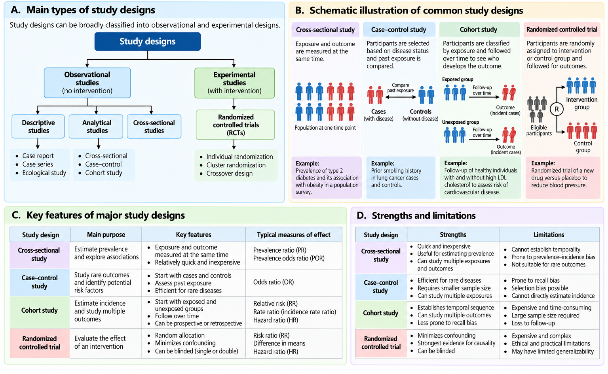
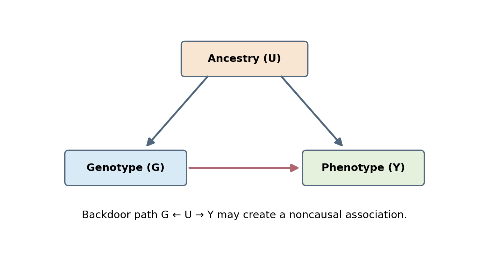
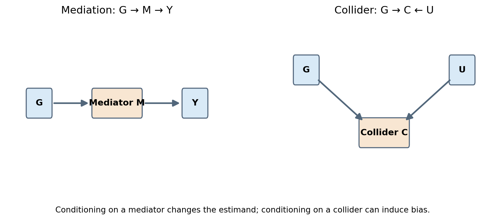
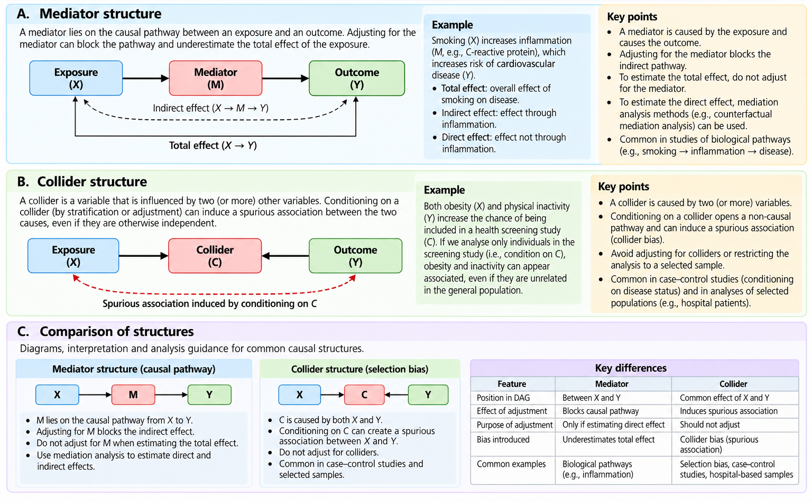
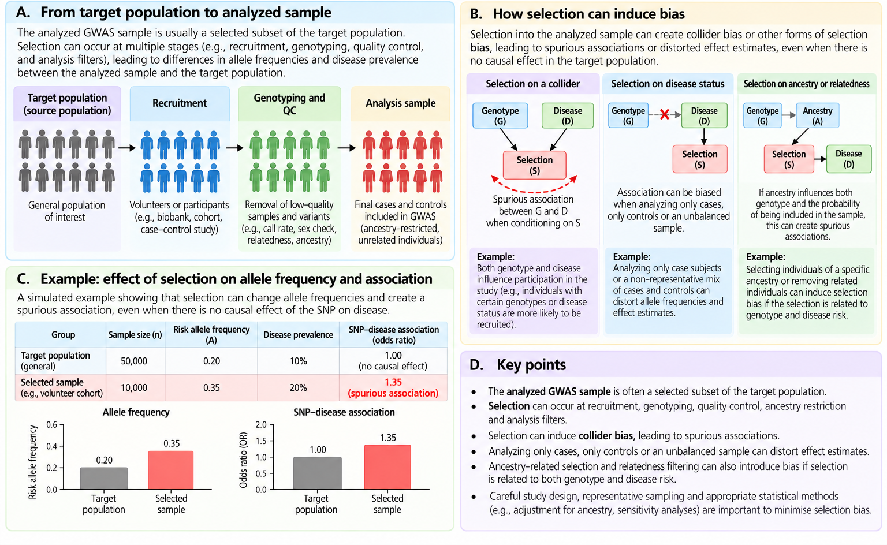
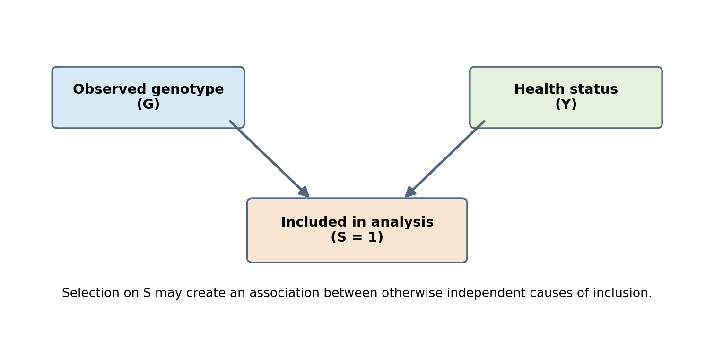

Phenotypes, Covariates and Confounding
================

## 5.1 Why phenotype definition matters in GWAS

A genome-wide association study (GWAS) relates genetic variation to an
observed characteristic. Genetic data may be measured precisely, but
even a technically perfect genotype cannot rescue a poorly defined
phenotype. The same label—for example, *hypertension*, *asthma*, or
*depression*—can refer to different ascertainment strategies across
studies. We therefore distinguish the **underlying biological
construct**, its **operational definition**, and the **recorded analysis
variable**.

A **phenotype** is a measurable characteristic of an individual.
Examples include systolic blood pressure (SBP), blood glucose
concentration, height, age at diagnosis, and disease status. A **trait**
is often used more broadly for the underlying characteristic. A
phenotype may reflect genetic influences, environment, treatment,
measurement procedures, and random variability. Association does not, by
itself, imply a causal relationship.

<figure>

<figcaption aria-hidden="true">Figure 5.1. From an underlying trait to a
measured and analyzed phenotype.</figcaption>
</figure>

*Figure 5.1. The measurement process separates a biological
characteristic from the variable entered into a statistical model. This
is a conceptual diagram.*

### Operational definitions

For each phenotype we should record the measurement method, units,
collection time, diagnostic criteria, repeat measurements, medication
status, exclusion criteria, and rules for handling ambiguous records. A
clinical diagnosis based on a validated adjudication protocol is not
necessarily interchangeable with a self-reported diagnosis or a single
electronic health record code.

## 5.2 Phenotype types and appropriate models

<table>

<thead>

<tr>

<th>

Phenotype type
</th>

<th>

Example
</th>

<th>

Typical GWAS approach
</th>

<th>

Important caution
</th>

</tr>

</thead>

<tbody>

<tr>

<td>

Continuous
</td>

<td>

SBP (mmHg), height (cm)
</td>

<td>

Linear regression or appropriate mixed model
</td>

<td>

Check distribution, residuals and measurement units
</td>

</tr>

<tr>

<td>

Binary
</td>

<td>

Case versus control
</td>

<td>

Logistic regression or suitable mixed model
</td>

<td>

Document case and control definitions
</td>

</tr>

<tr>

<td>

Ordinal
</td>

<td>

Disease severity categories
</td>

<td>

Ordinal model, or justified alternative
</td>

<td>

Categories are ordered, not necessarily equally spaced
</td>

</tr>

<tr>

<td>

Count
</td>

<td>

Number of episodes
</td>

<td>

Poisson/negative-binomial models where appropriate
</td>

<td>

Overdispersion and exposure time matter
</td>

</tr>

<tr>

<td>

Time to event
</td>

<td>

Age at disease onset
</td>

<td>

Survival analysis with censoring
</td>

<td>

Distinguish event time from follow-up time
</td>

</tr>

</tbody>

</table>

**Binary traits.** Cases and controls must be defined using the same
underlying eligibility rules wherever feasible. Controls are not
automatically healthy for every phenotype; they are individuals who meet
a specified control definition.

**Continuous traits.** A quantitative phenotype preserves the magnitude
of observed differences. Dichotomizing a continuous variable usually
discards information, although a clinically meaningful threshold may be
required for a specific research question.

<figure>

<figcaption aria-hidden="true">Figure 5.2. Continuous versus
dichotomized systolic blood pressure.</figcaption>
</figure>

*Figure 5.4. Simulated SBP values illustrate how a threshold replaces a
continuum with two groups. This is not an empirical clinical dataset.*

## 5.3 Measurement error, reliability and misclassification

Suppose a measured quantitative phenotype is represented as

$$Y_{\mathrm{observed}}=Y_{\mathrm{true}}+\epsilon_{\mathrm{measurement}}.$$

The error term may reflect device precision, timing, observer variation,
or biological fluctuations. Repeated measurements can help characterize
reliability, but averaging does not eliminate systematic bias. For
binary outcomes, **sensitivity** is the probability that a true case is
classified as a case; **specificity** is the probability that a true
non-case is classified as a non-case. Misclassification can attenuate or
distort associations, depending on its mechanism and relationship to
genotype and covariates.

### Worked example: classification performance

Imagine 100 participants, including 40 true cases and 60 true non-cases.
A hypothetical screening definition correctly identifies 34 cases and 54
non-cases. Sensitivity is 34/40 = 0.85 and specificity is 54/60 = 0.90.
The six missed cases and six false positives illustrate why diagnostic
criteria must be recorded. These counts are invented for teaching.

## 5.4 Covariates: what they are and why we include them

A **covariate** is a variable included in a statistical model alongside
the genetic predictor. Covariates may control confounding, account for
study design, or improve precision. They are not interchangeable, and
including more covariates is not automatically better.

Common GWAS covariates include age, sex-related variables where
scientifically appropriate, ancestry principal components (PCs),
recruitment center, genotyping array or batch, and other design-specific
factors. Their suitability depends on the estimand, phenotype,
population and study protocol.

<table>

<thead>

<tr>

<th>

Covariate
</th>

<th>

Potential purpose
</th>

<th>

Key question before inclusion
</th>

</tr>

</thead>

<tbody>

<tr>

<td>

Age
</td>

<td>

Account for age-dependent phenotype variation
</td>

<td>

Is age at measurement or at diagnosis relevant?
</td>

</tr>

<tr>

<td>

Sex-related variable
</td>

<td>

Account for phenotype differences or design factors
</td>

<td>

Which biological or recorded variable was measured?
</td>

</tr>

<tr>

<td>

Ancestry PCs
</td>

<td>

Reduce confounding from population structure
</td>

<td>

Were PCs estimated from appropriately QC’d genotype data?
</td>

</tr>

<tr>

<td>

Genotyping batch
</td>

<td>

Address technical differences
</td>

<td>

Is batch confounded with case status or ancestry?
</td>

</tr>

<tr>

<td>

Medication use
</td>

<td>

Describe treatment-related phenotype changes
</td>

<td>

Could treatment be downstream of disease or genotype?
</td>

</tr>

</tbody>

</table>

## 5.5 Confounding: the fundamental problem

A **confounder** is a variable that can generate a noncausal association
between exposure and outcome through an open backdoor path. In genetic
epidemiology, ancestry is a familiar source of confounding when allele
frequencies and phenotype distributions differ between groups for
reasons unrelated to the tested variant’s effect.

<figure>

<figcaption aria-hidden="true">Figure 5.3. Ancestry-related confounding
in GWAS.</figcaption>
</figure>

*Figure 5.2. The diagram illustrates ancestry U influencing both
genotype G and phenotype Y. The G–Y arrow represents an effect under
investigation, not an established causal effect.*

Consider a hypothetical dataset with two ancestry groups. In Group A,
the G-allele frequency is 0.10 and the disease prevalence is 0.05. In
Group B, the G-allele frequency is 0.40 and disease prevalence is 0.20.
Even if G has **no causal effect** on disease within either group,
pooling participants can create an apparent genotype–disease
association. This is population stratification. Adjustment using
ancestry PCs or appropriate mixed models may reduce—but does not
guarantee elimination of—this bias.

## 5.6 Confounders, mediators and colliders are different

**Confounder:** a common cause of exposure and outcome (or a variable
that blocks a relevant backdoor path).

**Mediator:** a variable on a causal pathway from exposure to outcome.
Adjusting for it may remove part of the total effect we intend to
estimate.

**Collider:** a variable influenced by two other variables. Conditioning
on it can open a previously blocked path and induce a spurious
association.

<figure>

<figcaption aria-hidden="true">Figure 5.4. Mediator and collider
structures.</figcaption>
</figure>

*Figure 5.3. Left: mediation, G → M → Y. Right: collider, G → C ← U. The
diagrams illustrate causal structures, not results from observed data.*

A causal directed acyclic graph (**DAG**) is a simplified representation
of assumed causal relationships. DAGs help us state assumptions
explicitly. They do not establish causality merely by being drawn.

### A medication example

For blood pressure, medication can alter the measured outcome. However,
medication use may also be a consequence of prior blood pressure,
diagnosis, access to care, and clinician decisions. Automatically
adjusting for medication can therefore change the target estimand or
introduce bias. Options such as medication-corrected phenotypes require
phenotype-specific justification and sensitivity analysis.

## 5.7 Selection bias and missingness

A study may include only participants with complete phenotype and
genotype records. If participation or completeness depends jointly on
variables associated with genotype and outcome, conditioning on
inclusion can create selection bias. This is related to collider bias.

<figure>

<figcaption aria-hidden="true">Figure 5.5. Selection into an analyzed
GWAS sample.</figcaption>
</figure>

*Figure 5.6. Inclusion S may be influenced by genotype-associated and
phenotype-associated factors. This simplified example shows why
complete-case analysis requires assumptions.*

Missingness should be summarized separately for phenotypes and
covariates. We should report counts before and after exclusions, examine
whether missingness varies by site or ancestry, and avoid treating
imputation of a covariate as equivalent to genotype imputation.

## 5.8 Quantitative-trait GWAS model

For participant i and one tested SNP, a common additive linear model is

$$Y_i=\beta_0+\beta_G G_i+\beta_A A_i+\beta_S S_i+\sum_{k=1}^{K}\gamma_k PC_{ik}+\epsilon_i.$$

Here Y is the measured phenotype; G is the effect-allele dosage (0, 1 or
2 for a diploid, hard-called biallelic genotype); A is age; S denotes a
prespecified sex-related variable; PCs summarize axes of genetic
variation; and the residual term captures variation not explained by the
included predictors. Imputed dosage may be continuous between 0 and 2.

The coefficient $\beta_G$ is the expected difference in Y per additional
effect allele **conditional on the included covariates**, under the
model assumptions. It is not automatically a causal effect.

### Worked example

Suppose a fitted model is

$$\widehat{SBP}=90+0.6\,\mathrm{Age}+2G.$$

For a 50-year-old with genotype dosage 0, predicted SBP is 120 mmHg. For
the same age and dosage 2, it is 124 mmHg. The 4 mmHg contrast
represents a modeled association under this invented example; it is not
an individual prediction guarantee or an empirical GWAS estimate.

<figure>

<figcaption aria-hidden="true">Figure 5.6. Age-related variation and
residualization.</figcaption>
</figure>

*Figure 5.5. Simulated SBP data illustrate an age trend and residuals
after subtracting a prespecified age trend. This is an illustration, not
a recommendation to residualize every GWAS phenotype.*

## 5.9 Binary-trait GWAS model

For a binary phenotype, logistic regression models the log odds:

$$\log\left(\frac{p_i}{1-p_i}\right)=\beta_0+\beta_G G_i+\boldsymbol{\gamma}^{T}\mathbf{C}_i.$$

The per-allele odds ratio is

$$OR=\exp(\beta_G).$$

For example, if $\beta_G=0.1823$, then $OR\approx 1.20$. This is a 20%
increase in **odds**, not necessarily a 20% increase in risk. Odds
ratios also have a non-collapsibility property: adjusted and unadjusted
odds ratios can differ even without confounding. Case–control sampling,
separation and extreme case imbalance may require specialized
association methods, discussed in later chapters.

## 5.10 Practical R exercise 1 — inspect and validate a phenotype

The following code uses **simulated data only**. No real HapMap, PGC or
clinical records are analyzed here.

``` r
set.seed(505)
n <- 600L
age <- sample(25:75, n, replace = TRUE)
genotype <- rbinom(n, size = 2, prob = 0.30)
sbp <- 92 + 0.65 * age + 1.8 * genotype + rnorm(n, sd = 11)
phenotype <- data.frame(id = sprintf("P%04d", seq_len(n)), age, genotype, sbp)
stopifnot(!anyDuplicated(phenotype$id), all(phenotype$genotype %in% 0:2))
summary(phenotype[, c("age", "genotype", "sbp")])
```

    ##       age           genotype           sbp       
    ##  Min.   :25.00   Min.   :0.0000   Min.   : 76.5  
    ##  1st Qu.:37.00   1st Qu.:0.0000   1st Qu.:114.7  
    ##  Median :49.00   Median :1.0000   Median :126.3  
    ##  Mean   :49.77   Mean   :0.6167   Mean   :125.6  
    ##  3rd Qu.:64.00   3rd Qu.:1.0000   3rd Qu.:135.4  
    ##  Max.   :75.00   Max.   :2.0000   Max.   :180.5

We check identifier uniqueness, units, ranges, genotype coding,
implausible values and missingness before fitting a model. For real
data, validation rules must be prespecified and biologically justified
rather than selected to improve association significance.

## 5.11 Practical R exercise 2 — unadjusted and adjusted models

``` r
unadjusted <- lm(sbp ~ genotype, data = phenotype)
adjusted <- lm(sbp ~ genotype + age, data = phenotype)
coef(summary(unadjusted))["genotype", ]
```

    ##   Estimate Std. Error    t value   Pr(>|t|) 
    ## 2.15745686 0.90015149 2.39677085 0.01684626

``` r
coef(summary(adjusted))["genotype", ]
```

    ##    Estimate  Std. Error     t value    Pr(>|t|) 
    ## 1.991945591 0.686576396 2.901273047 0.003853463

Because genotype was generated independently of age, age is not a
confounder in this simulation. Adjustment can nevertheless change
precision. We must not interpret a change in the estimated coefficient
as proof of confounding without considering the data-generating
mechanism and sampling variation.

## 5.12 Practical R exercise 3 — a population-stratification example

We simulate two groups with different allele frequencies and baseline
disease probabilities, but **no within-group genetic effect**.

``` r
set.seed(507)
n_per_group <- 1500L
ancestry_group <- rep(c("A", "B"), each = n_per_group)
p_allele <- ifelse(ancestry_group == "A", 0.10, 0.40)
g <- rbinom(2L * n_per_group, size = 2, prob = p_allele)
p_disease <- ifelse(ancestry_group == "A", 0.05, 0.20)
y <- rbinom(2L * n_per_group, size = 1, prob = p_disease)
dat <- data.frame(y, g, ancestry_group)
pooled <- glm(y ~ g, family = binomial(), data = dat)
stratified_adjusted <- glm(y ~ g + ancestry_group, family = binomial(), data = dat)
c(pooled_OR = exp(coef(pooled)["g"]),
  adjusted_OR = exp(coef(stratified_adjusted)["g"]))
```

    ##   pooled_OR.g adjusted_OR.g 
    ##     1.4819781     0.9450182

The pooled estimate can show a noncausal association. Adjusting for the
known simulated group variable should reduce the systematic bias on
average, although a finite simulation need not yield an adjusted odds
ratio of exactly 1. In real GWAS, ancestry is not ordinarily represented
by two known categories; genetic PCs and mixed models address more
complex structure.

## 5.13 Practical R exercise 4 — missingness and reproducibility audit

``` r
set.seed(508)
phenotype$sbp_with_missing <- phenotype$sbp
missing_rows <- sample(seq_len(nrow(phenotype)), 30L)
phenotype$sbp_with_missing[missing_rows] <- NA_real_
missing_n <- sum(is.na(phenotype$sbp_with_missing))
complete_n <- sum(complete.cases(phenotype[, c("genotype", "age", "sbp_with_missing")]))
stopifnot(missing_n == 30L, complete_n == nrow(phenotype) - 30L)
c(total = nrow(phenotype), missing_sbp = missing_n, analyzed = complete_n)
```

    ##       total missing_sbp    analyzed 
    ##         600          30         570

This example creates missing values completely at random by
construction. It should not be generalized to real-world missingness,
which can depend on health status, recruitment and other variables.

## 5.14 A phenotype and covariate quality-control checklist

<table>

<thead>

<tr>

<th>

Audit component
</th>

<th>

Required record
</th>

</tr>

</thead>

<tbody>

<tr>

<td>

Phenotype definition
</td>

<td>

Case criteria, units, instruments, coding, time point
</td>

</tr>

<tr>

<td>

Sample inclusion
</td>

<td>

Eligibility, exclusions, missingness and counts
</td>

</tr>

<tr>

<td>

Covariates
</td>

<td>

Definitions, rationale, coding, missing values
</td>

</tr>

<tr>

<td>

Study design
</td>

<td>

Recruitment, ascertainment, case/control selection
</td>

</tr>

<tr>

<td>

Genetic ancestry
</td>

<td>

PC derivation, reference data and adjustment strategy
</td>

</tr>

<tr>

<td>

Model
</td>

<td>

Outcome scale, link function, effect-allele convention
</td>

</tr>

<tr>

<td>

Sensitivity analysis
</td>

<td>

Alternative phenotype definitions and covariate sets
</td>

</tr>

<tr>

<td>

Reproducibility
</td>

<td>

Input files, scripts, software versions and seeds
</td>

</tr>

</tbody>

</table>

## 5.15 Common misunderstandings

<table>

<thead>

<tr>

<th>

Misunderstanding
</th>

<th>

Correction
</th>

</tr>

</thead>

<tbody>

<tr>

<td>

More covariates always reduce bias
</td>

<td>

Conditioning on mediators or colliders may change the estimand or
introduce bias
</td>

</tr>

<tr>

<td>

All missing data can safely be discarded
</td>

<td>

Complete-case analysis requires assumptions about the missingness and
selection process
</td>

</tr>

<tr>

<td>

An adjusted SNP coefficient proves causation
</td>

<td>

Adjustment addresses modeled associations; unmeasured confounding and
other biases may remain
</td>

</tr>

<tr>

<td>

Odds ratio and risk ratio are identical
</td>

<td>

They differ, especially when the outcome is common
</td>

</tr>

<tr>

<td>

Thresholding a continuous trait adds information
</td>

<td>

It usually discards within-category information
</td>

</tr>

<tr>

<td>

Medication is always a confounder
</td>

<td>

Medication may be a consequence of disease and can act as a mediator or
selection-related variable
</td>

</tr>

</tbody>

</table>

## 5.16 Practice questions

1.  Distinguish a biological trait from its operational phenotype
    definition, using hypertension as an example.
2.  Explain why a single disease code may produce a different case set
    from clinical adjudication.
3.  Calculate sensitivity and specificity for 45 true cases and 55 true
    controls if a test detects 36 cases and 50 controls correctly.
4.  Explain the difference between a confounder, a mediator and a
    collider.
5.  Draw a DAG illustrating ancestry-related confounding of a
    SNP–phenotype association.
6.  Why might adjustment for medication use be inappropriate when
    estimating a total genetic association?
7.  Compare the information retained by continuous SBP and a binary
    hypertension threshold.
8.  Interpret a genotype coefficient of 1.5 mmHg in an age-adjusted
    linear model.
9.  Interpret a per-allele odds ratio of 1.25, avoiding the
    odds-versus-risk error.
10. Describe how we would audit missing phenotype values before
    association testing.

## 5.17 Methods and reproducibility record

All numerical datasets and plots in this chapter are **synthetic
teaching examples**. The figures were generated using Python/Matplotlib,
and the R exercises are provided for execution in R. No
participant-level genotype or phenotype files were accessed. The
simulation seeds are 505, 507 and 508. Sample sizes are 600 for the
quantitative-trait example and 3,000 for the two-group stratification
example. Figure 5.4 uses a separate simulated set of 600 SBP
measurements; Figure 5.5 uses a separate simulated set of 180
observations. The exact software versions should be recorded on the
machine used for final reproduction. This chapter does not claim to have
run the R code or obtained empirical genetic association results.

## 5.18 Selected references

- Price AL et al. Principal components analysis corrects for
  stratification in genome-wide association studies. *Nature Genetics*.
  2006;38:904–909.
- Visscher PM et al. 10 years of GWAS discovery: biology, function, and
  translation. *American Journal of Human Genetics*. 2017;101:5–22.
- Hernán MA, Robins JM. *Causal Inference: What If*. Chapman & Hall/CRC.
  2020.
- Greenland S, Pearl J, Robins JM. Causal diagrams for epidemiologic
  research. *Epidemiology*. 1999;10:37–48.
- Bulik-Sullivan BK et al. LD Score regression distinguishes confounding
  from polygenicity in genome-wide association studies. *Nature
  Genetics*. 2015;47:291–295.

**Next chapter:** Chapter 6 — Statistical Foundations for GWAS. We will
formalize probability, estimation, hypothesis testing, confidence
intervals, multiple testing and statistical power.
