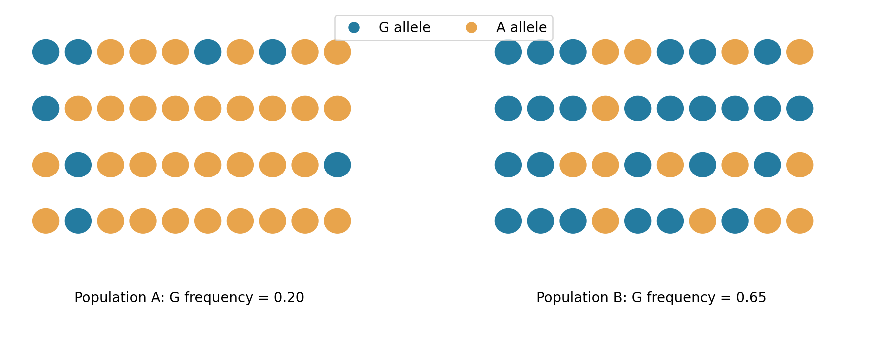
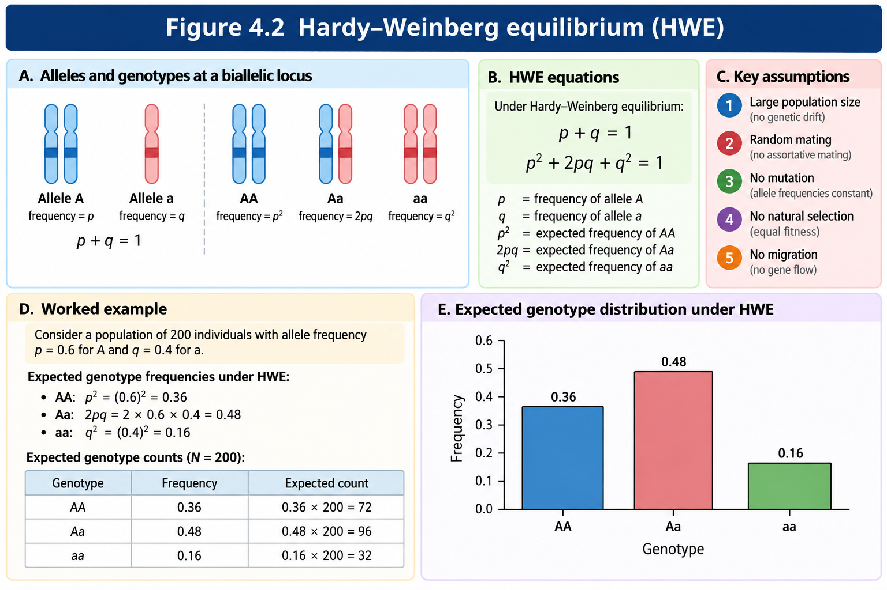
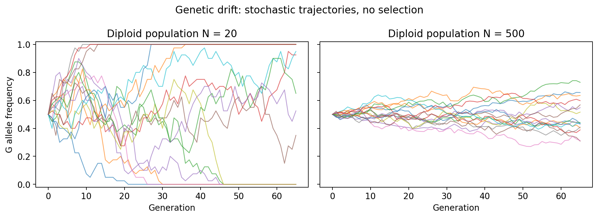
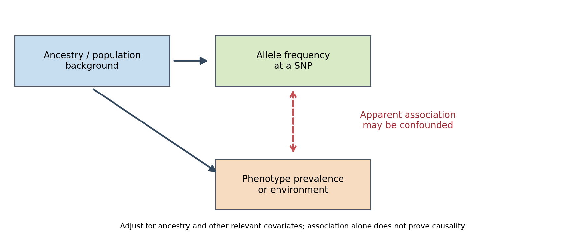
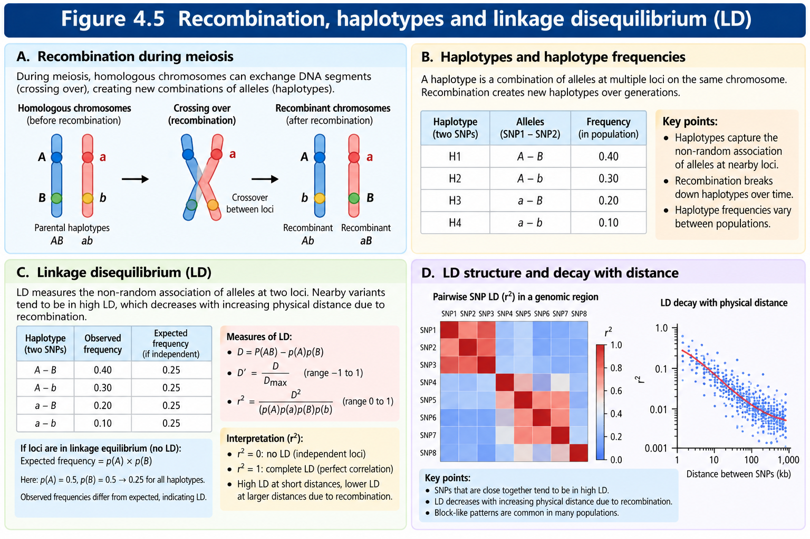
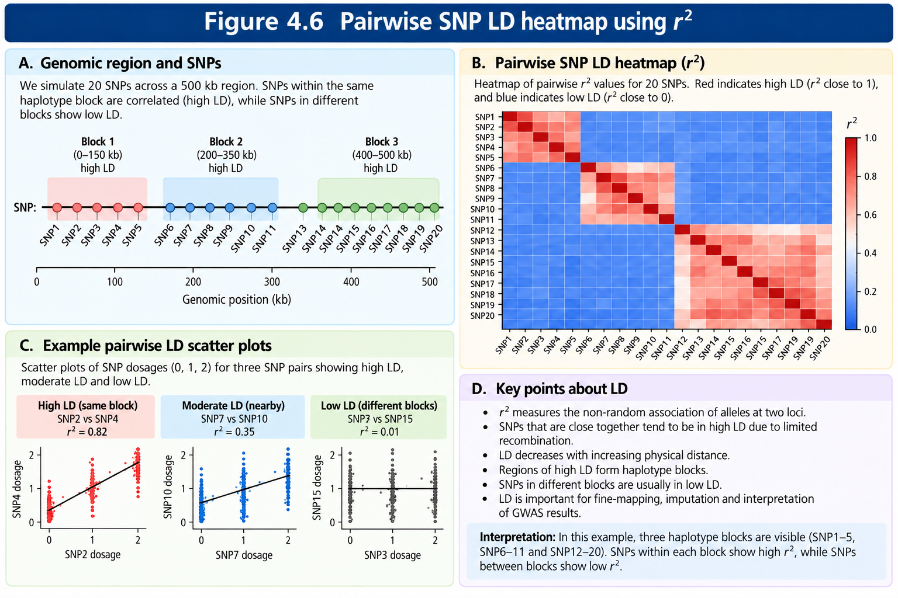
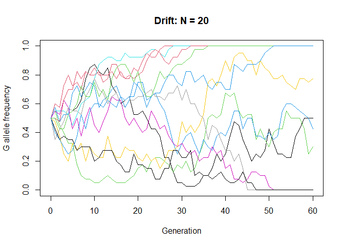
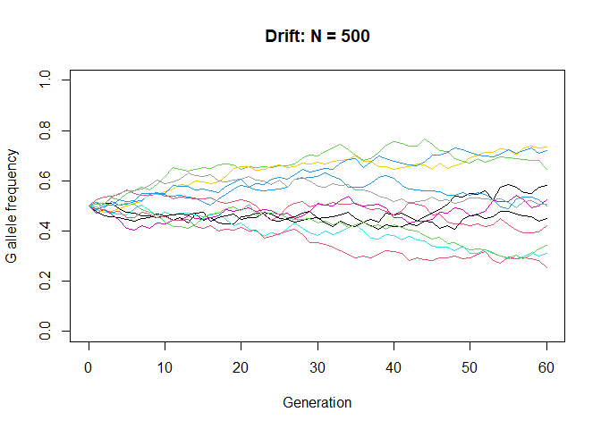

Population Genetics
================

# 4.0 Introduction

Population genetics studies how genetic variants are distributed among
individuals and how their frequencies change across generations and
populations. For genome-wide association studies (GWAS), these
principles explain why ancestry matters, why correlated markers can
share association signals, and why genotype distributions require
careful quality control.

## 4.1 Populations, gene pools and allele frequencies

A **population** is a group of potentially interbreeding individuals
considered within a defined biological or sampling context. A **gene
pool** is the collection of genetic variants carried by that population.
Human genetic variation is not partitioned into discrete biological
races: allele frequencies usually vary continuously and populations
exchange ancestry through migration.

At a biallelic autosomal locus, each successfully genotyped diploid
individual contributes two allele copies. For alleles A and G, let $p$
be the frequency of A and $q$ the frequency of G. Then $p+q=1$.



*Figure 4.1. Population 1 represents European Population and Population
2 represents East Asian Ancestry; Major allele is represented as A and
minor allele isrepresented a.*

## 4.2 Counting alleles and genotypes

Suppose we genotype 100 individuals at one autosomal SNP. We observe 36
AA, 48 AG and 16 GG genotypes.

<table>

<thead>

<tr>

<th>

Genotype
</th>

<th>

Individuals
</th>

<th>

A copies
</th>

<th>

G copies
</th>

</tr>

</thead>

<tbody>

<tr>

<td>

AA
</td>

<td>

36
</td>

<td>

72
</td>

<td>

0
</td>

</tr>

<tr>

<td>

AG
</td>

<td>

48
</td>

<td>

48
</td>

<td>

48
</td>

</tr>

<tr>

<td>

GG
</td>

<td>

16
</td>

<td>

0
</td>

<td>

32
</td>

</tr>

<tr>

<th>

Total
</th>

<th>

100
</th>

<th>

120
</th>

<th>

80
</th>

</tr>

</tbody>

</table>

The total number of observed allele copies is $2(100)=200$. Thus:

$$p = \frac{2n_{AA}+n_{AG}}{2N}=\frac{120}{200}=0.60$$

$$q = \frac{n_{AG}+2n_{GG}}{2N}=\frac{80}{200}=0.40$$

The observed genotype frequencies are 0.36, 0.48 and 0.16. **Missing
genotype calls must not be counted in the denominator.** For example, if
10 of 100 individuals have missing calls at this SNP, the denominator is
180 allele copies, not 200.

## 4.3 Hardy–Weinberg equilibrium: meaning and derivation

Under random union of gametes at a diploid, autosomal, biallelic locus,
with equal allele frequencies in the relevant gamete pools, genotype
probabilities follow the expansion of $(p+q)^2$:

$$(p+q)^2=p^2+2pq+q^2=1.$$

Here $p^2$ is the expected AA frequency, $2pq$ the expected AG frequency
and $q^2$ the expected GG frequency. For $p=0.60$ and $q=0.40$:

$$P(AA)=0.36,\qquad P(AG)=0.48,\qquad P(GG)=0.16.$$

For 200 individuals, the expected counts are 72 AA, 96 AG and 32 GG.
These are *expectations*, not a guarantee of observed counts.
Hardy–Weinberg proportions can arise after one generation of random
mating under the standard model; allele-frequency constancy over many
generations additionally requires the absence of forces such as drift,
selection, mutation and migration.



*Figure 4.2. HWE expectations at an autosomal biallelic locus when p(A)
= 0.60 and q(a) = 0.40.*

**Assumptions and interpretation.** The basic model presumes random
mating with respect to the locus, ordinary diploid inheritance and
appropriate sampling. Finite samples fluctuate. Nonrandom mating,
population mixture, genotyping errors, inbreeding, selection and other
mechanisms can cause departures. HWE alone does not establish that a
variant is valid or invalid.

## 4.4 Testing Hardy–Weinberg proportions

To compare observed and expected genotype counts, we can calculate a
Pearson statistic:

$$\chi^2=\sum_{g\in\{AA,AG,GG\}}\frac{(O_g-E_g)^2}{E_g}.$$

Consider a second **hypothetical** sample of 100 individuals with 40 AA,
40 AG and 20 GG. Its estimated A frequency is $(2(40)+40)/200=0.60$.
Expected counts under HWE are 36, 48 and 16.

$$\chi^2=\frac{(40-36)^2}{36}+\frac{(40-48)^2}{48}+\frac{(20-16)^2}{16}
=0.4444+1.3333+1=2.7778.$$

Because one allele-frequency parameter is estimated from the same
sample, the conventional asymptotic test has **one degree of freedom**.
The corresponding p-value is approximately 0.096. This is not evidence
that HWE is ‘proved’; it means the observed departure is not unusually
large under that test at a conventional 0.05 threshold.

For rare alleles or small expected counts, the asymptotic approximation
can be inaccurate. **Exact conditional HWE tests** are commonly
preferable in genetic QC. Case–control studies often assess HWE in
controls rather than applying an indiscriminate filter to cases, where
true association may also affect genotype proportions. Later, Chapter 26
will cover the practical PLINK-based QC decisions.

## 4.5 Forces changing allele frequencies

**Mutation** creates new sequence variants; its per-generation effect on
common allele frequencies is usually small. **Natural selection**
changes reproductive success associated with genotypes. **Migration
(gene flow)** moves allele copies among populations. **Genetic drift**
changes allele frequencies through random sampling in finite
populations. **Nonrandom mating** directly alters genotype proportions
and may indirectly influence allele frequencies when coupled to other
processes.

For a simple migration mixture, if a fraction $m$ of gametes comes from
a source population with allele frequency $q_m$, then:

$$q_{next}=(1-m)q_{local}+m q_m.$$

If $q_{local}=0.20$, $q_m=0.80$ and $m=0.10$, the new frequency is
$0.90(0.20)+0.10(0.80)=0.26$. This is a stylized one-generation mixture,
not a demographic estimate.

## 4.6 Genetic drift, bottlenecks and effective population size

In the simplest Wright–Fisher model, the next generation’s number of G
copies follows a binomial draw:

$$X_{t+1}\sim \mathrm{Binomial}(2N,q_t),\qquad q_{t+1}=\frac{X_{t+1}}{2N}.$$

Its conditional expectation is $E(q_{t+1}|q_t)=q_t$ and its variance is
$q_t(1-q_t)/(2N)$. Smaller populations therefore show greater random
variation. A **bottleneck** is a sharp reduction in population size; a
**founder effect** arises when a new population is founded by a small
sample. The **effective population size**, $N_e$, is the idealized
population size producing comparable drift or inbreeding; it need not
equal the census size.

<figure>

<figcaption aria-hidden="true">Figure 4.3. Simulated genetic drift
trajectories.</figcaption>
</figure>

## 4.7 Population differentiation and F-statistics

Population differentiation reflects variation in allele frequencies
across populations. A commonly used summary is $F_{ST}$, but several
estimators exist and can differ, especially with unequal sample sizes or
rare variants.

For an **illustrative two-population heuristic** with equal weighting
and allele frequencies $p_1=0.20$ and $p_2=0.60$, the mean frequency is
$\bar p=0.40$. Define $H_T=2\bar p(1-\bar p)=0.48$ and
$H_S=[2(0.20)(0.80)+2(0.60)(0.40)]/2=0.40$. Then:

$$F_{ST}^{(illustrative)}=\frac{H_T-H_S}{H_T}=\frac{0.48-0.40}{0.48}\approx 0.167.$$

This is a pedagogical heterozygosity-based calculation, **not** a
recommendation to use this simple expression as a general unbiased
estimator. In research, we should specify the estimator (for example,
Weir–Cockerham), sampling design and variant set. $F_{ST}$ does not
assign ancestry to an individual and does not measure genetic ‘purity’.

## 4.8 Population structure, admixture and confounding

**Population structure** describes systematic allele-frequency
differences correlated with ancestry or demographic history.
**Admixture** occurs when lineages with different ancestry histories
contribute to a population. When ancestry also correlates with a
phenotype through environmental, social, recruitment or other factors, a
SNP can show a misleading association.

<figure>

<figcaption aria-hidden="true">Figure 4.4. Population structure as a
potential confounder.</figcaption>
</figure>

GWAS analyses commonly use ancestry principal components (PCs), suitable
mixed models, study design restrictions and careful cohort
harmonization. PCs summarize genetic variation; they are not perfect
controls for all confounding. We will implement ancestry QC in Chapter
24 and regression adjustment in later association chapters.

## 4.9 Linkage, recombination and haplotypes

A **haplotype** is a combination of alleles on the same chromosome. For
two biallelic loci A/a and B/b, possible haplotypes are AB, Ab, aB and
ab. **Physical linkage** refers to loci on the same chromosome;
**recombination** can reshuffle their alleles across generations.
Genetic distance, often expressed in centimorgans (cM), describes
recombination frequency on a genetic map and is not interchangeable with
physical base-pair distance.

<figure>

<figcaption aria-hidden="true">Figure 4.5. Illustrative two-locus
haplotype frequencies.</figcaption>
</figure>

## 4.10 Linkage disequilibrium: D, D-prime and r-squared

**Linkage disequilibrium (LD)** means alleles at different loci occur
together at frequencies different from those expected under
independence. LD is influenced by recombination, drift, mutation,
demographic history and selection; it is not identical to physical
linkage.

Using the Figure 4.5 frequencies, $P(A)=0.40+0.10=0.50$,
$P(B)=0.40+0.20=0.60$ and $P(AB)=0.40$. Therefore:

$$D=P(AB)-P(A)P(B)=0.40-(0.50)(0.60)=0.10.$$

The squared allele correlation is:

$$r^2=\frac{D^2}{p_A(1-p_A)p_B(1-p_B)}
=\frac{0.10^2}{(0.50)(0.50)(0.60)(0.40)}
=\frac{0.01}{0.06}\approx 0.167.$$

For positive $D$, the largest feasible value is
$D_{max}=\min[p_A(1-p_B),(1-p_A)p_B]=\min(0.20,0.30)=0.20$. Hence
$D'=D/D_{max}=0.50$. For negative $D$, the corresponding negative bound
must be used; $D'$ is a normalized measure and should not be confused
with $r^2$.

**Interpretation:** $r^2$ describes correlation and is closely related
to how effectively one marker tags another in association studies. A
high $D'$ does not necessarily imply high $r^2$. Pairwise LD varies
across ancestry groups and reference samples. Haplotype frequencies may
require phasing or inference; unphased genotype correlations provide a
related, but not identical, computational perspective.

## 4.11 LD blocks, tagging SNPs and GWAS signals

A tagging SNP can be associated with a trait because it is correlated
with a nearby causal variant. LD blocks are operational descriptions of
correlated genomic regions, not universal immutable chromosome
boundaries. Long-range LD can also occur, especially in complex regions
such as the MHC.

<figure>

<figcaption aria-hidden="true">Figure 4.6. Illustrative pairwise squared
correlations.</figcaption>
</figure>

## 4.12 Why population genetics matters in GWAS

<table>

<thead>

<tr>

<th>

Concept
</th>

<th>

GWAS consequence
</th>

<th>

Later practical chapter
</th>

</tr>

</thead>

<tbody>

<tr>

<td>

HWE
</td>

<td>

Can flag genotype irregularities; interpret in study context
</td>

<td>

Chapter 26
</td>

</tr>

<tr>

<td>

Population structure
</td>

<td>

Potential confounding and inflation of association statistics
</td>

<td>

Chapters 24 and 37–42
</td>

</tr>

<tr>

<td>

Allele frequency
</td>

<td>

Controls power, variant filtering and rare-variant interpretation
</td>

<td>

Chapter 28
</td>

</tr>

<tr>

<td>

LD
</td>

<td>

Correlated signals, tagging, imputation and interpretation
</td>

<td>

Chapters 33–42
</td>

</tr>

<tr>

<td>

Drift and ancestry history
</td>

<td>

Differences among reference panels and cohorts
</td>

<td>

Chapters 24 and 33–36
</td>

</tr>

</tbody>

</table>

## 4.13 Practical R exercises

The following exercises use **invented counts or simulations**. They are
not results from the HapMap tutorial data or any PGC dataset. All
examples use base R to minimize dependencies.

### Practical 1: Allele frequencies and HWE

``` r
counts <- c(AA=40, AG=40, GG=20)
N <- sum(counts)
p_A <- (2*counts['AA']+counts['AG'])/(2*N)
q_G <- 1-p_A
expected <- N*c(AA=p_A^2, AG=2*p_A*q_G, GG=q_G^2)
chisq <- sum((counts-expected)^2/expected)
p_value <- pchisq(chisq, df=1, lower.tail=FALSE)
print(data.frame(genotype=names(counts), observed=as.integer(counts), expected=as.numeric(expected)))
```

    ##   genotype observed expected
    ## 1       AA       40       36
    ## 2       AG       40       48
    ## 3       GG       20       16

``` r
print(c(p_A=unname(p_A), q_G=unname(q_G), chi_square=unname(chisq), p_value=unname(p_value)))
```

    ##        p_A        q_G chi_square    p_value 
    ##  0.6000000  0.4000000  2.7777778  0.0955807

``` r
stopifnot(abs(unname(chisq)-2.7777777778)<1e-6)
```

**Expected interpretation:** Estimated A frequency is 0.60, expected
counts are 36/48/16, and the asymptotic p-value is about 0.096. We will
later use appropriate exact-test software for practical GWAS QC.

### Practical 2: Wright–Fisher drift

``` r
set.seed(404)
simulate_drift <- function(N, generations=60, q0=0.5) {
  q <- numeric(generations+1); q[1] <- q0
  for (t in seq_len(generations)) q[t+1] <- rbinom(1, 2*N, q[t])/(2*N)
  q
}
small <- replicate(12, simulate_drift(20))
large <- replicate(12, simulate_drift(500))
matplot(0:60, small, type='l', lty=1, col=seq_len(12), ylim=c(0,1),
        xlab='Generation', ylab='G allele frequency', main='Drift: N = 20')
```

<!-- -->

``` r
matplot(0:60, large, type='l', lty=1, col=seq_len(12), ylim=c(0,1),
        xlab='Generation', ylab='G allele frequency', main='Drift: N = 500')
```

<!-- -->

### Practical 3: Illustrative differentiation

``` r
p <- c(0.20,0.60)
p_bar <- mean(p)
H_T <- 2*p_bar*(1-p_bar)
H_S <- mean(2*p*(1-p))
FST_illustrative <- (H_T-H_S)/H_T
print(c(H_T=H_T,H_S=H_S,FST_illustrative=FST_illustrative))
```

    ##              H_T              H_S FST_illustrative 
    ##        0.4800000        0.4000000        0.1666667

``` r
stopifnot(abs(FST_illustrative-1/6)<1e-10)
```

### Practical 4: Two-locus LD from known haplotypes

``` r
h <- c(AB=.40, Ab=.10, aB=.20, ab=.30)
stopifnot(abs(sum(h)-1)<1e-12)
pA <- h['AB']+h['Ab']; pB <- h['AB']+h['aB']
D <- h['AB']-pA*pB
r2 <- D^2/(pA*(1-pA)*pB*(1-pB))
Dmax <- if (D>=0) min(pA*(1-pB),(1-pA)*pB) else min(pA*pB,(1-pA)*(1-pB))
Dprime <- D/Dmax
print(c(D=unname(D), Dprime=unname(Dprime), r2=unname(r2)))
```

    ##         D    Dprime        r2 
    ## 0.1000000 0.5000000 0.1666667

``` r
stopifnot(abs(unname(r2)-1/6)<1e-10)
```

The R plots produced in Practical 2 are intentionally separate from the
numbered publication figures; they let us investigate how simulations
vary. No external genotype file is required.

## 4.14 Common misunderstandings

<table>

<thead>

<tr>

<th>

Misunderstanding
</th>

<th>

Correction
</th>

</tr>

</thead>

<tbody>

<tr>

<td>

HWE means allele frequencies never change.
</td>

<td>

HWE describes genotype proportions under a model; stability across
generations needs additional assumptions.
</td>

</tr>

<tr>

<td>

A nonsignificant HWE test proves equilibrium.
</td>

<td>

It only means the test did not detect a departure at the available
power.
</td>

</tr>

<tr>

<td>

LD means variants are physically adjacent.
</td>

<td>

LD is statistical association; physical distance and LD are related but
distinct.
</td>

</tr>

<tr>

<td>

High LD proves a SNP causes disease.
</td>

<td>

A tagging SNP may be correlated with the causal variant.
</td>

</tr>

<tr>

<td>

Ancestry PCs remove every confounder.
</td>

<td>

They address some ancestry-related structure, not all sources of bias.
</td>

</tr>

<tr>

<td>

FST gives the ancestry of a person.
</td>

<td>

FST summarizes allele-frequency differentiation among defined
populations.
</td>

</tr>

</tbody>

</table>

## 4.15 Summary and exercises

Population genetics connects variant frequencies, mating and demography
to the patterns observed in GWAS. HWE gives a genotype-frequency
baseline; drift and migration explain frequency changes; population
structure can confound association studies; and LD explains why
associated markers need not be causal.

**Practice questions**

1.  For 120 AA, 60 AG and 20 GG individuals, calculate allele
    frequencies and genotype proportions.
2.  If p(A) = 0.70, compute expected genotype counts in 500 individuals
    under HWE.
3.  Explain why a case-only HWE filter can remove genuine
    disease-associated signals.
4.  Derive the variance of one-generation drift in the ideal
    Wright–Fisher model.
5.  Compare genetic drift in populations with N = 25 and N = 2,500.
6.  Describe how recruitment differences across ancestry groups can
    create spurious associations.
7.  Given AB = 0.30, Ab = 0.20, aB = 0.10, ab = 0.40, calculate D and
    r-squared.
8.  Explain the difference between physical linkage, haplotypes, D-prime
    and r-squared.
9.  Why can a tagging SNP be significant when it is not causal?
10. Which aspects of this chapter should be considered when choosing an
    LD reference panel?

## Methods and reproducibility record

<table>

<thead>

<tr>

<th>

Item
</th>

<th>

Record
</th>

</tr>

</thead>

<tbody>

<tr>

<td>

Inputs
</td>

<td>

Invented genotype counts and haplotype frequencies; no external
participant-level data
</td>

</tr>

<tr>

<td>

R requirements
</td>

<td>

Base R only; record local R and rmarkdown/Pandoc versions when rendering
</td>

</tr>

<tr>

<td>

Seeds
</td>

<td>

404 for the R drift exercise; 41, 404, 4 and 406 used for
figure-generating Python scripts
</td>

</tr>

<tr>

<td>

Checks
</td>

<td>

Genotype totals, haplotype sum, chi-square and LD arithmetic checked in
source code
</td>

</tr>

<tr>

<td>

Limitations
</td>

<td>

Figure 4.6 uses simulated diploid SNP dosages rather than empirical
genotype data; simplified FST calculation is illustrative
</td>

</tr>

<tr>

<td>

Data provenance
</td>

<td>

All numerical examples are simulated or hypothetical; no HapMap/PGC
findings are claimed
</td>

</tr>

</tbody>

</table>

## 4.16 Selected references

- Hardy GH. Mendelian proportions in a mixed population. *Science*.
  1908;28:49–50.
- Weinberg W. Über den Nachweis der Vererbung beim Menschen.
  *Jahreshefte des Vereins für vaterländische Naturkunde in
  Württemberg*. 1908;64:368–382.
- Wigginton JE, Cutler DJ, Abecasis GR. A note on exact tests of
  Hardy–Weinberg equilibrium. *American Journal of Human Genetics*.
  2005;76:887–893.
- Weir BS, Cockerham CC. Estimating F-statistics for the analysis of
  population structure. *Evolution*. 1984;38:1358–1370.
- Pritchard JK, Stephens M, Donnelly P. Inference of population
  structure using multilocus genotype data. *Genetics*.
  2000;155:945–959.
- Price AL et al. Principal components analysis corrects for
  stratification in genome-wide association studies. *Nature Genetics*.
  2006;38:904–909.
- Slatkin M. Linkage disequilibrium—understanding the evolutionary past
  and mapping the medical future. *Nature Reviews Genetics*.
  2008;9:477–485.
