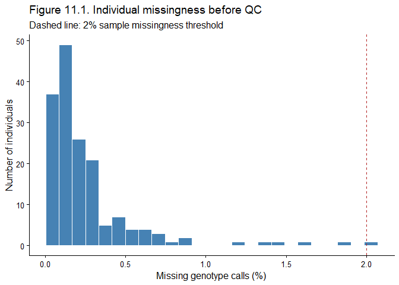
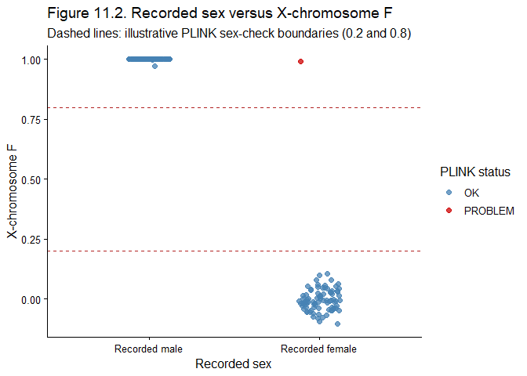
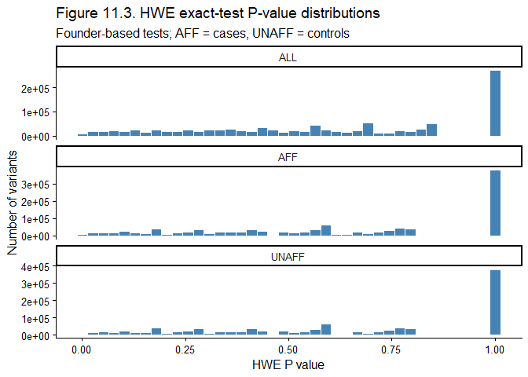
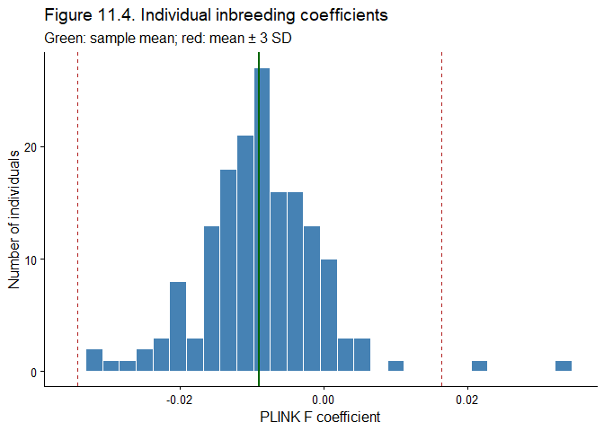
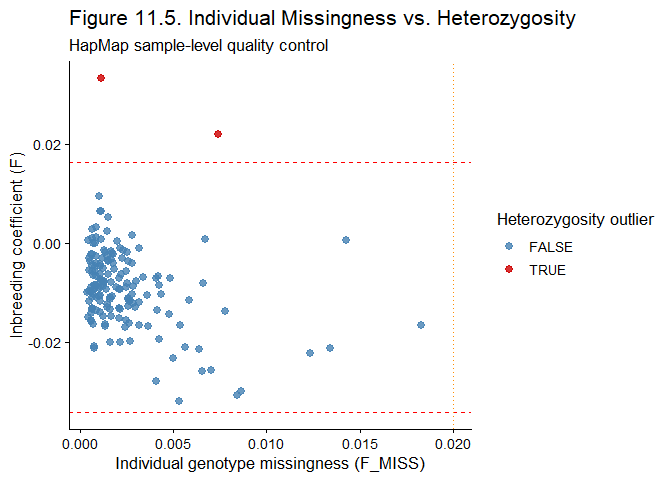
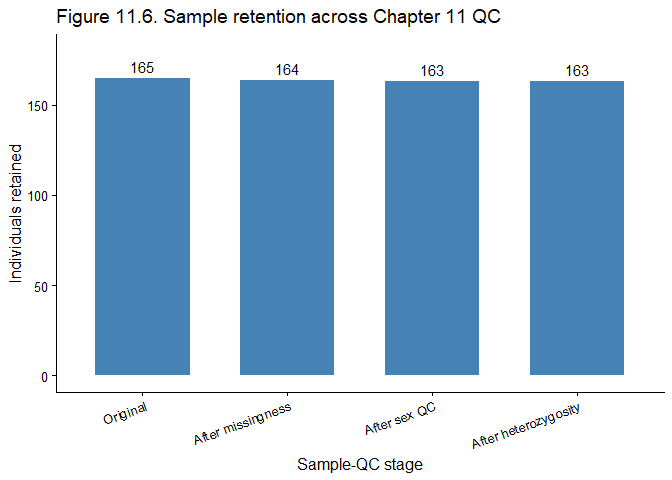

# 11.1 Why sample-level quality control comes before association testing

A genome-wide association study (GWAS) asks whether genetic variants are
associated with a phenotype. Before testing associations, we must
establish that the genotype data represent the intended individuals and
that technical problems are not mistaken for biological associations.
**Sample-level quality control (QC)** assesses the reliability of each
person’s genotype profile. A **variant** or **SNP** (single-nucleotide
polymorphism) is a genomic position at which alleles can differ; a
**genotype** is the observed pair of alleles at a diploid autosomal
position (for example, AA, AG, or GG). A **sample** is the genotyped
individual or specimen.

Sample QC can identify excessive missing genotypes, discrepancies
between recorded sex and sex-chromosome patterns, and unusual
genome-wide homozygosity or heterozygosity. Other essential
checks—duplicate samples, genetic relatedness, ancestry, and definitive
variant-level QC—follow in subsequent chapters. The ordering is
deliberate: a low-quality sample can distort estimates for many
variants, while poorly genotyped variants can distort sample metrics.
Consequently, QC is an **iterative process**, not a universal,
unchangeable sequence.

# 11.2 Data provenance, software, and reproducibility

The input is `HapMap_3_r3_1`, the HapMap Phase III tutorial dataset used
in the Marees *et al.* GWAS QC tutorial. The source tutorial describes a
European-ancestry subset with a **simulated** binary phenotype; the
source HapMap data were supplied on **NCBI build 36 (hg18)**
coordinates. We should verify ancestry and build from provenance records
rather than infer them from a filename. The tutorial’s phenotype values
are illustrative, not measured disease outcomes.

**Observed software:** PLINK **v1.90b7 (16 January 2023)**, run from a
WSL terminal in `/mnt/d/TOOLS/PLINK`; R with `data.table` and `ggplot2`
for tables and figures. PLINK logs report 5,878 MB available RAM and
2,939 MB reserved for its main workspace. The R package versions and
session details should be recorded when the R analysis is run.

``` r
library(data.table)
library(ggplot2)
sessionInfo()
```

**Running the figures.** The figure chunks below are executable and
contain the full `ggplot2` source. We can modify axes, cutoffs, titles,
colors, and sizes directly. With the required PLINK report files in the
R Markdown working directory, change the YAML parameter to
`run_qc_plots: true` and render the chapter. The plots will be shown
inline and saved to `figures/`. When publishing a lightweight GitHub
chapter without the report files, leave it `false` and include any
previously rendered images separately if desired. PLINK Bash chunks
remain non-executing for safety; run those sequentially in the terminal.

**Directory convention.** PLINK commands below assume the current
directory contains the input `.bed/.bim/.fam` triplet and subsequent
PLINK output files. R code assumes the same working directory, unless we
explicitly provide a path. A command with `--out PREFIX` writes files
with that prefix; it does **not** overwrite the original input unless
explicitly instructed.

# 11.3 Genotype and analysis file formats: a beginner’s guide

## 11.3.1 Text-based PED and MAP

A `.ped` file is an older, text-based PLINK pedigree-and-genotype
format. Each row represents one individual, beginning with six
pedigree/phenotype fields, followed by **two allele fields per marker**.
The six fields are family ID (`FID`), individual ID (`IID`), paternal ID
(`PID`), maternal ID (`MID`), sex, and phenotype. For example, `A G`
could encode a heterozygous genotype at one marker. A `.map` file
accompanies `.ped` and describes variants with four columns: chromosome,
variant ID, genetic-map distance (centimorgans), and base-pair position.
Large `.ped` files are bulky and slow to process.

**Illustrative example only (not a row from our data):**

``` text
# Example .ped row: FID IID PID MID SEX PHENO [marker1 alleles] [marker2 alleles]
F001 C1 P1 P2 1 2 A G C C
# Example .map rows: CHR SNP_ID CM BP
1 rsExample1 0 10500
1 rsExample2 0 10800
```

## 11.3.2 Binary BED, BIM and FAM

Our analysis uses the more compact **PLINK 1 binary triplet**:

| File | What it stores | How to inspect it |
|:---|:---|:---|
| `.bed` | Binary-encoded genotype calls across samples and variants | Read using PLINK; **not** a text file and **not** a browser BED interval file |
| `.bim` | One variant per row: chromosome, SNP ID, genetic distance, physical position, allele 1, allele 2 | `head HapMap_3_r3_1.bim` |
| `.fam` | One individual per row: FID, IID, PID, MID, sex, phenotype | `head HapMap_3_r3_1.fam` |

A PLINK binary `.bed` file is **different** from the widely used
three-column genomic-interval `.bed` format. The `.bim` allele columns
are not automatically guaranteed to represent the reference/alternate or
major/minor alleles. The **genome build** determines how chromosome
positions should be interpreted.

**Example `.fam` rows (illustrative):**

``` text
F001 P1 0 0 1 1
F001 P2 0 0 2 1
F001 C1 P1 P2 1 2
```

PLINK 1 binary phenotype conventions for a case–control trait are
usually `1 = control`, `2 = case`, and `-9` or `0 = missing` (depending
on the file/settings). Recorded sex is usually `1 = male`, `2 = female`,
`0 = unknown`. These are **data codes**, not inferences from genetic
markers.

## 11.3.3 Founder, non-founder, and family structure

A **founder** has no parents recorded in the pedigree (`PID = 0` and
`MID = 0`). A **non-founder** has at least one parent recorded. A
founder is not necessarily the oldest person in a family, nor
necessarily genetically unrelated to other founders. A non-founder is
not automatically a low-quality sample. For example, the parents P1/P2
in the illustrative `.fam` above are founders, whereas C1 is a
non-founder.

Why do these terms matter? In PLINK 1.9, several
allele-frequency-dependent procedures ordinarily estimate allele
frequencies from **founders** by default, helping avoid giving large
pedigrees disproportionate weight. However, founder status alone does
not guarantee independent genotypes: two founders can be cousins or
siblings whose parents were never recorded. **Genotype-based
relatedness** will be assessed in Chapter 12.

In our **initial** dataset, PLINK reported **112 founders and 53
non-founders**; after the two sample exclusions, **112 founders and 51
non-founders** remained. The simulated phenotype was present for 112
individuals; the remaining 53 initially lacked phenotype values.

## 11.3.4 Outputs used in this chapter

| Extension | Contents | Created by |
|:---|:---|:---|
| `.log` | Exact PLINK command, version, input counts, warnings, outputs, and timing | Nearly every PLINK run |
| `.imiss` | Missingness **per individual**: `N_MISS`, `N_GENO`, `F_MISS` | `--missing` |
| `.lmiss` | Missingness **per variant** | `--missing` |
| `.sexcheck` | Recorded sex (`PEDSEX`), genotype-inferred sex (`SNPSEX`), `STATUS`, X-chromosome `F` | `--check-sex` |
| `.hh` | Heterozygous haploid genotype calls flagged by PLINK | Warning on sex/haploid regions |
| `.hwe` | Hardy–Weinberg exact-test results, including `ALL`, `AFF`, `UNAFF` | `--hardy` |
| `.prune.in` | SNP IDs **retained** after LD pruning | `--indep-pairwise` |
| `.prune.out` | SNP IDs **excluded** by LD pruning | `--indep-pairwise` |
| `.het` | Observed/expected homozygosity, nonmissing genotypes, inbreeding coefficient `F` | `--het` |
| `.tsv` | Tab-separated text table; here, our merged R QC report | `fwrite()` in R |
| `.png` | Image file for plots | `ggsave()` in R |

**Command vocabulary.** `--bfile` supplies the shared prefix of a
`.bed/.bim/.fam` triplet; `--out` names outputs; `--make-bed` writes a
new binary triplet; `--remove` removes named individuals; `--extract`
selects named SNPs; `--exclude` removes named SNPs or genomic ranges. A
command such as `--mind 0.02` filters **individuals** with \>2% missing
genotypes, whereas `--geno 0.02` filters **variants** with \>2% missing
genotypes. Confusing the two changes the scientific meaning of the
analysis.

# 11.4 Baseline audit: missingness before exclusions

## Purpose and position in the workflow

A **missing genotype** is a genotype not confidently called, not a
person missing from the dataset. The **individual missingness fraction**
is

$$m_i=\frac{\text{number of missing genotype calls for individual }i}{\text{number of genotypes assessed for individual }i},$$

and **call rate** is $1-m_i$. Variant missingness reverses the
denominator: it is the fraction of individuals lacking a call at a given
marker. Excessive missingness may indicate poor DNA quality, assay
failure, genotype-calling problems, or technical batch effects. It can
reduce power and, if associated with case/control status or ancestry,
generate biased associations.

We inspect missingness **before filtering** so that the original quality
distribution is preserved. This provides a baseline for auditing the
chosen thresholds and distinguishes a genuinely problematic sample from
a dataset-wide marker issue.

``` bash
./plink --bfile HapMap_3_r3_1 --missing --out QC11_initial_missingness
```

**Verified result:** **165 people** (80 male, 85 female), **1,457,897
variants**, **112 founders/53 non-founders**, and overall genotyping
rate **0.997378** (99.7378%). The log warned of **225 heterozygous
haploid calls**, which are recorded separately in
`QC11_initial_missingness.hh`. One sample, **FID 1444 / IID NA12739**,
had **2.029% missingness**, above the planned 2% sample threshold.

The 225 calls are a **warning**, not 225 people or 225 variants
automatically excluded. They concern sex-chromosome/haploid genotype
handling and should be reviewed in the appropriate chromosome-aware QC
context; we do not silently erase the warning.

``` r
library(data.table)
library(ggplot2)
miss_initial <- fread("D:/TOOLS/PLINK/QC11_initial_missingness.imiss")
stopifnot(nrow(miss_initial) == 165)
miss_initial[, Missing_percent := 100 * F_MISS]
p1 <- ggplot(miss_initial, aes(Missing_percent)) +
  geom_histogram(bins = 25, fill = "steelblue", color = "white") +
  geom_vline(xintercept = 2, linetype = "dashed", color = "firebrick") +
  labs(title = "Figure 11.1. Individual missingness before QC",
       subtitle = "Dashed line: 2% sample missingness threshold",
       x = "Missing genotype calls (%)", y = "Number of individuals") +
  theme_classic(base_size = 12)
print(p1)
```

<!-- -->

``` r
#ggsave("figures/ch11-fig-11-1-initial-missingness.png", p1,
#       width = 8, height = 5, dpi = 300)
```

All six figures are defined as editable **R code chunks**. Set
`params: run_qc_plots: true` in the YAML when the QC reports are
available in the working directory; figures will be generated during
rendering and also saved as PNG files in `figures/`. Leave this
parameter `false` for website builds without genotype reports. In that
mode the figures will not appear; no fixed PNG substitutes are silently
used.

# 11.5 Permissive variant screen before sample filtering

A few extremely poor markers can artificially inflate the missingness of
otherwise adequate samples. The original Marees tutorial begins with
permissive missingness thresholds before stricter QC. We followed that
principle by checking whether any SNP exceeded **20% missingness**
before applying the 2% individual threshold.

``` bash
./plink --bfile HapMap_3_r3_1 --geno 0.20 \
  --make-bed --out QC11_preliminary_variant_screen
```

`--geno 0.20` means **exclude SNPs missing in more than 20% of
individuals**; it does not mean 20% minor-allele frequency.
**Observed:** no variants were excluded; 165 individuals and 1,457,897
variants remained. We deliberately did **not** apply a strict
genome-wide variant missingness filter here: the main variant-QC chapter
will evaluate marker missingness in detail after sample problems have
been addressed. The permissive screen was an initial safeguard, not
definitive variant QC.

# 11.6 Individual missingness: the first sample exclusion

## Why this step occurs now

After confirming that there are no extremely poorly called SNPs by the
permissive screen, we can evaluate sample call rate more meaningfully. A
low-call-rate individual may produce unreliable genotype estimates
across thousands of markers. Removing a genuinely poor sample before
later sex and heterozygosity calculations reduces the influence of
unreliable data on those diagnostics.

**Threshold used:** exclude individuals with **more than 2% missing
genotypes**, equivalent to a call rate below 98%. This is a
tutorial-specific QC choice, not a universal biological boundary. In
larger studies, platform-specific distributions, batch effects, and
sensitivity analyses may motivate a different threshold.

``` bash
./plink --bfile QC11_preliminary_variant_screen --mind 0.02 \
  --make-bed --out QC11_sample_missingness_filtered
```

**Verified:** one individual (**1444 / NA12739**) was excluded; **164
individuals** and **1,457,897 variants** remained. The genotyping rate
increased to **0.997486**. **Why remove?** This individual exceeded the
prespecified sample missingness threshold (2.029% versus 2%). **Why
retain the other 164?** They did not exceed the selected threshold at
this stage. Their retention does not guarantee that every other QC
metric will pass.

**Recorded troubleshooting:** An initial attempt accidentally used
`--mind 0.2` (20%) rather than `--mind 0.02` (2%) and removed no one.
The corrected command above is the **authoritative** command. This
distinction matters: `0.2` and `0.02` differ by a factor of ten.
Preserve the unsuccessful attempt in the development log, not as a valid
filtering result.

``` r
miss_initial <- fread("D:/TOOLS/PLINK/QC11_initial_missingness.imiss")
miss_initial[F_MISS > 0.02,
             .(FID, IID, N_MISS, N_GENO, F_MISS)]
stopifnot(sum(miss_initial$F_MISS > 0.02) == 1L)
```

# 11.7 Sex-chromosome consistency check

## Why we assess it after missingness

Recorded sex (`PEDSEX` in PLINK) is metadata. `--check-sex` evaluates
whether X-chromosome genotype patterns are broadly consistent with that
metadata. A high proportion of homozygous calls on the
non-pseudoautosomal X chromosome often occurs in typical XY samples; a
lower homozygosity coefficient is expected in typical XX samples. These
patterns are not definitive measures of gender identity, reproductive
anatomy, or even all biological sex-chromosome configurations.

We perform this check **after** removing the low-call-rate sample
because poorly called genotypes can compromise sex-chromosome metrics.
We perform it **before** autosomal heterozygosity work because it
detects a distinct class of sample-identity or metadata problems.

``` bash
./plink --bfile QC11_sample_missingness_filtered --check-sex \
  --out QC11_sex_check
```

PLINK’s `.sexcheck` columns include `PEDSEX` (recorded code), `SNPSEX`
(inferred code), `STATUS` (`OK` or `PROBLEM`), and **X-chromosome F**
(an inbreeding/homozygosity measure). Under commonly used PLINK 1.9
default thresholds, **F \< 0.2** supports an XX-like pattern and **F \>
0.8** supports an XY-like pattern; the interval between is ambiguous.
These are configurable **heuristics**, not clinical diagnostic cutoffs.
Chromosomal aneuploidy, mosaicism, pseudoautosomal-region handling,
ancestry, genotyping errors, or metadata issues may affect
interpretation.

**Verified:** 25,093 X-chromosome SNPs were scanned and **one**
individual was labeled `PROBLEM`: **FID 1349 / IID NA10854**, recorded
female (`PEDSEX = 2`), inferred male (`SNPSEX = 1`), **X F = 0.9903**.
This is a **discordance**, not proof of a particular cause. The original
metadata and specimen identity should ideally be checked before any
exclusion.

``` r
library(data.table)
library(ggplot2)
sexcheck <- fread("D:/TOOLS/PLINK/QC11_sex_check.sexcheck")
sexcheck[, Recorded := factor(PEDSEX, levels = c(1, 2, 0),
                              labels = c("Recorded male", "Recorded female", "Unknown"))]
p2 <- ggplot(sexcheck, aes(x = Recorded, y = F, color = STATUS)) +
  geom_jitter(width = 0.12, height = 0, alpha = 0.75, size = 2) +
  geom_hline(yintercept = c(0.2, 0.8), linetype = "dashed", color = "firebrick") +
  scale_color_manual(values = c(OK = "steelblue", PROBLEM = "red3")) +
  labs(title = "Figure 11.2. Recorded sex versus X-chromosome F",
       subtitle = "Dashed lines: illustrative PLINK sex-check boundaries (0.2 and 0.8)",
       x = "Recorded sex", y = "X-chromosome F", color = "PLINK status") +
  theme_classic(base_size = 12)
print(p2)
```

<!-- -->

``` r
#ggsave("figures/ch11-fig-11-2-sex-check.png", p2,
#       width = 8, height = 5, dpi = 300)
sexcheck[STATUS == "PROBLEM", .(FID, IID, PEDSEX, SNPSEX, STATUS, F)]
```

    ##      FID     IID PEDSEX SNPSEX  STATUS      F
    ##    <int>  <char>  <int>  <int>  <char>  <num>
    ## 1:  1349 NA10854      2      1 PROBLEM 0.9903

## Documented decision and exclusion

For this **teaching dataset**, we followed the source tutorial’s
conservative choice to remove the discordant record from the working
dataset. In a real clinical or population study, the preferred first
action is **investigation**, not automatic exclusion; correcting a
confirmed metadata error may preserve a valid sample. We cannot
establish the underlying reason for this discrepancy from `.sexcheck`
alone.

``` bash
# Generate a two-column FID/IID removal list from the actual sex-check report.
awk 'NR > 1 && $5 == "PROBLEM" {print $1, $2}' \
  QC11_sex_check.sexcheck > QC11_sex_discrepancies.txt

./plink --bfile QC11_sample_missingness_filtered \
  --remove QC11_sex_discrepancies.txt --make-bed \
  --out QC11_sex_filtered
```

**Verified:** **163 people** remained (**79 recorded males, 84 recorded
females**), with **1,457,897 variants**, **112 founders/51
non-founders**, 56 simulated cases, 56 simulated controls, and 51
missing phenotypes. Overall genotyping rate: **0.997572**. **Why remove
one?** Unresolved discordance under the tutorial’s specified rule. **Why
retain everyone else?** No additional sex-check discordances were
identified.

The log still notes **225 heterozygous haploid calls**. Their
persistence after removal indicates that this warning should not be
equated with the one sex-discrepant sample. The full chromosome-aware
treatment is outside this chapter’s sample filtering decisions.

# 11.8 Constructing a *temporary* autosomal heterozygosity panel

**Crucial distinction:** The dataset `QC11_sex_filtered` contains **163
people and 1,457,897 variants**. We do **not** permanently remove
hundreds of thousands of SNPs from the GWAS here. Instead, we create a
**working marker panel** for robust heterozygosity estimation. Final
variant QC belongs to Chapter 14.

## 11.8.1 Autosomes first

**Autosomes** are chromosomes 1–22. We use them because sex chromosomes
have different ploidy and sex-dependent genotype expectations, which
would confound an ordinary diploid autosomal heterozygosity statistic.
This step also avoids the earlier heterozygous-haploid warning in the
temporary panel.

``` bash
./plink --bfile QC11_sex_filtered --chr 1-22 \
  --make-bed --out QC11_autosomal
```

**Verified:** 1,423,833 autosomal variants remained; **34,064
non-autosomal variants** were left out **only from this working panel**.
All 163 people remained.

## 11.8.2 Common markers for a stable estimate

**Minor-allele frequency (MAF)** is the frequency of the less frequent
allele at a biallelic variant in the analyzed reference sample. A
variant with MAF 0.01 has a minor allele frequency of 1%; rare variants
contribute less stable information to a small-sample genome-wide
heterozygosity estimate and may be especially sensitive to
allele-frequency estimation error. For this **diagnostic panel**, we
used **MAF ≥ 0.05**.

``` bash
./plink --bfile QC11_autosomal --maf 0.05 \
  --make-bed --out QC11_het_common
```

**Verified:** 331,344 markers were excluded from the temporary panel;
**1,092,489** remained. **Why not remove these variants from the GWAS?**
Because the 5% cutoff is chosen for a particular diagnostic purpose, not
as a definitive variant-retention rule for all analyses.

## 11.8.3 Low marker missingness for heterozygosity

We then exclude SNPs with more than 2% missing genotypes **within the
temporary panel**. A poorly called SNP can distort an individual’s
observed-versus-expected homozygosity comparison. This follows the
common-marker screen and precedes LD pruning so that the pruning
algorithm sees better-quality markers.

``` bash
./plink --bfile QC11_het_common --geno 0.02 \
  --make-bed --out QC11_het_common_geno
```

**Verified:** 18,595 additional variants were excluded from the
temporary panel; **1,073,894 variants** and **163 individuals**
remained. Genotyping rate **0.998135**. This is not the final
genome-wide variant missingness filter.

# 11.9 Hardy–Weinberg equilibrium as a diagnostic

**Hardy–Weinberg equilibrium (HWE)** describes expected genotype
frequencies in a simplified, randomly mating population with no relevant
evolutionary or technical disturbances. For allele frequencies $p$ and
$q=1-p$, expected diploid genotype frequencies are $p^2$ (AA), $2pq$
(Aa), and $q^2$ (aa). Real populations can depart from these assumptions
due to ancestry mixture, family structure, selection, true disease
association, or genotype error. Therefore, a low HWE P value is a
**diagnostic flag**, not proof of laboratory failure.

**Why assess HWE before pruning?** We want to inspect potential
genotype-distribution anomalies before choosing the final heterozygosity
reference markers. **Why not use it as the final genome-wide filter?**
This chapter’s objective is sample QC; formal case/control-aware marker
HWE filtering will be revisited during variant QC. In case–control GWAS,
**control HWE** is generally more informative for detecting genotyping
artifacts than case HWE, because genuine disease associations can create
departures among cases. The phenotype in this tutorial is simulated.

``` bash
./plink --bfile QC11_het_common_geno --hardy \
  --out QC11_het_hwe_assessment
```

PLINK reported **112 founders and 51 non-founders**. The `.hwe` output
provides `ALL`, `AFF` (affected/cases), and `UNAFF`
(unaffected/controls) tests for each SNP; the tests use founders by
default. **Verified summary:**

| Test group | SNPs assessed | P \< 0.05 | P \< 1e-4 | P \< 1e-6 | P \< 1e-10 |
|:-----------|--------------:|----------:|----------:|----------:|-----------:|
| ALL        |     1,073,894 |    36,048 |        54 |         0 |          0 |
| AFF        |     1,073,894 |    30,173 |        24 |         1 |          0 |
| UNAFF      |     1,073,894 |    29,904 |        45 |     **0** |          0 |

**Decision:** no additional HWE-based exclusions were made from this
temporary panel. In particular, **no control (`UNAFF`) test had P \<
1e-6**. This is **not** evidence that all genotypes are error-free: the
small founder-control group limits power to detect deviations, and
discrete exact tests can produce spikes near P = 1.

``` r
library(data.table)
library(ggplot2)
hwe <- fread("D:/TOOLS/PLINK/QC11_het_hwe_assessment.hwe")
hwe[, P := as.numeric(P)]
hwe <- hwe[is.finite(P) & P >= 0 & P <= 1]
hwe[, TEST := factor(TEST, levels = c("ALL", "AFF", "UNAFF"))]
p3 <- ggplot(hwe, aes(P)) +
  geom_histogram(bins = 40, fill = "steelblue", color = "white") +
  facet_wrap(~ TEST, scales = "free_y", ncol = 1) +
  labs(title = "Figure 11.3. HWE exact-test P-value distributions",
       subtitle = "Founder-based tests; AFF = cases, UNAFF = controls",
       x = "HWE P value", y = "Number of variants") +
  theme_classic(base_size = 12)
print(p3)
```

<!-- -->

``` r
#ggsave("figures/ch11-fig-11-3-hwe.png", p3,
#       width = 8, height = 8, dpi = 300)
hwe[, .(Variants = .N, Below_1e6 = sum(P < 1e-6)), by = TEST]
```

    ##      TEST Variants Below_1e6
    ##    <fctr>    <int>     <int>
    ## 1:    ALL  1073894         0
    ## 2:    AFF  1073894         1
    ## 3:  UNAFF  1073894         0

# 11.10 Linkage disequilibrium pruning

**Linkage disequilibrium (LD)** is the nonrandom association of alleles
at different genomic positions. Nearby SNPs often carry overlapping
information. If a dense LD block contributes thousands of correlated
markers to a genome-wide homozygosity calculation, it can dominate the
statistic and violate the intuition that each SNP contributes
approximately independent information. We therefore use **LD pruning**
to retain a representative set of markers.

For two biallelic markers, $r^2$ is a squared allele-correlation measure
commonly used to quantify LD, ranging from 0 (no correlation) to 1
(perfect correlation). The pruning settings below mean a **50-SNP
window**, advanced **5 SNPs at a time**, removing variants to reduce
pairwise LD above **$r^2=0.2$** within windows. These are common
tutorial settings, not universally optimal values.

``` bash
./plink --bfile QC11_het_common_geno \
  --indep-pairwise 50 5 0.2 \
  --out QC11_het_pruning
```

**Verified:** **969,068 SNPs pruned**, **104,826 retained**.
`QC11_het_pruning.prune.in` lists retained SNP IDs;
`QC11_het_pruning.prune.out` lists removed SNP IDs. **No individuals are
removed by this command.** We do not call the retained SNPs perfectly
independent: pruning is local, threshold-based, and depends on the
reference sample.

## 11.10.1 Extended MHC exclusion

The **major histocompatibility complex (MHC)** on chromosome 6 is a
region of extensive and sometimes long-range LD. Even after ordinary
local pruning, long-range correlation may remain. To reduce its
influence on the heterozygosity statistic, we excluded an extended
**chr6:25–34 Mb** interval, using the **build 36** coordinate convention
of the source dataset. This is a pragmatic region-specific exclusion,
**not** a complete catalogue of all known long-range LD regions.

Create a four-column interval file with **no header**:

``` bash
printf '6\t25000000\t34000000\tMHC\n' > QC11_MHC_exclusion.txt
```

The columns are `CHR`, `START`, `END`, `REGION_NAME`. The final command
is:

``` bash
./plink --bfile QC11_het_common_geno \
  --extract QC11_het_pruning.prune.in \
  --exclude range QC11_MHC_exclusion.txt \
  --make-bed --out QC11_het_final_markers
```

**Verified:** of the **104,826** LD-pruned SNPs, **397** fell within the
excluded MHC interval, leaving **104,429 SNPs** in **163 people**;
overall genotyping rate **0.9981**. The final `.bed/.bim/.fam` triplet
was created successfully.

**Order limitation.** We performed ordinary LD pruning first and MHC
exclusion second. For a fully prespecified, broader long-range-LD
strategy, it is often preferable to exclude build-matched long-range-LD
regions **before** pruning, then rerun pruning on the remaining SNPs. We
report the **actual executed order**, rather than claiming that an
unperformed rerun occurred. The final marker panel is adequate for the
reported teaching analysis, but a broader long-range-LD sensitivity
analysis is a possible improvement.

**Troubleshooting documented from real execution:**

1.  `QC11_het_pruning.in` was incorrect; PLINK wrote
    `QC11_het_pruning.prune.in`.
2.  The legacy `--range` flag caused PLINK to interpret the SNP-ID
    `--extract` list as an interval file;
    `--exclude range QC11_MHC_exclusion.txt` resolved the ambiguity.
3.  The exclusion file initially lacked the fourth region-name field; it
    was corrected to `6 25000000 34000000 MHC`.

Only the **corrected** command above belongs in the executable protocol;
the errors remain in this audit trail to show what was investigated and
fixed.

# 11.11 Individual heterozygosity and the inbreeding coefficient

**Heterozygosity** is the proportion of evaluated diploid loci at which
the two alleles differ. PLINK `--het` reports observed and expected
**homozygous** counts and an inbreeding coefficient $F$:

$$F=\frac{O(\mathrm{HOM})-E(\mathrm{HOM})}{N(\mathrm{NM})-E(\mathrm{HOM})},$$

where `O(HOM)` is the number of observed homozygous genotype calls,
`E(HOM)` is the expected homozygous count based on estimated allele
frequencies, and `N(NM)` is the number of nonmissing evaluated
genotypes. A **positive F** indicates more homozygosity than expected; a
**negative F** indicates more heterozygosity than expected. Neither sign
alone diagnoses contamination, inbreeding, or poor DNA quality.
Population structure, true consanguinity, and allele-frequency
estimation also influence F.

**Why now?** We calculate F only after selecting common, well-called,
approximately LD-independent autosomal SNPs; otherwise the result can be
dominated by sex-chromosome ploidy, rare-marker instability,
missingness, or large correlated LD blocks.

``` bash
./plink --bfile QC11_het_final_markers --het \
  --out QC11_heterozygosity
```

**Verified:** PLINK scanned **104,429 SNPs** for **163 people**,
producing `QC11_heterozygosity.het` without a reported execution error.
The `.het` file contains `FID`, `IID`, `O(HOM)`, `E(HOM)`, `N(NM)`, and
`F`.

## 11.11.1 Calculate outliers in R

A common exploratory heuristic flags observations more than **three
sample standard deviations** from the sample mean. This is **not** a
validated biological cutoff and may be inappropriate for heterogeneous
ancestry groups or related individuals. Our calculation initially uses
all 163 individuals, including 51 non-founders; ancestry- and
relatedness-informed sensitivity analyses are deferred to later
chapters.

``` r
library(data.table)
library(ggplot2)
het <- fread("D:/TOOLS/PLINK/QC11_heterozygosity.het")
stopifnot(nrow(het) == 163L, !anyNA(het$F))
mean_F <- mean(het$F)
sd_F <- sd(het$F)
lower_F <- mean_F - 3 * sd_F
upper_F <- mean_F + 3 * sd_F
het[, Het_Outlier := F < lower_F | F > upper_F]
print(data.table(n = nrow(het), mean_F, sd_F, lower_F, upper_F,
                 outliers = sum(het$Het_Outlier)))
```

    ##        n       mean_F        sd_F     lower_F    upper_F outliers
    ##    <int>        <num>       <num>       <num>      <num>    <int>
    ## 1:   163 -0.008931932 0.008414707 -0.03417605 0.01631219        2

``` r
print(het[Het_Outlier == TRUE, .(FID, IID, F, `N(NM)`)])
```

    ##      FID     IID       F  N(NM)
    ##    <int>  <char>   <num>  <int>
    ## 1:  1330 NA12342 0.02194 103849
    ## 2:  1459 NA12874 0.03320 104349

``` r
p4 <- ggplot(het, aes(F)) +
  geom_histogram(bins = 30, fill = "steelblue", color = "white") +
  geom_vline(xintercept = mean_F, color = "darkgreen", linewidth = 0.8) +
  geom_vline(xintercept = c(lower_F, upper_F),
             linetype = "dashed", color = "firebrick") +
  labs(title = "Figure 11.4. Individual inbreeding coefficients",
       subtitle = "Green: sample mean; red: mean ± 3 SD",
       x = "PLINK F coefficient", y = "Number of individuals") +
  theme_classic(base_size = 12)
print(p4)
```

<!-- -->

``` r
#ggsave("figures/ch11-fig-11-4-heterozygosity.png", p4,
#       width = 8, height = 5, dpi = 300)
```

**Verified numerical results from the actual `.het` file:** mean F
**−0.00893193**, sample SD **0.00841471**, lower limit **−0.03417605**,
upper limit **0.01631219**, observed range **−0.03193 to 0.03320**. Two
individuals exceeded the **upper** limit; none fell below the lower
limit.

| FID  | IID     |       F | Interpretation                          |
|:-----|:--------|--------:|:----------------------------------------|
| 1330 | NA12342 | 0.02194 | Provisional excess-homozygosity outlier |
| 1459 | NA12874 | 0.03320 | Provisional excess-homozygosity outlier |

**Decision:** flag both individuals for investigation, **do not exclude
them solely on this basis**. A three-SD rule is an exploratory alert,
not evidence of a genotype error.

# 11.12 Cross-check heterozygosity against individual missingness

If unusual F values occur alongside elevated missingness, sample quality
concerns may be stronger. If missingness is low, unusual F can still be
genuine or reflect other confounding factors. We therefore remeasured
missingness using the **broad 163-person post-sex-QC dataset**, not the
restricted 104,429-SNP heterozygosity panel. The broad dataset provides
a more informative cross-check of genome-wide call rate.

``` bash
./plink --bfile QC11_sex_filtered --missing \
  --out QC11_missingness_het_review
```

**Verified:** 163 individuals, **1,457,897 variants**, overall
genotyping rate **0.997572**. The log again noted 225 heterozygous
haploid calls. We merged the `.imiss` report with the `.het` file by the
**joint FID/IID key**, avoiding accidental merges of individuals with
similar IDs.

``` r
library(data.table)
library(ggplot2)
het <- fread("D:/TOOLS/PLINK/QC11_heterozygosity.het")
miss <- fread("D:/TOOLS/PLINK/QC11_missingness_het_review.imiss")
qc <- merge(het, miss[, .(FID, IID, F_MISS)], by = c("FID", "IID"))
stopifnot(nrow(qc) == 163L, !anyDuplicated(qc[, .(FID, IID)]))
mean_F <- mean(qc$F)
sd_F <- sd(qc$F)
lower_F <- mean_F - 3 * sd_F
upper_F <- mean_F + 3 * sd_F
qc[, Het_Outlier := F < lower_F | F > upper_F]
print(qc[Het_Outlier == TRUE, .(FID, IID, F, F_MISS, `N(NM)`)])
```

    ## Key: <FID, IID>
    ##      FID     IID       F   F_MISS  N(NM)
    ##    <int>  <char>   <num>    <num>  <int>
    ## 1:  1330 NA12342 0.02194 0.007384 103849
    ## 2:  1459 NA12874 0.03320 0.001133 104349

``` r
p5 <- ggplot(qc, aes(x = F_MISS, y = F)) +
  geom_point(aes(color = Het_Outlier), size = 2.5, alpha = 0.8) +
  geom_hline(yintercept = c(lower_F, upper_F),
             linetype = "dashed", color = "red") +
  geom_vline(xintercept = 0.02, linetype = "dotted", color = "darkorange") +
  scale_color_manual(values = c(`FALSE` = "steelblue", `TRUE` = "red3")) +
  labs(title = "Figure 11.5. Individual Missingness vs. Heterozygosity",
       subtitle = "HapMap sample-level quality control",
       x = "Individual genotype missingness (F_MISS)",
       y = "Inbreeding coefficient (F)", color = "Heterozygosity outlier") +
  theme_classic(base_size = 13)
print(p5)
```

<!-- -->

``` r
#ggsave("figures/ch11-fig-11-5-missingness-vs-heterozygosity.png",
 #      p5, width = 8, height = 5, dpi = 300)
fwrite(qc, "D:/TOOLS/PLINK/QC11_combined_het_missingness.tsv", sep = "\t")
```

**Observed missingness of flagged individuals:**

| FID / IID      |       F | `F_MISS` | Missingness (%) | Exceeds 2%? |
|:---------------|--------:|---------:|----------------:|:------------|
| 1330 / NA12342 | 0.02194 | 0.007384 |          0.7384 | No          |
| 1459 / NA12874 | 0.03320 | 0.001133 |          0.1133 | No          |

Both have missingness below 2%. This does **not** prove that their
genotypes are correct, but it removes one straightforward argument for
exclusion. The R code above generates Figure 11.5 directly from the
actual PLINK reports when `run_qc_plots` is enabled.

# 11.13 Verify pedigree status of flagged individuals

Because relatedness and pedigree structure can influence
allele-frequency estimation and F distributions, we inspected the `.fam`
records for the two flagged samples. In `.fam`, `PID = 0` and `MID = 0`
indicate that neither parent is recorded; such individuals are
**founders** in PLINK’s pedigree representation.

``` r
library(data.table)
fam <- fread("D:/TOOLS/PLINK/QC11_sex_filtered.fam", header = FALSE)
setnames(fam, c("FID", "IID", "PID", "MID", "SEX", "PHENO"))
fam[IID %in% c("NA12342", "NA12874"),
    .(FID, IID, PID, MID, SEX, PHENO)]
```

**Verified output:**

| FID  | IID     | PID | MID | Recorded sex | Simulated phenotype | Founder? |
|:-----|:--------|----:|----:|:-------------|:--------------------|:---------|
| 1330 | NA12342 |   0 |   0 | 1 (male)     | 1 (control)         | Yes      |
| 1459 | NA12874 |   0 |   0 | 1 (male)     | 2 (case)            | Yes      |

These records establish **pedigree founder status only**. They do not
establish genetic unrelatedness, and the phenotype labels are simulated.
**Decision:** retain both samples provisionally; assess genotype-based
relatedness in Chapter 12 and ancestry in Chapter 13 before interpreting
their unusual F values as sample-quality failures.

# 11.14 Sample-flow summary and final decisions

| Stage | Input individuals | Removed at stage | Retained individuals | Variant count in stage dataset | Decision |
|:---|---:|---:|---:|---:|:---|
| Original `HapMap_3_r3_1` | 165 | — | 165 | 1,457,897 | Baseline |
| Permissive `--geno 0.20` | 165 | 0 | 165 | 1,457,897 | No extremely poor variants found |
| Individual `--mind 0.02` | 165 | **1** | 164 | 1,457,897 | Remove NA12739 (\>2% missingness) |
| Sex consistency review | 164 | **1** | 163 | 1,457,897 | Remove NA10854 under tutorial protocol; cause unverified |
| Temporary autosomal panel | 163 | 0 | 163 | 1,423,833 | Only panel restriction |
| Temporary MAF ≥ 0.05 panel | 163 | 0 | 163 | 1,092,489 | Only panel restriction |
| Temporary marker missingness ≤2% | 163 | 0 | 163 | 1,073,894 | Only panel restriction |
| HWE assessment | 163 | 0 | 163 | 1,073,894 | Diagnostic; no SNP exclusion |
| LD-pruned panel | 163 | 0 | 163 | 104,826 | Only panel restriction |
| MHC-excluded panel | 163 | 0 | 163 | **104,429** | Only panel restriction |
| Heterozygosity review | 163 | **0** | **163** | 104,429 in diagnostic panel | Two flags, neither removed |

**Final Chapter 11 working sample dataset:** `QC11_sex_filtered.bed`,
`.bim`, `.fam` = **163 individuals and 1,457,897 variants**. **Final
heterozygosity diagnostic panel:** `QC11_het_final_markers.bed`, `.bim`,
`.fam` = **163 individuals and 104,429 variants**. Do not mistake the
second dataset for the final GWAS marker set.

**What was removed and why?** One sample exceeded the prespecified 2%
missingness threshold; one had unresolved sex-metadata/X-genotype
discordance and was excluded for this tutorial. **What was not removed
and why?** Two positive-F outliers did not have elevated missingness;
their genetic ancestry and relatedness have not yet been evaluated. The
51 non-founders were **not** removed simply for being non-founders. No
additional samples were excluded during temporary marker filtering or LD
pruning.

## 11.14.1 Reproduce the sample-flow figure in R

``` r
library(data.table)
library(ggplot2)
flow <- data.table(
  stage = factor(c("Original", "After missingness", "After sex QC", "After heterozygosity"),
                 levels = c("Original", "After missingness", "After sex QC", "After heterozygosity")),
  n = c(165L, 164L, 163L, 163L)
)
p6 <- ggplot(flow, aes(stage, n)) +
  geom_col(fill = "steelblue", width = 0.65) +
  geom_text(aes(label = n), vjust = -0.5, size = 4) +
  coord_cartesian(ylim = c(0, 180)) +
  labs(title = "Figure 11.6. Sample retention across Chapter 11 QC",
       x = "Sample-QC stage", y = "Individuals retained") +
  theme_classic(base_size = 12) +
  theme(axis.text.x = element_text(angle = 20, hjust = 1))
print(p6)
```

<!-- -->

``` r
#ggsave("figures/ch11-fig-11-6-sample-flow.png", p6,
#       width = 8, height = 5, dpi = 300)
```

# 11.15 Reproducibility and interpretation checklist

Before declaring this chapter complete, we should verify that:

- [ ] `HapMap_3_r3_1.bed`, `.bim`, and `.fam` are present and correspond
  to the same dataset.
- [ ] Genome build, HapMap provenance, and **simulated** phenotype are
  documented.
- [ ] All PLINK `.log` files are retained, including warnings and
  input/output counts.
- [ ] The `--mind 0.02` command, not the erroneous `--mind 0.2`, is used
  in the final protocol.
- [ ] The sex-discrepant record is described as **unresolved**, not
  diagnosed as a specific biological condition.
- [ ] The `.fam` founder/non-founder distinction is explained
  independently of genetic relatedness.
- [ ] All `figures/` outputs are regenerated locally and checked for
  legibility before publication.
- [ ] The 104,429-SNP panel is labeled **heterozygosity-only**, not the
  final GWAS variant set.
- [ ] Both heterozygosity outliers are flagged but **not removed**.
- [ ] Sex-chromosome heterozygous-haploid warnings, long-range-LD
  limitations, and the lack of ancestry-stratified F thresholds are
  recorded.
- [ ] R `sessionInfo()` and PLINK version are included in the analysis
  archive.

# 11.16 What comes next?

**Chapter 12 — Genetic relatedness and duplicate detection** will assess
pairwise genotype similarity, duplicates, close relatives, and
independence assumptions. **Chapter 13 — Ancestry and population
structure** will use principal components or related methods to evaluate
ancestry heterogeneity and outliers. **Chapter 14 — Variant-level QC**
will revisit variant missingness, allele frequencies, HWE, and other
marker-level filters in the context of the final sample set. The two
positive-F samples remain on a **review list** across these stages.

**Final interpretation:** This real-data tutorial began with **165**
individuals and retained **163** after the documented sample missingness
and sex-consistency exclusions. A diagnostic panel of **104,429**
autosomal, common, well-called, LD-pruned, MHC-excluded SNPs was used to
estimate heterozygosity. Two founder samples showed excess homozygosity
by the sample-wide ±3 SD rule, but neither had excessive missingness;
both remain provisionally included pending ancestry and relatedness
review.

# References and further reading

1.  Marees AT, de Kluiver H, Stringer S, et al. *A tutorial on
    conducting genome-wide association studies: Quality control and
    statistical analysis.* International Journal of Methods in
    Psychiatric Research. 2018;27:e1608.
    <https://doi.org/10.1002/mpr.1608>
2.  Purcell S, Neale B, Todd-Brown K, et al. *PLINK: a tool set for
    whole-genome association and population-based linkage analyses.*
    American Journal of Human Genetics. 2007;81:559–575.
    <https://doi.org/10.1086/519795>
3.  Chang CC, Chow CC, Tellier LC, et al. *Second-generation PLINK:
    rising to the challenge of larger and richer datasets.* GigaScience.
    2015;4:7. <https://doi.org/10.1186/s13742-015-0047-8>
4.  PLINK 1.9 documentation: <https://www.cog-genomics.org/plink/1.9/>
5.  Original Marees tutorial scripts and HapMap input documentation: see
    the accompanying `1_Main_script_QC_GWAS` tutorial source distributed
    with the teaching data.
