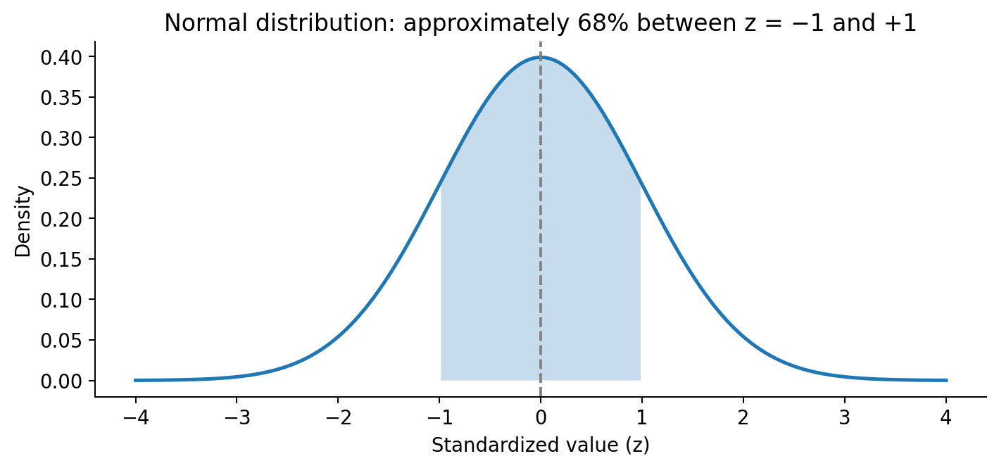
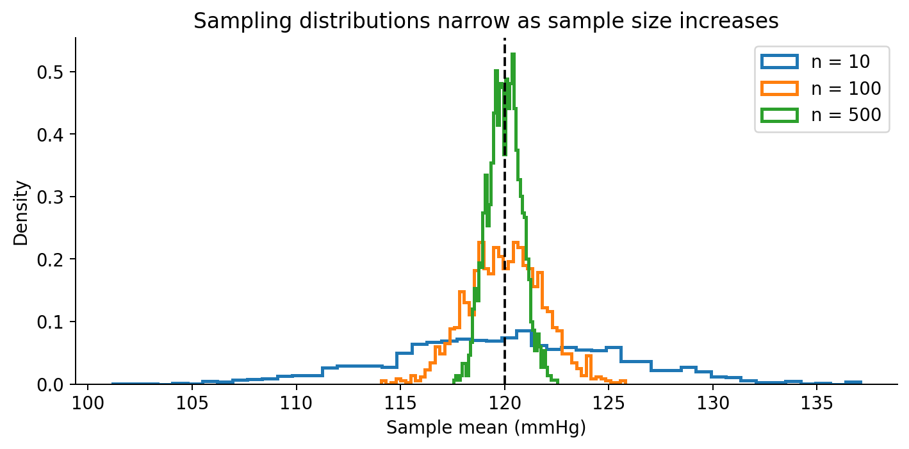
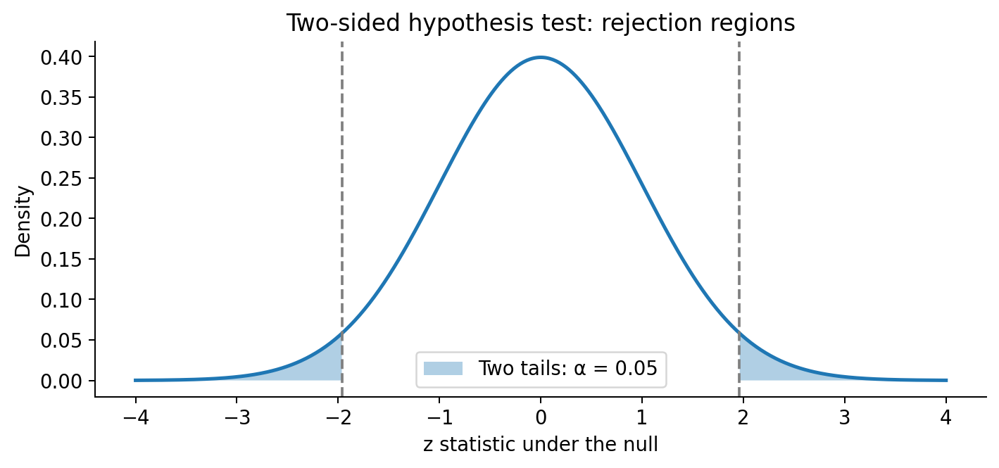
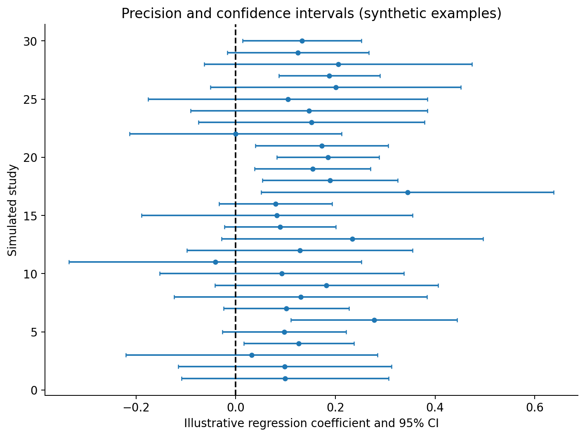
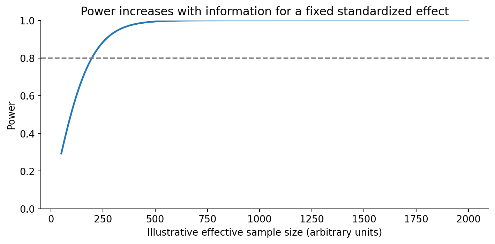
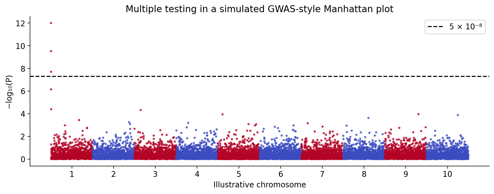

Statistical Foundations for GWAS
================

## 6.1 Why statistics is central to GWAS

A genome-wide association study evaluates whether genetic variation is
statistically associated with a phenotype. The observed relationship may
reflect a real association, sampling variation, confounding, selection
or measurement error. Statistical reasoning allows us to quantify
uncertainty, but it cannot by itself establish a biological mechanism or
causality.

A **population** is the group about which we seek to draw conclusions. A
**sample** is the observed subset. A **parameter** describes a
population property; a **statistic** is calculated from a sample. For
example, the population allele frequency is a parameter, while the
frequency calculated from 200 observed chromosomes is an estimate.

## 6.2 Variables, probability and conditional probability

A **random variable** is a quantity whose value can vary under a
probabilistic model. A binary phenotype can be represented as 0
(control) or 1 (case); blood pressure is continuous. Genotype dosage at
a diploid biallelic autosomal locus may take values 0, 1 or 2.

Probability ranges from 0 to 1. Conditional probability restricts
attention to a defined subgroup:

$$P(A\mid B)=\frac{P(A\cap B)}{P(B)},\qquad P(B)>0.$$

**Worked example.** Suppose 40 of 100 cases carry at least one G allele,
whereas 20 of 100 controls do. Then the sample proportions carrying G
are 0.40 and 0.20, respectively. These are proportions *conditional on
case/control status*. They are not estimates of disease risk without
additional sampling assumptions, especially in a case–control study.

## 6.3 Probability distributions

A **Bernoulli distribution** describes a single binary outcome with
probability $p$ of 1. A **binomial distribution** describes the number
of successes in $n$ independent Bernoulli trials with common success
probability $p$:

$$P(X=k)=\binom{n}{k}p^k(1-p)^{n-k},\quad k=0,1,\ldots,n.$$

Its mean is $np$ and variance is $np(1-p)$. Under simplified independent
sampling, an allele count among $2N$ diploid chromosome copies may be
modeled as binomial; relatedness, population structure and genotype
uncertainty can violate this simple approximation.

A **normal distribution** is continuous, symmetric and characterized by
a mean $\mu$ and standard deviation $\sigma$. Its standardized variable
is:

$$Z=\frac{X-\mu}{\sigma}.$$

<figure>

<figcaption aria-hidden="true">Figure 6.1. Standard normal distribution,
highlighting the central interval.</figcaption>
</figure>

*Figure 6.1.* The central area between −1 and +1 standard deviation is
approximately 68.3% for a normal distribution; this is a mathematical
reference, not a distribution of real GWAS effects.

## 6.4 Mean, variance and standard deviation

For measurements $x_1,\ldots,x_n$, the sample mean and sample variance
are:

$$\bar{x}=\frac{1}{n}\sum_{i=1}^{n}x_i,\qquad
s^2=\frac{\sum_{i=1}^{n}(x_i-\bar{x})^2}{n-1}.$$

**Hand calculation.** For systolic blood pressure values 110, 120 and
130 mmHg, the mean is 120 mmHg. The squared deviations are 100, 0 and
100, so the sample variance is $200/(3-1)=100$ mmHg² and the sample
standard deviation is 10 mmHg. The $n-1$ denominator is used in the
usual unbiased sample-variance estimator under independent sampling.

``` r
sbp <- c(110, 120, 130)
mean(sbp)
```

    ## [1] 120

``` r
var(sbp)
```

    ## [1] 100

``` r
sd(sbp)
```

    ## [1] 10

``` r
stopifnot(mean(sbp)==120, var(sbp)==100, sd(sbp)==10)
```

## 6.5 Sampling distributions and standard errors

A **sampling distribution** describes how a statistic would vary across
repeated samples under a specified sampling design. A **standard error
(SE)** is the standard deviation of that sampling distribution. For an
independent sample mean:

$$SE(\bar X)=\frac{\sigma}{\sqrt{n}},$$

where $\sigma$ is the population standard deviation; in practice, we
often estimate it with $s$. The standard deviation describes individual
variation, whereas the standard error describes estimation uncertainty.

If $s=18$ mmHg and $n=100$, the estimated standard error of the mean is
$18/\sqrt{100}=1.8$ mmHg. Increasing $n$ from 100 to 400 halves this
standard error if the other assumptions remain unchanged.

<figure>

<figcaption aria-hidden="true">Figure 6.2. Simulated sampling
distributions for three sample sizes.</figcaption>
</figure>

*Figure 6.2.* Sampling distributions from repeated synthetic samples
with mean 120 and standard deviation 18 mmHg. Larger samples give more
precise sample means.

``` r
set.seed(606)
means_100 <- replicate(2000, mean(rnorm(100, mean=120, sd=18)))
c(mean=mean(means_100), empirical_SE=sd(means_100), theoretical_SE=18/sqrt(100))
```

    ##           mean   empirical_SE theoretical_SE 
    ##     120.041961       1.786894       1.800000

## 6.6 Hypotheses, test statistics and P values

A **null hypothesis** is a reference statistical statement, often that a
regression coefficient equals zero. An **alternative hypothesis** allows
a nonzero effect. For a biallelic additive association model, a typical
test is $H_0:\beta_G=0$ against $H_1:\beta_G\ne0$.

A *P* value is the probability, **assuming the null model and its
assumptions**, of obtaining a test statistic at least as extreme as the
one observed. It is **not** the probability that the null hypothesis is
true, nor the probability that a SNP is causal.

For an approximately normal estimator, a Wald statistic is:

$$Z=\frac{\widehat{\beta}_G}{SE(\widehat{\beta}_G)}.$$

**Worked example.** If $\widehat{\beta}_G=0.12$ and $SE=0.04$, then
$Z=3$. The two-sided normal-reference *P* value is approximately
0.00270. Whether this result is genome-wide significant is a separate
multiple-testing question.

``` r
beta_hat <- 0.12
se_beta <- 0.04
z <- beta_hat / se_beta
p_two_sided <- 2 * pnorm(-abs(z))
c(z=z, p_value=p_two_sided)
```

    ##           z     p_value 
    ## 3.000000000 0.002699796

``` r
stopifnot(abs(p_two_sided - 0.002699796) < 1e-6)
```

<figure>

<figcaption aria-hidden="true">Figure 6.3. Two-sided null distribution
and rejection tails.</figcaption>
</figure>

*Figure 6.3.* At a nominal two-sided $\alpha=0.05$, the rejection
regions begin beyond approximately ±1.96 under a standard normal null
distribution.

## 6.7 Type I and Type II errors

A **Type I error** occurs when we reject a true null hypothesis. Its
probability under a calibrated test is the significance level $\alpha$.
A **Type II error** occurs when we fail to reject a false null
hypothesis. **Power** is $1-\beta_{\mathrm{II}}$, the probability of
rejecting the null under a specified alternative effect and design.
Failure to reject is not proof that the effect is zero.

<table>

<thead>

<tr>

<th>

True state
</th>

<th>

Reject null
</th>

<th>

Do not reject null
</th>

</tr>

</thead>

<tbody>

<tr>

<td>

Null true
</td>

<td>

Type I error
</td>

<td>

Correct non-rejection
</td>

</tr>

<tr>

<td>

Null false
</td>

<td>

Correct rejection (power)
</td>

<td>

Type II error
</td>

</tr>

</tbody>

</table>

## 6.8 Confidence intervals and precision

For an estimator with approximately normal sampling behavior, a
conventional 95% Wald confidence interval is:

$$\widehat{\beta}\pm1.96\,SE(\widehat{\beta}).$$

For the example above, $0.12\pm1.96(0.04)$ gives approximately **0.0416
to 0.1984**. The 95% refers to the long-run coverage of the procedure
under its assumptions, not a 95% probability that this fixed parameter
lies in the computed interval.

<figure>

<figcaption aria-hidden="true">Figure 6.4. Illustrative effect estimates
and confidence intervals.</figcaption>
</figure>

*Figure 6.4.* Synthetic effect estimates illustrate why uncertainty
matters. An interval crossing zero does not demonstrate that the true
effect is zero.

``` r
ci <- beta_hat + c(-1, 1)*qnorm(0.975)*se_beta
ci
```

    ## [1] 0.04160144 0.19839856

``` r
stopifnot(ci[1] < beta_hat, ci[2] > beta_hat)
```

## 6.9 Correlation is not regression or causation

**Correlation** describes linear co-variation between two numerical
variables; its Pearson coefficient lies between −1 and +1.
**Regression** models a conditional relationship and estimates
coefficients under a specified functional form. Neither automatically
establishes causality. A genetic marker can correlate with a phenotype
because of linkage disequilibrium, population structure, or other
mechanisms.

## 6.10 Linear regression for quantitative traits

For a continuous phenotype, an illustrative additive genetic model is:

$$Y_i=\beta_0+\beta_G G_i+\beta_A A_i+\varepsilon_i,$$

where $G_i$ is effect-allele dosage and $A_i$ is a covariate such as
age. Here $\beta_G$ represents the expected trait difference per
additional effect allele **conditional on included covariates and model
assumptions**. A fitted coefficient is an association estimate, not
automatically a causal effect.

``` r
set.seed(610)
n <- 300
G <- rbinom(n, 2, 0.30)
age <- round(rnorm(n, 45, 12))
y <- 110 + 1.5*G + 0.45*age + rnorm(n, 0, 10)
fit_linear <- lm(y ~ G + age)
summary(fit_linear)$coefficients
```

    ##                Estimate Std. Error   t value      Pr(>|t|)
    ## (Intercept) 109.1354119 2.50129202 43.631616 3.388241e-131
    ## G             2.5115893 0.95410135  2.632414  8.921391e-03
    ## age           0.4568815 0.05134462  8.898332  5.705762e-17

This dataset is entirely simulated. The true data-generating dosage
coefficient is 1.5 mmHg, but the fitted estimate will differ due to
sampling variability.

## 6.11 Logistic regression for binary traits

For a binary phenotype, logistic regression models the log-odds:

$$\log\left(\frac{p_i}{1-p_i}\right)=\beta_0+\beta_G G_i+\beta_A A_i.$$

The **odds** of an event are $p/(1-p)$; the **odds ratio** associated
with a one-unit increase in $G$ is $\exp(\beta_G)$ under the fitted
model. Odds and probability are different: a probability of 0.20
corresponds to odds of $0.20/0.80=0.25$.

If $\beta_G=\log(1.20)$, the modeled odds ratio is 1.20 per G allele.
This does not imply a 20% increase in absolute disease probability.

``` r
set.seed(611)
n <- 500
G <- rbinom(n, 2, 0.30)
age <- rnorm(n, 45, 12)
eta <- -2.0 + log(1.30)*G + 0.02*(age-45)
case <- rbinom(n, 1, plogis(eta))
fit_logistic <- glm(case ~ G + age, family=binomial())
c(beta_G=coef(fit_logistic)["G"], OR_G=exp(coef(fit_logistic)["G"]))
```

    ##    beta_G.G      OR_G.G 
    ## 0.004830016 1.004841699

The simulated sample is not a case–control ascertainment design; its
intercept and fitted probabilities should not be transferred to a
sampled case–control GWAS without considering ascertainment.

## 6.12 Power, sample size and allele frequency

Power depends on sample size, effect magnitude, allele frequency,
phenotype variability or prevalence, genotype quality, covariate
structure, model choice and significance threshold. Rare variants
generally contribute less information to a single-variant additive test
at a fixed sample size because fewer copies are observed. Larger samples
improve precision, but they do not remove confounding or technical bias.

<figure>

<figcaption aria-hidden="true">Figure 6.5. Illustrative statistical
power curve.</figcaption>
</figure>

*Figure 6.5.* A simplified normal-approximation illustration of
increasing power with information. The horizontal axis is an abstract
effective sample size; it is **not** a calibrated GWAS sample-size
calculator.

``` r
alpha <- 0.05
zcrit <- qnorm(1-alpha/2)
illustrative_n <- c(100, 400, 900)
standardized_effect <- 0.20
ncp <- standardized_effect*sqrt(illustrative_n)
power <- pnorm(-zcrit-ncp) + pnorm(-zcrit+ncp, lower.tail=FALSE)
data.frame(illustrative_n, power)
```

    ##   illustrative_n        power
    ## 1            100 0.4840696871
    ## 2            400 0.0206733706
    ## 3            900 0.0000267215

## 6.13 Multiple testing and genome-wide significance

A GWAS may test hundreds of thousands or millions of variants. If one
million independent true-null tests each use $\alpha=0.05$, the expected
number of nominal false positives is $1{,}000{,}000(0.05)=50{,}000$.
Genetic tests are correlated because of linkage disequilibrium, so they
are not independent; nevertheless, multiplicity remains essential.

**Bonferroni correction** uses $\alpha/m$ for $m$ tests and controls
family-wise error under general dependence. For one million tests,
$0.05/1{,}000{,}000=5\times10^{-8}$. The familiar common-variant GWAS
threshold of $5\times10^{-8}$ is a historical field convention motivated
by the effective burden of common-variant tests; it is **not** a
universal threshold for every ancestry, variant class or analysis.

The **Benjamini–Hochberg false discovery rate (FDR)** procedure controls
an expected proportion of false discoveries among rejected hypotheses
under specified assumptions. FDR and family-wise error control answer
different questions.

<figure>

<figcaption aria-hidden="true">Figure 6.6. Simulated Manhattan plot and
conventional threshold.</figcaption>
</figure>

*Figure 6.6.* Fully simulated *P* values across ten illustrative
chromosomes; no biological association is claimed.

``` r
p <- c(0.0001, 0.003, 0.02, 0.15, 0.70)
data.frame(raw_p=p, bonferroni=p.adjust(p, "bonferroni"), BH_FDR=p.adjust(p, "BH"))
```

    ##    raw_p bonferroni     BH_FDR
    ## 1 0.0001     0.0005 0.00050000
    ## 2 0.0030     0.0150 0.00750000
    ## 3 0.0200     0.1000 0.03333333
    ## 4 0.1500     0.7500 0.18750000
    ## 5 0.7000     1.0000 0.70000000

## 6.14 Genomic inflation and association-test calibration

The genomic inflation factor $\lambda_{GC}$ is commonly computed as the
ratio of the median observed one-degree-of-freedom chi-square statistic
to the theoretical null median (approximately 0.455). An elevated value
can arise from population stratification, relatedness, technical
artifacts or widespread true polygenic signal. Therefore,
$\lambda_{GC}>1$ does **not** uniquely diagnose confounding, and its
interpretation depends on sample size and genetic architecture. We will
examine QQ plots, genomic control and LD Score regression in their
appropriate downstream contexts.

## 6.15 Common misunderstandings

<table>

<thead>

<tr>

<th>

Misconception
</th>

<th>

Correction
</th>

</tr>

</thead>

<tbody>

<tr>

<td>

A small P value proves a causal variant.
</td>

<td>

It quantifies evidence against a statistical null under model
assumptions.
</td>

</tr>

<tr>

<td>

P = 0.03 means a 3% chance the null is true.
</td>

<td>

That is not the definition of a P value.
</td>

</tr>

<tr>

<td>

A nonsignificant result proves no association.
</td>

<td>

Low power or imprecision may prevent detection.
</td>

</tr>

<tr>

<td>

An odds ratio of 1.2 means 20% higher absolute risk.
</td>

<td>

It refers to odds, not absolute probability.
</td>

</tr>

<tr>

<td>

A large sample fixes confounding.
</td>

<td>

Large samples reduce random error but can preserve systematic bias.
</td>

</tr>

<tr>

<td>

Every GWAS uses exactly the same P-value threshold.
</td>

<td>

Appropriate thresholds depend on the testing context.
</td>

</tr>

</tbody>

</table>

## 6.16 Reproducibility and methods record

<table>

<thead>

<tr>

<th>

Item
</th>

<th>

Record
</th>

</tr>

</thead>

<tbody>

<tr>

<td>

Empirical input
</td>

<td>

None; no Hapmap files accessed
</td>

</tr>

<tr>

<td>

Software
</td>

<td>

Base R; record local version at execution
</td>

</tr>

<tr>

<td>

Random seeds
</td>

<td>

606, 610 and 611 for separate demonstrations
</td>

</tr>

<tr>

<td>

Figures
</td>

<td>

Six static original illustrations; all numerical inputs
hypothetical/simulated
</td>

</tr>

<tr>

<td>

QC filtering
</td>

<td>

Not performed
</td>

</tr>

<tr>

<td>

Verification
</td>

<td>

Arithmetic checks and executable R assertions included
</td>

</tr>

<tr>

<td>

Limitations
</td>

<td>

Illustrations do not estimate real GWAS effects or calibrated study
power
</td>

</tr>

</tbody>

</table>

``` r
R.version.string
```

    ## [1] "R version 4.5.3 (2026-03-11 ucrt)"

``` r
sessionInfo()
```

    ## R version 4.5.3 (2026-03-11 ucrt)
    ## Platform: x86_64-w64-mingw32/x64
    ## Running under: Windows 11 x64 (build 26200)
    ## 
    ## Matrix products: default
    ##   LAPACK version 3.12.1
    ## 
    ## locale:
    ## [1] LC_COLLATE=English_United States.utf8 
    ## [2] LC_CTYPE=English_United States.utf8   
    ## [3] LC_MONETARY=English_United States.utf8
    ## [4] LC_NUMERIC=C                          
    ## [5] LC_TIME=English_United States.utf8    
    ## 
    ## time zone: Asia/Calcutta
    ## tzcode source: internal
    ## 
    ## attached base packages:
    ## [1] stats     graphics  grDevices utils     datasets  methods   base     
    ## 
    ## loaded via a namespace (and not attached):
    ##  [1] compiler_4.5.3    fastmap_1.2.0     cli_3.6.6         tools_4.5.3      
    ##  [5] htmltools_0.5.9   rstudioapi_0.19.0 yaml_2.3.12       rmarkdown_2.31   
    ##  [9] knitr_1.51        xfun_0.57         digest_0.6.39     rlang_1.2.0      
    ## [13] evaluate_1.0.5

## Chapter summary

Statistical inference separates estimated associations from the
uncertainty around them. Sampling variability is summarized by standard
errors and confidence intervals; tests compare observed evidence with a
null model. Linear and logistic regression are common foundations of
GWAS association analysis, while power and multiple-testing correction
shape which signals can be detected. Neither statistical significance
nor genomic proximity alone establishes causation.

## Concept checks and exercises

1.  Distinguish a population parameter from a sample statistic using
    allele frequency as an example.
2.  Calculate the sample mean, sample variance and standard deviation of
    10, 12 and 14.
3.  Explain why a standard error generally decreases as sample size
    increases.
4.  Calculate a two-sided Wald $Z$ statistic when $\widehat{\beta}=0.15$
    and $SE=0.05$.
5.  Calculate an approximate 95% confidence interval for
    $\widehat{\beta}=0.15$ and $SE=0.05$.
6.  Explain why a 95% confidence interval does not assign a 95%
    probability to a fixed parameter.
7.  Convert a disease probability of 0.25 into odds.
8.  If a logistic regression coefficient is $\log(1.5)$, interpret its
    odds ratio.
9.  Calculate the Bonferroni threshold for 500,000 tests at family-wise
    $\alpha=0.05$.
10. Explain how LD affects the interpretation of a genome-wide
    association signal.
11. Explain why statistical power depends on allele frequency as well as
    sample size.
12. Run the R examples, record the local R version and explain why
    simulation estimates differ from the generating coefficients.

## References and further reading

1.  Visscher PM, Wray NR, Zhang Q, et al. 10 years of GWAS discovery:
    biology, function, and translation. *American Journal of Human
    Genetics*. 2017;101:5–22.
    <https://doi.org/10.1016/j.ajhg.2017.06.005>
2.  Marees AT, de Kluiver H, Stringer S, et al. A tutorial on conducting
    genome-wide association studies: Quality control and statistical
    analysis. *International Journal of Methods in Psychiatric
    Research*. 2018;27:e1608. <https://doi.org/10.1002/mpr.1608>
3.  Wasserstein RL, Lazar NA. The ASA statement on p-values: Context,
    process, and purpose. *The American Statistician*. 2016;70:129–133.
    <https://doi.org/10.1080/00031305.2016.1154108>
4.  Benjamini Y, Hochberg Y. Controlling the false discovery rate: a
    practical and powerful approach to multiple testing. *Journal of the
    Royal Statistical Society Series B*. 1995;57:289–300.
    <https://doi.org/10.1111/j.2517-6161.1995.tb02031.x>
5.  Price AL, Patterson NJ, Plenge RM, et al. Principal components
    analysis corrects for stratification in genome-wide association
    studies. *Nature Genetics*. 2006;38:904–909.
    <https://doi.org/10.1038/ng1847>
6.  Bulik-Sullivan BK, Loh PR, Finucane HK, et al. LD Score regression
    distinguishes confounding from polygenicity in genome-wide
    association studies. *Nature Genetics*. 2015;47:291–295.
    <https://doi.org/10.1038/ng.3211>

**Next chapter:** Chapter 7 — How to Design a GWAS.
