Statistical Models for GWAS: Linear Regression, Logistic Regression, and
Genetic Association Models
================

## 9.1 Why statistical models matter in GWAS

A genome-wide association study generally fits a prespecified
association model at each variant while holding a consistent phenotype
definition and covariate strategy. The estimated coefficient describes
an association *conditional on the fitted covariates*; it does not, by
itself, establish causation \[2\]. A model can be statistically well
fitted yet scientifically misleading when selection bias, population
structure, phenotype error, or genotype error is present. Statistical
inference, prediction, and causal interpretation are different goals.
Prediction evaluates performance on unseen individuals; association
tests whether a model parameter differs from a null value; causal
inference additionally requires identification assumptions.

**Figure 9.1. Statistical-model selection in GWAS.** The conceptual
workflow separates phenotype type, regression family, and validity
checks; it is not an empirical result.

<figure>

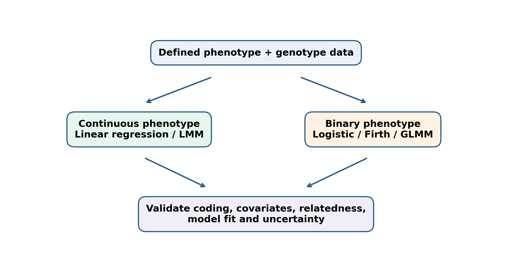
<figcaption>

<strong>Figure 9.1.</strong> Conceptual model selection for continuous
and binary GWAS outcomes.
</figcaption>

</figure>

## 9.2 Variables, allele coding, and units

Let $Y_i$ be an observed phenotype for individual $i$, $G_i$ the number
of copies of the *effect allele*, and $X_i$ a vector of prespecified
covariates. For a diploid biallelic autosomal variant, hard-called $G_i$
is commonly 0, 1, or 2. An imputed dosage is an expected allele count
between 0 and 2, not a certainty about genotype. The reference allele is
not necessarily the minor allele, and the effect allele may be either
reference or alternate depending on software and file conventions.

| Quantity | Example | Interpretation |
|:---|:---|:---|
| $Y$ continuous | systolic blood pressure (mmHg) | phenotype in original units |
| $Y$ binary | disease status (0/1) | outcome indicator |
| $G$ | 0, 1, 2 effect alleles | additive dosage |
| $A$ | age (years) | potential covariate |
| $S$ | sex-related covariate | encode appropriately for study and trait |
| $PC_1,PC_2$ | ancestry principal components | adjustment for measured population structure |
| $G\times E$ | dosage by exposure | interaction term |

A genotype coefficient has meaning only after specifying the phenotype
scale, tested allele, genotype encoding, and covariate set. An intercept
may represent a hypothetical individual with zero-valued covariates;
centering age can make it more interpretable.

## 9.3 Simple linear regression: intercept, slope, and residual

For a continuous phenotype, the simple model is

$$Y_i=\beta_0+\beta_1X_i+\varepsilon_i,\qquad E(\varepsilon_i\mid X_i)=0.$$

The conditional mean is $E(Y_i\mid X_i)=\beta_0+\beta_1X_i$. The fitted
value is $\hat Y_i=\hat\beta_0+\hat\beta_1X_i$; the residual is
$e_i=Y_i-\hat Y_i$. A slope of $2$ mmHg per allele corresponds to a
two-unit *conditional mean difference* per additional effect allele
under additive coding, not to a two-percent increase.

**Worked example (hypothetical):** use $x=(0,1,2,3)$ and $y=(2,3,5,6)$.
Then $\bar x=1.5$, $\bar y=4$, $\sum(x_i-\bar x)(y_i-\bar y)=7$, and
$\sum(x_i-\bar x)^2=5$. Therefore $\hat\beta_1=7/5=1.4$ and
$\hat\beta_0=4-1.4(1.5)=1.9$. These $x$ values illustrate regression
arithmetic and are *not* diploid genotype calls because 3 is included.

``` r
x <- 0:3; y <- c(2,3,5,6)
b1 <- sum((x-mean(x))*(y-mean(y))) / sum((x-mean(x))^2)
b0 <- mean(y)-b1*mean(x)
fit_small <- lm(y ~ x)
stopifnot(isTRUE(all.equal(unname(coef(fit_small)), c(b0,b1))),
          isTRUE(all.equal(c(b0,b1),c(1.9,1.4))))
data.frame(x=x,y=y,fitted=round(fitted(fit_small),2),residual=round(resid(fit_small),2))
```

    ##   x y fitted residual
    ## 1 0 2    1.9      0.1
    ## 2 1 3    3.3     -0.3
    ## 3 2 5    4.7      0.3
    ## 4 3 6    6.1     -0.1

**Figure 9.2. Observations, fitted line and residuals.** All coordinates
follow the four stated hypothetical observations.

<figure>

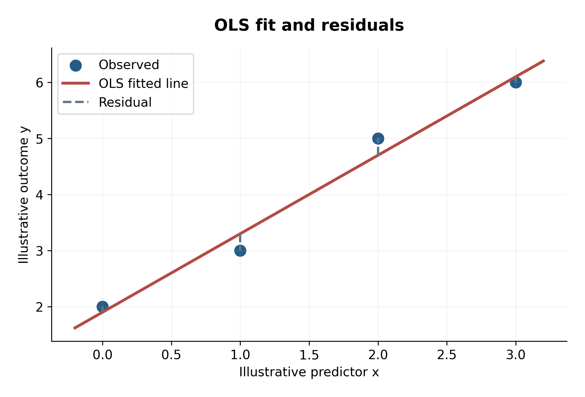
<figcaption>

<strong>Figure 9.2.</strong> OLS line and residuals for four
hypothetical observations.
</figcaption>

</figure>

## 9.4 Ordinary least squares and why squares are minimized

Ordinary least squares (OLS) chooses $b_0,b_1$ to minimize

$$RSS(b_0,b_1)=\sum_{i=1}^n\{y_i-(b_0+b_1x_i)\}^2.$$

Setting both partial derivatives to zero gives the normal equations.
Solving them yields

$$\hat\beta_1=\frac{\sum_i(x_i-\bar x)(y_i-\bar y)}{\sum_i(x_i-\bar x)^2},\qquad \hat\beta_0=\bar y-\hat\beta_1\bar x.$$

The denominator must be positive: a constant predictor cannot have an
estimated slope. For the worked example, residuals are
$(0.1,-0.3,0.3,-0.1)$ and $RSS=0.20$. With $n=4$ and two fitted
parameters, $\hat\sigma^2=RSS/(n-2)=0.10$; the classical slope standard
error is
$\sqrt{\hat\sigma^2/\sum(x_i-\bar x)^2}=\sqrt{0.1/5}\approx0.1414$.
These small-sample calculations illustrate mechanics rather than a
reliable GWAS effect estimate.

``` r
rss <- sum(residuals(fit_small)^2)
se_slope <- sqrt((rss/(length(x)-2))/sum((x-mean(x))^2))
stopifnot(abs(rss-.2)<1e-10,
          isTRUE(all.equal(se_slope,summary(fit_small)$coefficients[2,2])))
c(RSS=rss, residual_variance=rss/(length(x)-2), slope_SE=se_slope)
```

    ##               RSS residual_variance          slope_SE 
    ##           0.20000           0.10000           0.14142

**Figure 9.3. Residual sum of squares.** This exact quadratic objective
uses the same four observations; the intercept is optimized for each
trial slope.

<figure>

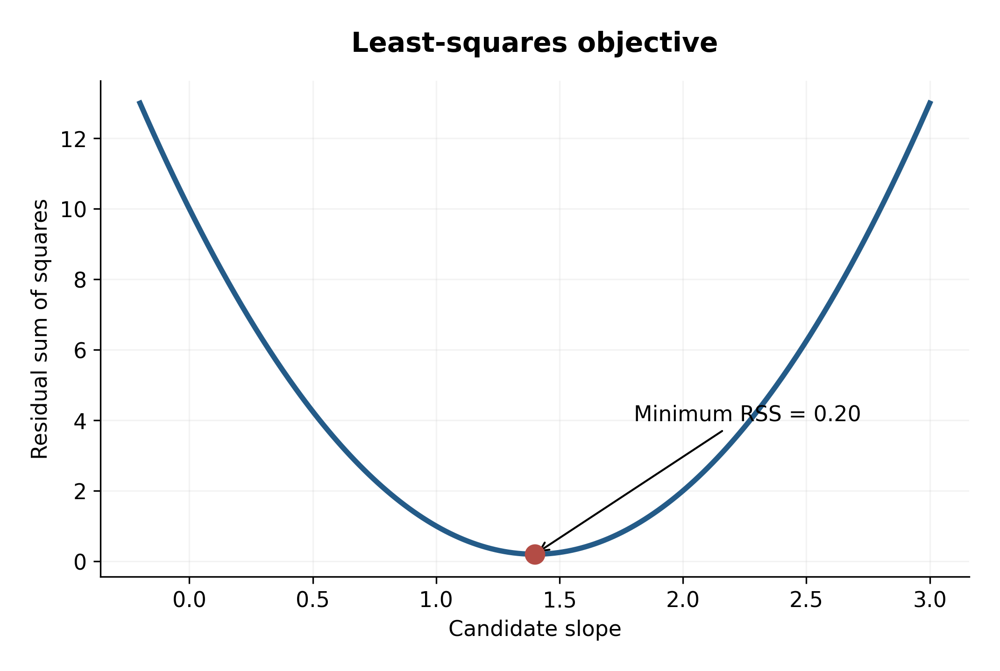
<figcaption>

<strong>Figure 9.3.</strong> Profile residual sum of squares for the
four-observation example.
</figcaption>

</figure>

Gradient descent is an *algorithm for minimizing an objective*, not a
separate statistical model. For simple linear regression, the
closed-form solution is available; for large or complex models,
numerical methods may be more practical. In R, `lm()` uses numerically
stable matrix decomposition rather than directly inverting a matrix.

## 9.5 Multiple regression and conditional SNP effects

With age $A_i$, a suitably encoded sex covariate $S_i$, and genotype
dosage $G_i$,

$$Y_i=\beta_0+\beta_GG_i+\beta_AA_i+\beta_SS_i+\varepsilon_i.$$

The genotype coefficient compares expected phenotypes for individuals
with the same included covariates but one unit difference in $G$. If
genotype and ancestry-related environmental exposures are associated,
omitting ancestry can bias the coefficient. Adjustment is not
universally beneficial: mediators and colliders require causal
consideration.

In matrix form,
$\mathbf Y=\mathbf X\boldsymbol\beta+\boldsymbol\varepsilon$; if
$\mathbf X$ has full column rank, the algebraic OLS solution is
$\hat{\boldsymbol\beta}=(\mathbf X^T\mathbf X)^{-1}\mathbf X^T\mathbf Y$.
In practice QR-based methods are preferred to explicit inversion.
Perfect collinearity makes parameters non-identifiable.

``` r
set.seed(902)
n <- 240
age <- round(runif(n,20,70),1)
PC1 <- rnorm(n)
G <- rbinom(n,2,plogis(-.5+.65*PC1))
Y <- 115 + 1.8*G + .35*(age-45) + 4*PC1 + rnorm(n,sd=8)
teaching <- data.frame(Y,G,age,PC1)
m_unadjusted <- lm(Y~G,data=teaching)
m_adjusted <- lm(Y~G+age+PC1,data=teaching)
rbind(unadjusted=coef(summary(m_unadjusted))["G",],
      adjusted=coef(summary(m_adjusted))["G",])
```

    ##            Estimate Std. Error t value   Pr(>|t|)
    ## unadjusted    3.793    0.93231  4.0684 6.4413e-05
    ## adjusted      1.346    0.78714  1.7100 8.8579e-02

**Figure 9.4. Adjusted and unadjusted genotype coefficients.** These
estimates come from an independently generated fixed-seed Python
simulation, not the R example above or Marees data.

<figure>

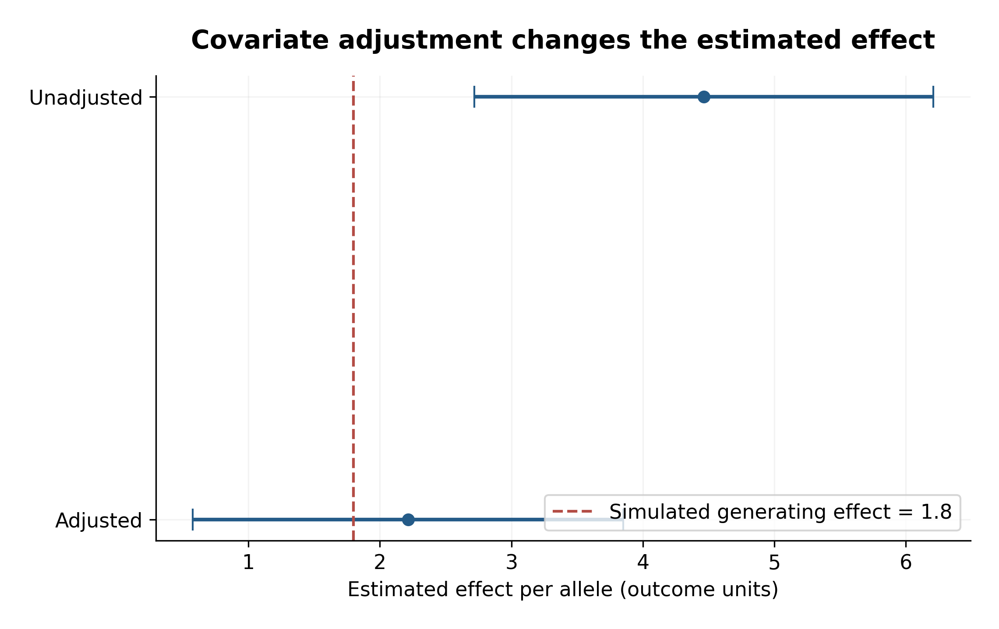
<figcaption>

<strong>Figure 9.4.</strong> Unadjusted and covariate-adjusted slopes
from an independently generated, fixed-seed simulation.
</figcaption>

</figure>

## 9.6 Quantitative-trait GWAS and phenotype scaling

A common additive association model is

$$Y_i=\beta_0+\beta_GG_i+\sum_{k=1}^K\gamma_kPC_{ik}+\varepsilon_i.$$

For blood pressure measured in mmHg, $\beta_G$ is in mmHg per tested
allele. Standardizing $Y$ converts it into standard-deviation units.
Log-transforming a positive trait changes the estimand to the log scale;
exponentiating a coefficient gives a multiplicative effect under that
model. Rank-based inverse-normal transformations can improve
distributional behavior but change interpretability and may not solve
confounding or heteroscedasticity. The model must account for
relatedness where independence is implausible.

## 9.7 Assumptions and regression diagnostics

The central condition for unbiased OLS slopes under standard sampling is
a correctly specified conditional mean, including
$E(\varepsilon\mid\mathbf X)=0$. Homoscedasticity is needed for the
conventional OLS standard error formula, not for the algebraic OLS
estimate. Normal residuals support exact classical small-sample
inference but are not a universal requirement for consistent
large-sample inference. Relatedness violates independent-error
assumptions; linear mixed models or appropriate robust approaches may be
needed \[3\]. Outliers can affect slopes and leverage; influential
observations should be investigated, not automatically deleted.

**Figure 9.5. Residual and Q–Q diagnostics.** Both panels are computed
from the independently generated Python simulation, not the R example
above.

<figure>

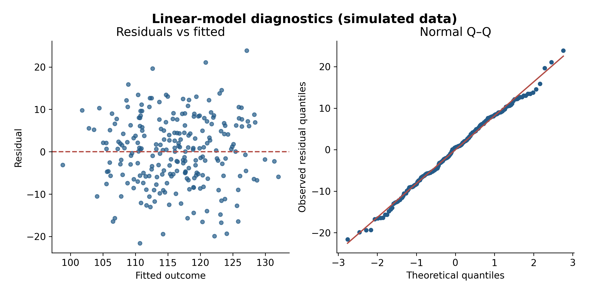
<figcaption>

<strong>Figure 9.5.</strong> Residual diagnostics from an independently
generated, fixed-seed simulation.
</figcaption>

</figure>

``` r
head(data.frame(leverage=hatvalues(m_adjusted),cooks_D=cooks.distance(m_adjusted)))
```

    ##   leverage    cooks_D
    ## 1 0.011473 0.00623164
    ## 2 0.022502 0.00028974
    ## 3 0.021385 0.00050071
    ## 4 0.018538 0.00324274
    ## 5 0.016660 0.00077251
    ## 6 0.014669 0.00460918

Robust sandwich standard errors can help under heteroscedasticity, but
they do not correct an omitted confounder. For related observations, the
variance estimator must reflect the actual dependence structure; a
genetic relationship matrix in an LMM addresses a different issue from a
simple heteroscedasticity correction.

## 9.8 Logistic regression: probability, odds and log-odds

For binary $Y_i\in\{0,1\}$, define $p_i=P(Y_i=1\mid G_i,\mathbf X_i)$.
Logistic regression models

$$\operatorname{logit}(p_i)=\log\frac{p_i}{1-p_i}=\beta_0+\beta_GG_i+\boldsymbol\gamma^T\mathbf X_i,$$

with $p_i=\{1+\exp(-\eta_i)\}^{-1}$. Odds are $p/(1-p)$, not the
probability itself. A coefficient $\beta_G=\log(1.5)$ implies a
conditional *odds ratio* of 1.5 per allele, holding covariates fixed.
The corresponding change in absolute probability depends on baseline
risk; a 50% increase in odds is not a 50% increase in probability.

**Numerical illustration:** baseline odds $0.10/0.90=1/9$. Multiplying
by 1.5 gives odds $1/6$, so the next-genotype probability is
$(1/6)/(1+1/6)=1/7\approx0.1429$, not 0.15. These probabilities are
hypothetical and do not estimate population disease risk from
case–control samples.

``` r
p0 <- .10; OR <- 1.5
odds0 <- p0/(1-p0)
p1 <- (OR*odds0)/(1+OR*odds0)
stopifnot(abs(p1-1/7)<1e-12)
c(p0=p0,odds0=odds0,p1=p1)
```

    ##      p0   odds0      p1 
    ## 0.10000 0.11111 0.14286

**Figure 9.6. Logistic link functions.** These curves follow the
equations, with no empirical data.

<figure>

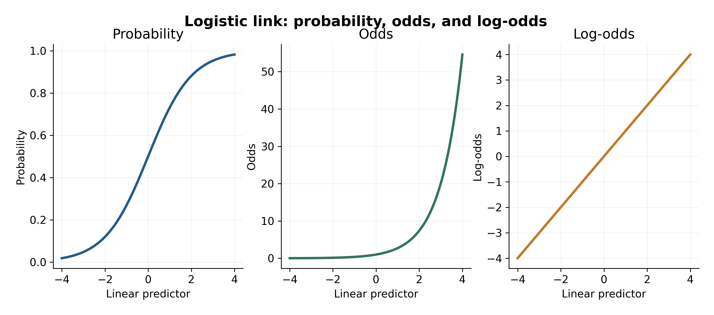
<figcaption>

<strong>Figure 9.6.</strong> Equation-derived probability, odds, and
log-odds curves.
</figcaption>

</figure>

## 9.9 Maximum likelihood for logistic regression

For independent Bernoulli outcomes, the likelihood is

$$L(\boldsymbol\beta)=\prod_{i=1}^n p_i^{y_i}(1-p_i)^{1-y_i},$$

and the log-likelihood is
$\ell(\boldsymbol\beta)=\sum_i[y_i\log p_i+(1-y_i)\log(1-p_i)]$. We
maximize this expression numerically. The observed information matrix
describes local curvature and yields approximate standard errors when
regularity conditions hold. Near separation or with sparse genotype
categories, ordinary maximum-likelihood estimates can diverge.

``` r
set.seed(903)
n_log <- 900
pc <- rnorm(n_log)
g <- rbinom(n_log,2,plogis(-.4+.3*pc))
eta <- -1.2+log(1.4)*g+.45*pc
case <- rbinom(n_log,1,plogis(eta))
logdat <- data.frame(case,g,pc)
fit_log <- glm(case~g+pc,data=logdat,family=binomial())
stopifnot(fit_log$converged)
summary(fit_log)$coefficients
```

    ##             Estimate Std. Error  z value   Pr(>|z|)
    ## (Intercept) -1.28509   0.122641 -10.4785 1.0843e-25
    ## g            0.50771   0.107971   4.7023 2.5729e-06
    ## pc           0.48611   0.078753   6.1726 6.7195e-10

## 9.10 Case–control association: effect sizes and ascertainment

The fitted $\hat\beta_G$ is a conditional log odds ratio;
$\exp(\hat\beta_G)$ is the corresponding conditional OR. A
normal-approximation 95% interval is $\exp(\hat\beta_G\pm1.96\,SE)$. Its
adequacy depends on asymptotic conditions. Under conventional
outcome-dependent case–control sampling, logistic slopes can estimate
population ORs under suitable sampling assumptions, but the fitted
intercept generally cannot be used as a population-risk estimate without
additional information \[4\].

``` r
b <- unname(coef(fit_log)["g"])
se <- coef(summary(fit_log))["g","Std. Error"]
OR_hat <- exp(b)
CI_OR <- exp(b+c(-1,1)*qnorm(.975)*se)
c(OR=OR_hat,lower95=CI_OR[1],upper95=CI_OR[2])
```

    ##      OR lower95 upper95 
    ##  1.6615  1.3446  2.0530

**Figure 9.7. Probability by genotype dosage.** This independent
mathematical illustration uses the hypothetical model logit(p) = -1 +
0.45G; the R exercise above fits a separate simulated dataset.

<figure>

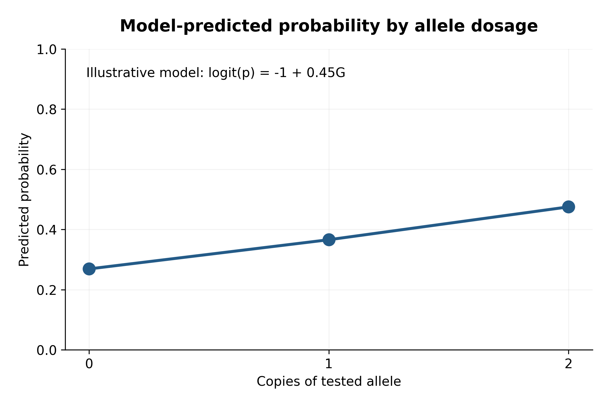
<figcaption>

<strong>Figure 9.7.</strong> Predicted probabilities from an explicitly
hypothetical logistic model; not estimated from the R teaching dataset.
</figcaption>

</figure>

## 9.11 Wald, score and likelihood-ratio tests

We commonly test $H_0:\beta_G=0$ against $H_1:\beta_G\ne0$. The Wald
statistic is $Z=\hat\beta_G/SE(\hat\beta_G)$, approximately standard
normal under suitable large-sample conditions. For a linear model with
estimated residual variance, the corresponding coefficient statistic
follows a $t$ distribution under classical normal-error assumptions. The
likelihood-ratio statistic $2(\ell_{full}-\ell_{null})$ is
asymptotically $\chi^2$ with degrees of freedom equal to the number of
additional free parameters. A score test evaluates the likelihood
gradient at the null fit. They are asymptotically related but can differ
markedly for sparse or unstable data.

``` r
fit_null <- glm(case~pc,data=logdat,family=binomial())
wald_z <- b/se
wald_p <- 2*pnorm(-abs(wald_z))
lrt <- 2*(as.numeric(logLik(fit_log))-as.numeric(logLik(fit_null)))
lrt_p <- pchisq(lrt,df=1,lower.tail=FALSE)
score_test <- anova(fit_null,fit_log,test="Rao")
data.frame(test=c("Wald","Likelihood ratio"),statistic=c(wald_z,lrt),p_value=c(wald_p,lrt_p))
```

    ##               test statistic    p_value
    ## 1             Wald    4.7023 2.5729e-06
    ## 2 Likelihood ratio   22.4902 2.1121e-06

``` r
score_test
```

    ## Analysis of Deviance Table
    ## 
    ## Model 1: case ~ pc
    ## Model 2: case ~ g + pc
    ##   Resid. Df Resid. Dev Df Deviance  Rao Pr(>Chi)    
    ## 1       898       1061                              
    ## 2       897       1038  1     22.5 22.6    2e-06 ***
    ## ---
    ## Signif. codes:  0 '***' 0.001 '**' 0.01 '*' 0.05 '.' 0.1 ' ' 1

The reference-distribution illustration follows the genetic-model coding
figure, preserving sequential figure numbering.

## 9.12 Genetic inheritance and association models

For a biallelic diploid genotype with tested-allele count $G=0,1,2$,
common one-degree-of-freedom codings are additive $(0,1,2)$, dominant
$(0,1,1)$, and recessive $(0,0,1)$. A genotypic model uses two
indicators $I(G=1)$ and $I(G=2)$, with $G=0$ as reference; testing both
together gives a two-degree-of-freedom association test. An
overdominant/heterozygote-indicator model codes $(0,1,0)$; this is not
the same as a two-degree-of-freedom genotypic model. Effect-allele
orientation must be explicit.

| Genotype count | Additive | Dominant | Recessive | Heterozygote indicator | Genotypic: Het | Genotypic: Hom |
|---:|---:|---:|---:|---:|---:|---:|
| 0 | 0 | 0 | 0 | 0 | 0 | 0 |
| 1 | 1 | 1 | 0 | 1 | 1 | 0 |
| 2 | 2 | 1 | 1 | 0 | 0 | 1 |

``` r
model_codes <- data.frame(G=0:2,additive=0:2,dominant=c(0,1,1),
                          recessive=c(0,0,1),heterozygote=c(0,1,0),
                          genotypic_het=c(0,1,0),genotypic_hom=c(0,0,1))
stopifnot(identical(model_codes$dominant,c(0,1,1)))
model_codes
```

    ##   G additive dominant recessive heterozygote genotypic_het genotypic_hom
    ## 1 0        0        0         0            0             0             0
    ## 2 1        1        1         0            1             1             0
    ## 3 2        2        1         1            0             0             1

**Figure 9.8. Verified genetic-model coding.** This plot shows coding
functions, not measured effects or penetrances.

<figure>

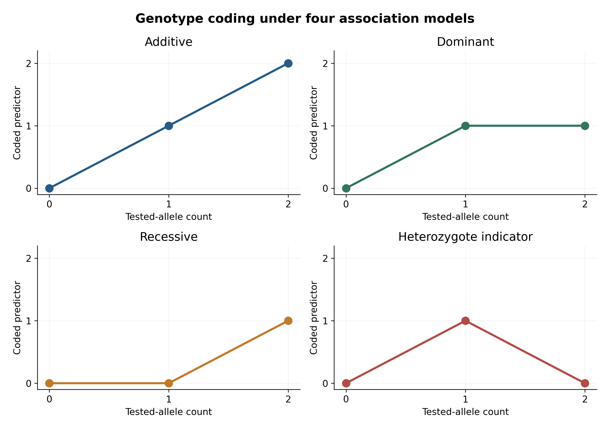
<figcaption>

<strong>Figure 9.8.</strong> Mathematical encoding of additive,
dominant, recessive, and heterozygote-indicator models.
</figcaption>

</figure>

``` r
logdat$dominant <- as.integer(logdat$g>=1)
logdat$recessive <- as.integer(logdat$g==2)
logdat$g_factor <- factor(logdat$g,levels=0:2)
fit_genotypic <- glm(case~g_factor+pc,data=logdat,family=binomial())
fit_additive <- glm(case~g+pc,data=logdat,family=binomial())
anova(fit_additive,fit_genotypic,test="Chisq")
```

    ## Analysis of Deviance Table
    ## 
    ## Model 1: case ~ g + pc
    ## Model 2: case ~ g_factor + pc
    ##   Resid. Df Resid. Dev Df Deviance Pr(>Chi)
    ## 1       897       1038                     
    ## 2       896       1037  1      1.2     0.27

The genotypic-versus-additive comparison is a one-degree-of-freedom
*departure-from-additivity* test (assuming nested fits with identical
samples), not the overall two-degree-of-freedom genotypic association
test. For the latter, compare the genotypic fit against a covariate-only
null model. Non-additive models may lose power when their assumptions
are unnecessary or genotype groups are sparse. Gene–environment
interactions add terms such as $\beta_{GE}G_iE_i$; interpreting the main
genotype coefficient then requires specifying the reference exposure
value.

**Figure 9.9. Wald and likelihood-ratio reference distributions.** We
show standard-normal Wald Z and chi-square(1) likelihood-ratio
references; these are asymptotic reference curves, not a claim of
identical statistics.

<figure>

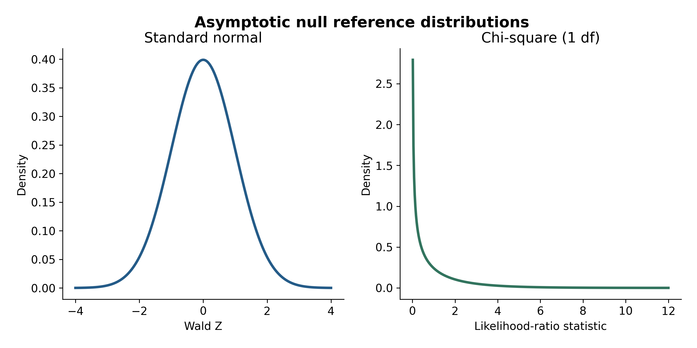
<figcaption>

<strong>Figure 9.9.</strong> Theoretical reference distributions for
Wald and likelihood-ratio statistics.
</figcaption>

</figure>

## 9.13 Effect alleles, reversals, and interpretation

Suppose a model uses dosage $G_A$ for allele A. Reversing to allele B in
diploid biallelic genotypes gives $G_B=2-G_A$. In an otherwise identical
additive model with an intercept, $\beta_B=-\beta_A$ and the logistic
odds ratio becomes $OR_B=1/OR_A$; the intercept shifts accordingly. The
standard error and two-sided test P-value are unchanged for the
algebraically equivalent recoding. Allele swaps in summary statistics
require careful harmonization, especially for palindromic variants.

``` r
logdat$g_other <- 2-logdat$g
reverse_fit <- glm(case~g_other+pc,data=logdat,family=binomial())
stopifnot(isTRUE(all.equal(unname(coef(reverse_fit)["g_other"]),-unname(coef(fit_log)["g"]),tolerance=1e-9)))
c(OR_tested=exp(coef(fit_log)["g"]),OR_other=exp(coef(reverse_fit)["g_other"]))
```

    ##      OR_tested.g OR_other.g_other 
    ##          1.66148          0.60187

**Figure 9.10. Effect-allele reversal.** Values are calculated from a
hypothetical beta and do not represent a locus.

<figure>

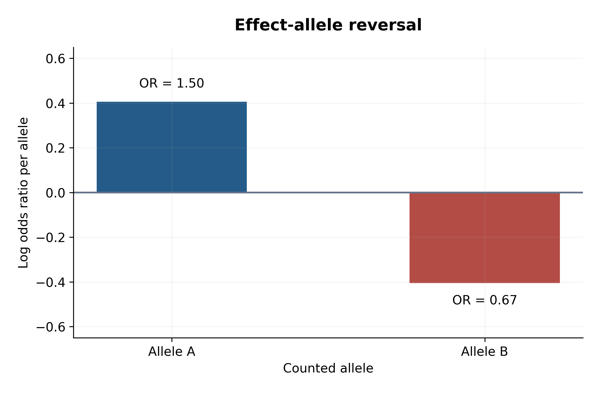
<figcaption>

<strong>Figure 9.10.</strong> Hypothetical effect-allele reversal:
log(1.5) and its negative.
</figcaption>

</figure>

## 9.14 Population structure, relatedness and confounding

Ancestry-related allele-frequency differences combined with
ancestry-related phenotype differences can produce a pooled association
even if the genotype has no causal effect on the phenotype. Covariate
adjustment may reduce this bias but is not guaranteed to eliminate it.
Related individuals also produce correlated errors. A linear mixed model
may represent residual genetic correlation through
$\mathbf u\sim N(0,\sigma_g^2\mathbf K)$, where $\mathbf K$ is a genetic
relationship matrix \[3,5\]. The statistical and biological assumptions
of these models differ.

``` r
set.seed(914)
ancestry<-rep(c(0,1),each=500)
g_anc<-c(rbinom(500,2,.15),rbinom(500,2,.70))
y_anc<-20+5*ancestry+rnorm(1000,sd=3) # No genotype effect in generating model
m_pooled<-lm(y_anc~g_anc)
m_anc_adj<-lm(y_anc~g_anc+ancestry)
coef(summary(m_pooled))["g_anc",]
```

    ##   Estimate Std. Error    t value   Pr(>|t|) 
    ## 2.0550e+00 1.3756e-01 1.4939e+01 1.0822e-45

``` r
coef(summary(m_anc_adj))["g_anc",]
```

    ##   Estimate Std. Error    t value   Pr(>|t|) 
    ##    0.15326    0.15644    0.97967    0.32749

**Figure 9.11. Confounding illustration.** This independent fixed-seed
simulation has zero genetic effect; any apparent association arises from
ancestry imbalance and sampling variability.

<figure>

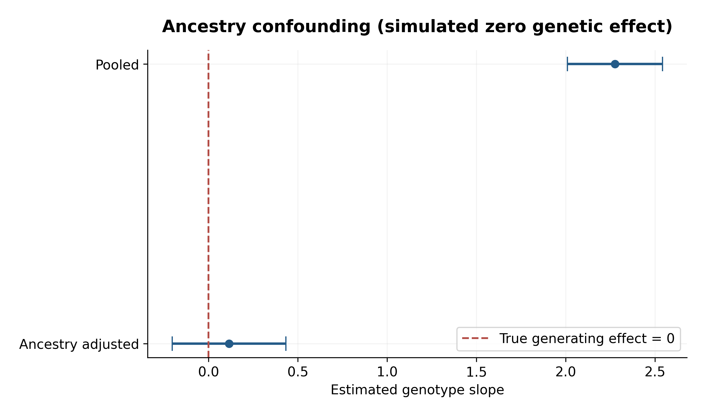
<figcaption>

<strong>Figure 9.11.</strong> Ancestry confounding under an
independently generated, fixed-seed zero-genetic-effect simulation.
</figcaption>

</figure>

## 9.15 Sparse data, separation and model failure

When a genotype category has few carriers, ordinary logistic regression
can produce unstable estimates or fail to converge. In complete
separation, a linear combination of predictors perfectly classifies
cases and controls, and finite maximum-likelihood coefficients need not
exist. Firth’s penalized likelihood can reduce small-sample bias and
provide finite estimates in many separated datasets \[6\]. Firth
correction does not cure confounding or inadequate phenotype
definitions. Severe case–control imbalance and relatedness may motivate
specialized methods such as SAIGE \[7\]. Always inspect the actual
software diagnostic output and allele counts before choosing an
alternative test.

## 9.16 A coherent R analysis checklist

The examples above demonstrate data creation, linear regression,
adjusted regression, logistic regression, odds ratios, confidence
intervals, genetic-model coding, diagnostics, and test comparison. A
reproducible workflow should additionally document phenotype
definitions, tested allele, genotype counts, missingness, covariate
construction, the sample set used for each model, convergence, and
analysis provenance. Our teaching simulations have deterministic seeds;
they must not be labeled as Marees-derived findings.

``` r
stopifnot(nrow(teaching)==240, nrow(logdat)==900,
          all(logdat$g %in% 0:2),
          all(is.finite(coef(fit_log))),
          all(fitted(fit_log)>0 & fitted(fit_log)<1))
data.frame(model=c("Linear adjusted","Logistic adjusted"),
           observations=c(nobs(m_adjusted),nobs(fit_log)),
           predictors=c(length(coef(m_adjusted))-1,length(coef(fit_log))-1))
```

    ##               model observations predictors
    ## 1   Linear adjusted          240          3
    ## 2 Logistic adjusted          900          2

## 9.17 PLINK association commands: version distinctions

The following are **command templates, not executed analyses**. Replace
file names with verified data paths. PLINK 1.9 supports `--linear` and
`--logistic`; PLINK 2.0 uses `--glm` and supports modifiers such as
`firth-fallback`. Exact supported modifiers, output formats, and
covariate options are version-specific; consult the installed version’s
documentation \[8,9\].

``` bash
# PLINK 1.9: continuous phenotype
plink --bfile QC_INPUT --pheno quantitative.pheno --covar covariates.txt --linear --out qt_linear

# PLINK 1.9: binary phenotype
plink --bfile QC_INPUT --pheno binary.pheno --covar covariates.txt --logistic --out cc_logistic

# PLINK 2.0: quantitative phenotype (requires appropriate phenotype coding)
plink2 --pfile QC_INPUT --pheno quantitative.pheno --covar covariates.txt --glm hide-covar --out qt_glm

# PLINK 2.0: binary phenotype, with Firth fallback
plink2 --pfile QC_INPUT --pheno binary.pheno --covar covariates.txt --glm firth-fallback hide-covar --out cc_glm
```

In PLINK 1.x binary phenotypes conventionally use 1=control and 2=case
(0 or -9 missing). PLINK 2.x phenotype conventions and accepted
encodings must be checked for the actual file and version. PLINK output
fields vary by analysis: commonly examine chromosome, position, variant
ID, tested allele, test type, observation count, coefficient/OR,
standard error, test statistic, P-value, and any error/diagnostic
fields. A value labelled OR must not be interpreted as a beta. The
examples do not substitute for an auditable QC pipeline.

## 9.18 Linear versus logistic regression

| Feature | Linear regression | Logistic regression |
|:---|:---|:---|
| Outcome | Continuous | Binary |
| Mean model | Identity link | Logit link |
| Conventional estimation | OLS | Bernoulli maximum likelihood |
| SNP coefficient | Mean phenotype difference per allele | Conditional log OR per allele |
| Exponentiated SNP coefficient | Not generally meaningful | Conditional OR |
| Main diagnostics | Residuals, leverage, variance, functional form | Calibration, separation, functional form, influence, convergence |
| Common failure | Heteroscedasticity, outliers, relatedness | Separation, sparse cells, relatedness |
| Typical GWAS application | Height, BMI, blood pressure | Disease case–control status |

## 9.19 Why genotype QC and imputation matter for regression

Missing genotypes can change the analyzed sample and bias results if
missingness is associated with phenotype or study design. Sample swaps,
sex discrepancies, heterozygosity outliers, relatedness, ancestry
differences, Hardy–Weinberg deviations, low allele counts, batch
effects, strand mismatches, and imputation uncertainty can undermine
association results. Imputed dosages represent expected allele counts
and require quality assessment. These issues will receive dedicated,
comprehensive treatment in later chapters; no QC or imputation is
claimed to have been executed here.

**Figure 9.12. Model-to-data integrity workflow.** This is a conceptual
diagram rather than a report of completed QC.

<figure>

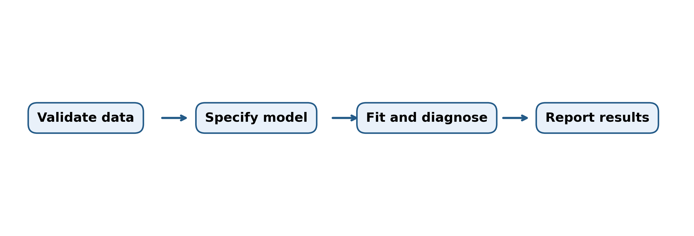
<figcaption>

<strong>Figure 9.12.</strong> Conceptual model-development and reporting
workflow.
</figcaption>

</figure>

## 9.20 Common misconceptions and corrections

| Misconception | Correction |
|:---|:---|
| A significant SNP is causal | LD and confounding can produce associations without direct causality. |
| Every beta is a percentage | Units depend on outcome transformation and model link. |
| OR equals probability | Odds are $p/(1-p)$; OR compares odds. |
| OR equals risk ratio | They can differ, especially for common outcomes. |
| Logistic intercept estimates population prevalence in case–control data | Ascertainment usually alters the intercept. |
| A 0/1/2 genotype code always means minor-allele count | It means copies of the specified tested allele. |
| The reference allele must be the effect allele | Software conventions vary. |
| Switching alleles leaves the beta sign unchanged | Additive beta reverses sign. |
| PCs remove every ancestry effect | Residual structure and selection may remain. |
| Related samples are independent | Genetic and shared environmental correlation can matter. |
| Normality of raw phenotypes is essential for OLS | Conditional error assumptions and inferential context matter. |
| Heteroscedasticity always biases OLS coefficients | It principally affects conventional SEs when conditional mean is correct. |
| Firth regression corrects population stratification | It addresses bias/separation, not confounding. |
| Imputed dosage is an observed genotype | It is an expected allele count with uncertainty. |
| The smallest P-value must have the largest effect | SE, frequency, sample size and model all matter. |
| A two-df genotypic test equals an additive test | They test different model spaces. |
| Gradient descent is a separate regression model | It is an optimization method. |
| A successful fit proves model validity | Model diagnostics and study design remain necessary. |

## 9.21 Practice exercises

**Foundations:** (1) Define a conditional SNP effect. (2) Explain why
odds and probabilities differ. (3) Distinguish effect and minor alleles.
(4) Compare quantitative and binary GWAS. (5) State the interpretation
of a genotype-by-environment coefficient.

**Calculations:** (6) Recalculate the slope and intercept in Section
9.3. (7) Calculate RSS and residual variance. (8) Convert
$\beta=\log(1.25)$ into an OR. (9) Calculate a 95% OR interval when
$\hat\beta=0.20$ and $SE=0.08$. (10) Reverse the tested allele for an OR
of 1.4.

**R practice:** (11) Fit `lm(Y~G)` and `lm(Y~G+age+PC1)` using
`teaching`. (12) Inspect leverage and Cook’s distance. (13) Fit dominant
and recessive logistic models in `logdat`. (14) Compare a genotypic
model against a covariate-only model. (15) Change the simulation seed
and discuss variation in estimates. (16) Generate a
predicted-probability plot for PC values -1, 0 and 1.

### Exercise solutions and checks

1.  A conditional SNP effect compares modeled outcome values at fixed
    included covariates. 2. Probability is $p$; odds are $p/(1-p)$. 3.
    Effect allele defines coefficient orientation; minor allele is
    defined by frequency in a population. 4. Continuous traits commonly
    use identity-link linear models; binary traits commonly use
    logit-link logistic models. 5. It is the change in genotype
    association per unit exposure under the specified interaction
    model. 6. Slope $1.4$, intercept $1.9$. 7. RSS $0.20$ and variance
    estimate $0.10$ with two residual degrees of freedom. 8. OR
    $1.25$. 9. $\exp(0.20\pm1.96\times0.08)$, approximately
    $(1.044,1.429)$. 10. Reversed OR $1/1.4\approx0.7143$. Exercises
    11–16 are verified by running the corresponding code below;
    numerical estimates may vary only when a seed is intentionally
    changed.

``` r
stopifnot(abs(exp(.2-1.96*.08)-1.044)<.001,
          abs(exp(.2+1.96*.08)-1.429)<.001)
fit_dom <- glm(case~dominant+pc,data=logdat,family=binomial())
fit_rec <- glm(case~recessive+pc,data=logdat,family=binomial())
fit_gen_null <- glm(case~pc,data=logdat,family=binomial())
print(anova(fit_gen_null,fit_genotypic,test="Chisq"))
```

    ## Analysis of Deviance Table
    ## 
    ## Model 1: case ~ pc
    ## Model 2: case ~ g_factor + pc
    ##   Resid. Df Resid. Dev Df Deviance Pr(>Chi)    
    ## 1       898       1061                         
    ## 2       896       1037  2     23.7  7.2e-06 ***
    ## ---
    ## Signif. codes:  0 '***' 0.001 '**' 0.01 '*' 0.05 '.' 0.1 ' ' 1

``` r
print(predict(fit_log,newdata=expand.grid(g=0:2,pc=c(-1,0,1)),type="response"))
```

    ##       1       2       3       4       5       6       7       8       9 
    ## 0.14539 0.22037 0.31956 0.21668 0.31488 0.43299 0.31024 0.42769 0.55390

## 9.22 Chapter summary

Linear regression estimates conditional mean differences; logistic
regression estimates conditional log odds ratios. Both depend on clearly
defined alleles, outcome scales, covariates, sample structure and valid
inference. Additive, dominant, recessive and genotypic tests encode
different genetic hypotheses. Statistical precision does not eliminate
confounding or genotype error. The next chapters develop the
data-quality and imputation procedures required before a trustworthy
association analysis.

## 9.23 References

1.  Marees AT, de Kluiver H, Stringer S, et al. A tutorial on conducting
    genome-wide association studies: Quality control and statistical
    analysis. *Int J Methods Psychiatr Res*. 2018;27:e1608.
    <doi:10.1002/mpr.1608>.
2.  Visscher PM, Wray NR, Zhang Q, et al. 10 years of GWAS discovery:
    Biology, function, and translation. *Am J Hum Genet*. 2017;101:5–22.
    <doi:10.1016/j.ajhg.2017.06.005>.
3.  Yang J, Zaitlen NA, Goddard ME, Visscher PM, Price AL. Advantages
    and pitfalls in the application of mixed-model association methods.
    *Nat Genet*. 2014;46:100–106. <doi:10.1038/ng.2876>.
4.  Prentice RL, Pyke R. Logistic disease incidence models and
    case-control studies. *Biometrika*. 1979;66:403–411.
    <doi:10.1093/biomet/66.3.403>.
5.  Price AL, Patterson NJ, Plenge RM, et al. Principal components
    analysis corrects for stratification in genome-wide association
    studies. *Nat Genet*. 2006;38:904–909. <doi:10.1038/ng1847>.
6.  Firth D. Bias reduction of maximum likelihood estimates.
    *Biometrika*. 1993;80:27–38. <doi:10.1093/biomet/80.1.27>.
7.  Zhou W, Nielsen JB, Fritsche LG, et al. Efficiently controlling for
    case-control imbalance and sample relatedness in large-scale genetic
    association studies. *Nat Genet*. 2018;50:1335–1341.
    <doi:10.1038/s41588-018-0184-y>.
8.  Purcell S, Neale B, Todd-Brown K, et al. PLINK: A tool set for
    whole-genome association and population-based linkage analyses. *Am
    J Hum Genet*. 2007;81:559–575. <doi:10.1086/519795>. Official
    documentation: <https://www.cog-genomics.org/plink/1.9/assoc>.
9.  Chang CC, Chow CC, Tellier LC, et al. Second-generation PLINK:
    Rising to the challenge of larger and richer datasets.
    *GigaScience*. 2015;4:7. <doi:10.1186/s13742-015-0047-8>. Official
    documentation: <https://www.cog-genomics.org/plink/2.0/assoc>.

### AI-assistance disclosure

ChatGPT (OpenAI) assisted with educational drafting,
mathematical-example design, R-code preparation, and figure planning.
The examples are hypothetical or simulated; no Marees genotype analysis
was executed for this chapter. The material requires final author
review, local R execution, and visual inspection of knitted figures
before publication. Scientific accuracy and interpretation remain the
author’s responsibility.

### Reproducibility and validation record

- **Actual genotype files used:** None.
- **Empirical association outputs:** None.
- **Teaching data:** Explicitly hypothetical observations and
  deterministic R simulations (`set.seed(902)`, `903`, `914`).
- **External R packages:** `knitr` and `rmarkdown` for rendering; base R
  for calculations and plotting.
- **Figure generation:** R chunks `fig-9-1` through `fig-9-12` in
  ascending order. Figures are generated when the Rmd is knitted.
- **Software versions:** Record local versions with the
  session-information chunk below.
- **QC and imputation:** Not performed in this chapter.
- **Validation status:** Mathematical identities have explicit
  `stopifnot()` checks. R execution and visual review are pending in an
  R-enabled environment.

``` r
sessionInfo()
```

    ## R version 4.5.3 (2026-03-11 ucrt)
    ## Platform: x86_64-w64-mingw32/x64
    ## Running under: Windows 11 x64 (build 26200)
    ## 
    ## Matrix products: default
    ##   LAPACK version 3.12.1
    ## 
    ## locale:
    ## [1] LC_COLLATE=English_United States.utf8  LC_CTYPE=English_United States.utf8   
    ## [3] LC_MONETARY=English_United States.utf8 LC_NUMERIC=C                          
    ## [5] LC_TIME=English_United States.utf8    
    ## 
    ## time zone: Asia/Calcutta
    ## tzcode source: internal
    ## 
    ## attached base packages:
    ## [1] stats     graphics  grDevices utils     datasets  methods   base     
    ## 
    ## loaded via a namespace (and not attached):
    ##  [1] compiler_4.5.3    fastmap_1.2.0     cli_3.6.6         tools_4.5.3      
    ##  [5] htmltools_0.5.9   rstudioapi_0.19.0 yaml_2.3.12       rmarkdown_2.31   
    ##  [9] knitr_1.51        xfun_0.57         digest_0.6.39     rlang_1.2.0      
    ## [13] evaluate_1.0.5
