# 12.1 Why do we check genetic relatedness in GWAS?

A **genome-wide association study (GWAS)** asks whether a genetic
variant is associated with a measured characteristic, called a
**phenotype**. For a case–control study, a **case** has the condition
and a **control** does not. Standard logistic regression typically
assumes that observations are independent *conditional on the model
covariates*. Close relatives violate the simple independent-sample
assumption because they share long stretches of DNA and potentially
environmental factors. If this correlation is ignored, standard errors
and significance tests may be miscalibrated; the direction and size of
the effect depend on the model and sampling design. Relatedness may also
coincide with **population structure**, which can confound association
tests.

A **duplicate** is a repeated measurement of the same person or
biological sample. **Monozygotic (identical) twins** can have nearly
indistinguishable germline genotype profiles, so genotype comparison
alone cannot always tell a technical duplicate from identical twins.
**Cryptic relatedness** means genetic relationships that are unknown,
unreported, or not apparent from the recorded pedigree. **Pedigree**
refers to the documented family relationships. A **founder** has no
parents recorded in the PLINK pedigree (`PID=0` and `MID=0`); founder
status does *not* mean the person has no biological relatives in the
dataset.

We perform this check **after basic sample QC** (Chapter 11), because
genotype errors and missing calls can distort relationship estimates,
and **before final association sample selection**, because we must know
which phenotype-eligible participants are closely related. We do **not**
remove every relative automatically: a relative with missing disease
status may not enter the case–control regression, and a mixed model can
sometimes retain related individuals appropriately.

**Data caveat:** the HapMap tutorial phenotypes are **simulated**; they
are not observed clinical disease outcomes. Our results demonstrate a QC
workflow, not a disease discovery.

# 12.2 Reproducibility, data provenance, and execution rules

The starting file prefix is `QC11_sex_filtered`, the verified output
from Chapter 11. It contains **163 individuals**, **1,457,897 markers**,
**79 males**, **84 females**, **112 recorded founders**, **51
nonfounders**, **56 simulated cases**, **56 simulated controls**, and
**51 missing phenotypes**. PLINK is **v1.90b7 (16 January 2023)**,
executed in WSL at `/mnt/d/TOOLS/PLINK`. The tutorial’s HapMap marker
positions use **NCBI build 36/hg18**. The original Chapter 11 file
remains unchanged throughout the relatedness-panel construction.

We distinguish three classes of content throughout: **VERIFIED** (read
from the user’s actual logs, reports, and R outputs); **ILLUSTRATIVE**
(constructed to teach a concept); and **TO VERIFY** (a result not
established by the supplied records). Do not interpret an illustrative
figure as a plot of observed genomic measurements.

``` r
# Install once if needed: install.packages(c("data.table", "ggplot2"))
library(data.table)
library(ggplot2)
sessionInfo()  # Record exact R and package versions for reproducibility
```

**PLINK files:** `.bed` = compact binary genotypes; `.bim` = marker
chromosome/ID/map-position/alleles; `.fam` = six pedigree and phenotype
columns. `--bfile PREFIX` reads these three files;
`--make-bed --out NEWPREFIX` writes a new trio. A `.log` documents what
PLINK actually did. A `.genome` file contains pairwise genetic-sharing
estimates. A `.prune.in` file lists markers retained by LD pruning;
`.prune.out` lists those removed. **A marker list is not a new genotype
dataset.**

# 12.3 Genetics foundations: alleles, genotypes, and inheritance

Most autosomal positions in a diploid human have two copies, one
inherited from each biological parent. An **allele** is a version of DNA
sequence at a genomic position. A **single-nucleotide polymorphism
(SNP)** is a site with nucleotide variation among individuals. At a
biallelic SNP with alleles A and G, the genotype may be AA, AG, or GG.
**Homozygous** means both copies are the same (AA or GG);
**heterozygous** means different (AG).

An individual inherits a chromosome segment from each parent. Siblings
may inherit the same ancestral segment from a parent, but they can also
inherit different segments. The resulting genome-wide sharing provides
evidence about biological relatedness.

## 12.3.1 IBS: identity by state

Two alleles are **identical by state (IBS)** if their observed allele
labels are the same. IBS says *what we observe*, not *why the alleles
match*. For example, two unrelated people can both carry A at a common
SNP. At a single biallelic diploid SNP, we often describe genotype
sharing as **IBS0**, **IBS1**, or **IBS2**: sharing zero, one, or two
alleles by state, respectively, under a conventional allele-matching
definition. AA versus GG is IBS0; AA versus AG is IBS1; AG versus AG is
IBS2. IBS is sensitive to allele frequency: matching a common allele
provides less evidence of close relationship than matching a rare
allele.

<figure>
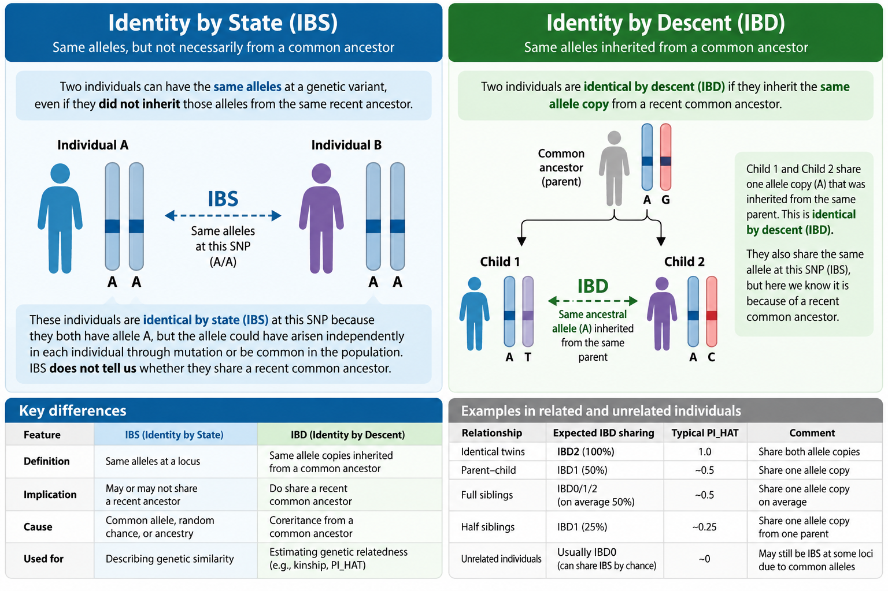
<figcaption aria-hidden="true">Figure 12.1. IBS matches allele labels;
IBD requires inheritance of the same ancestral allele copy.</figcaption>
</figure>

## 12.3.2 IBD: identity by descent

Two alleles are **identical by descent (IBD)** when they derive from the
**same ancestral allele copy**, inherited through a pedigree. IBD is
about *ancestral origin*. Inference of IBD is statistical when the
ancestry is not directly known. Two people may have alleles IBS without
being IBD through a recent shared ancestor. Conversely, alleles that are
IBD are ordinarily also IBS when genotypes are measured correctly and
mutations are ignored.

**Key distinction:** IBS = matching observed allele state; IBD = sharing
an ancestral copy. Genome-wide allele matching helps us *estimate* IBD;
it does not directly prove every ancestral transmission.

**Why IBS alone is insufficient:** a pair of unrelated individuals can
share thousands of common alleles. Calling them relatives based on raw
matching alone would generate false positives. We instead use
genome-wide sharing patterns and allele-frequency-aware estimation,
while accounting for ancestry and LD.

# 12.4 IBD sharing states: Z0, Z1, Z2, and PI_HAT

At an autosomal position, two diploid individuals can share **zero**,
**one**, or **two** allele copies IBD. `Z0`, `Z1`, and `Z2` in PLINK’s
`.genome` output are **estimated genome-wide proportions/probabilities**
for those states; they approximately sum to one. The values are
estimates, not direct observations of ancestral transmissions.

- **Z0:** probability/proportion of sharing zero alleles IBD.
- **Z1:** probability/proportion of sharing exactly one allele IBD.
- **Z2:** probability/proportion of sharing two alleles IBD.
- **PI_HAT:** estimated coefficient of relatedness expressed as the
  expected fraction of alleles shared IBD: `PI_HAT = Z1/2 + Z2`.

Why divide `Z1` by two? Sharing one out of the two possible allele
copies corresponds to **half** the maximum pairwise sharing; sharing two
corresponds to **all** of it. Hence:

$$\widehat{\pi}=\frac{\widehat{Z}_1}{2}+\widehat{Z}_2.$$

<figure>
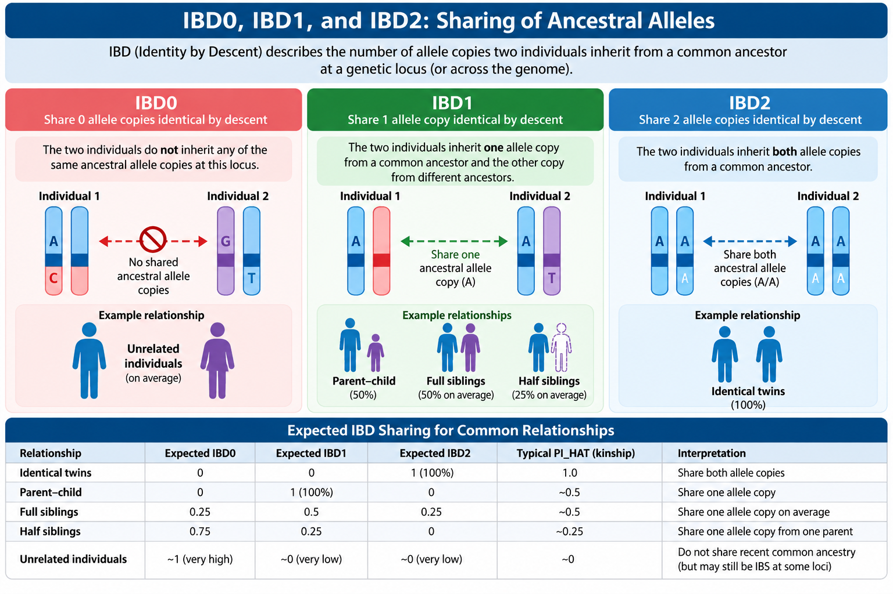
<figcaption aria-hidden="true">Figure 12.2. Conceptual representation of
sharing zero, one, or two allele copies identical by descent. Letters
label ancestral copies, not nucleotides.</figcaption>
</figure>

**Worked example:** if `Z0=0.25`, `Z1=0.50`, `Z2=0.25`, then
`PI_HAT=0.50/2+0.25=0.50`. Both full siblings and parent–offspring pairs
typically have `PI_HAT≈0.5`, but their **state patterns differ**.

| Relationship | Expected Z0 | Expected Z1 | Expected Z2 | Expected PI_HAT |
|:---|---:|---:|---:|---:|
| Unrelated (idealized) | 1 | 0 | 0 | 0 |
| Parent–offspring | 0 | 1 | 0 | 0.5 |
| Full siblings | 0.25 | 0.50 | 0.25 | 0.5 |
| Second-degree (e.g., avuncular, grandparent–grandchild) | 0.5 | 0.5 | 0 | 0.25 |
| First cousins | 0.75 | 0.25 | 0 | 0.125 |
| Same sample / identical twins (idealized) | 0 | 0 | 1 | 1 |

These are **pedigree expectations** under simplified assumptions
(outbred founders, no pedigree complications). Real estimates vary due
to sampling, genotyping error, ancestry, LD, and estimation methods. A
`PI_HAT` value alone cannot uniquely identify a relationship.

``` r
library(ggplot2)
expected <- data.frame(
  Relationship=rep(c("Unrelated","First cousins","Second-degree","Full siblings","Parent–offspring","Duplicates / MZ twins"),each=3),
  State=rep(c("Z0","Z1","Z2"),6),
  Probability=c(1,0,0, .75,.25,0, .5,.5,0, .25,.5,.25, 0,1,0, 0,0,1)
)
expected$Relationship <- factor(expected$Relationship,
 levels=c("Unrelated","First cousins","Second-degree","Full siblings","Parent–offspring","Duplicates / MZ twins"))
ggplot(expected,aes(Relationship,Probability,fill=State)) +
  geom_col(width=.7) + coord_flip() +
  scale_fill_manual(values=c(Z0="#94a3b8",Z1="#0f766e",Z2="#d97706")) +
  labs(x=NULL,y="Expected proportion",fill="IBD state") +
  theme_minimal(base_size=12)
```

<figure>
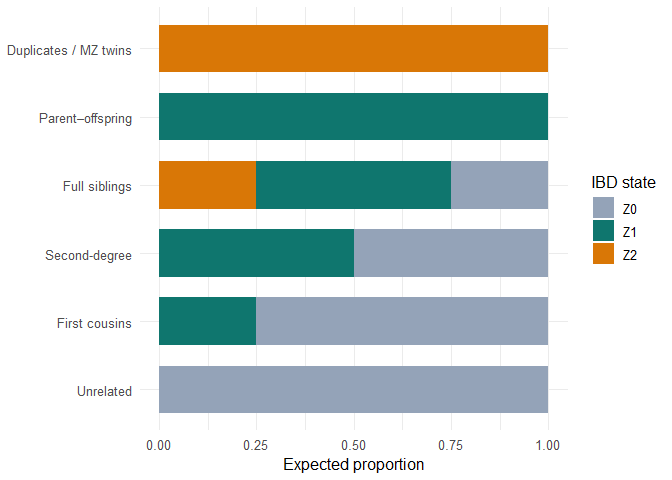
<figcaption aria-hidden="true">Figure 12.3 (ILLUSTRATIVE). Expected
IBD-state patterns for major pedigree relationships; values are
theoretical, not measured HapMap values.</figcaption>
</figure>

## 12.4.1 Kinship coefficient versus PI_HAT

The **kinship coefficient** ($\phi$) is the probability that one allele
sampled from each of two individuals at a locus is IBD. Under standard
definitions for a pair of outbred individuals,
$\phi=\mathrm{PI\_HAT}/2$. Thus full siblings have expected $\phi=0.25$
and `PI_HAT=0.5`. Different software can report relatedness or kinship
with different scales; always check definitions before comparing
thresholds.

## 12.4.2 IBS0 and why it helps distinguish relatives

`IBS0` counts SNPs where two individuals share **no alleles by state**
(for example, AA versus GG). A genuine parent–offspring pair should have
essentially no Mendelian-opposite homozygote pairs, apart from errors or
exceptional biology. Full siblings can show IBS0 at many markers.
Therefore, the **IBD-state profile plus IBS0** is more informative than
`PI_HAT` alone. The `.genome` `RT` field records a pedigree relationship
category (`PO`, `FS`, `UN`, etc.) based on available family information;
`RT=UN` does **not** mean the pair is genetically unrelated.

# 12.5 Why filtering is necessary before estimating IBD

We must avoid confusing a **genetic relationship** with a **technical
artifact** or an **ancestry difference**. We therefore build a
**temporary relatedness panel** from autosomal SNPs. The primary GWAS
dataset remains separate.

**Autosomes (`--chr 1-22`)** are the non-sex chromosomes. They are
diploid for most individuals, allowing the usual autosomal IBD model.
Including sex chromosomes without specialized handling could distort
comparisons between males and females.

**Minor allele frequency (MAF)** is the frequency of the less common
allele in a population sample. `--maf 0.05` retains SNPs with estimated
MAF at least 5%, providing common markers with relatively stable
frequency estimates in a small sample. Rare markers can be informative
in specialized methods, but this is not that method.

**Variant missingness** is the proportion of individuals lacking a
reliable genotype at a marker. `--geno 0.02` removes SNPs with more than
2% missing calls, limiting the influence of low-quality variants.

**Linkage disequilibrium (LD)** is the nonrandom association between
alleles at different sites. Adjacent SNPs can be highly correlated. IBD
estimators that assume approximately independent markers may overweight
a correlated region, inflating or distorting relatedness estimates. **LD
pruning** retains a less redundant subset; it does not mean discarded
SNPs are biologically unimportant or low quality.

**Extended MHC** is the gene-dense region on chromosome 6 with unusually
complex and long-range LD. Even after local-window pruning, it can exert
disproportionate influence. For this dataset’s **build 36/hg18**
coordinates, we used chromosome 6 positions **25,000,000–34,000,000**.
This is a pragmatic tutorial exclusion, not a claim that all other
long-range LD regions have been removed.

# 12.6 Step 1 — Build a common, well-called autosomal marker panel

**Why now?** We first remove chromosome and marker-level complications,
before estimating which individuals are related. This is **marker
filtering**, not individual exclusion.

``` bash
./plink \
  --bfile QC11_sex_filtered \
  --chr 1-22 \
  --maf 0.05 \
  --geno 0.02 \
  --make-bed \
  --out QC12_relatedness_common
```

**VERIFIED** from `QC12_relatedness_common.log`: 1,423,833 autosomal
SNPs loaded; 24,395 excluded for `--geno`; 325,544 excluded for `--maf`;
**1,073,894 SNPs** and **163 individuals** retained. The reported
genotyping rate of the final panel was **0.998135** in the next step’s
input log. No individuals were removed. The original 1,457,897-marker
dataset was not modified.

**What could go wrong?** Applying MAF/missingness filters to the full
association dataset without planning could unnecessarily discard
potentially informative association markers. That is why this panel is
labeled **relatedness** and not **final GWAS variants**. In a small
family-rich dataset, allele-frequency estimation can be affected by
related individuals; this is an acknowledged limitation.

# 12.7 Step 2 — LD pruning

``` bash
./plink \
  --bfile QC12_relatedness_common \
  --indep-pairwise 50 5 0.2 \
  --out QC12_relatedness_pruning
```

The three parameters mean: a sliding **window of 50 SNPs**, shifted by
**5 SNPs** at each iteration, with a pairwise LD threshold of
**$r^2=0.2$**. Here $r$ is the correlation between allele dosages; $r^2$
measures the strength of linear association between two markers, ranging
from 0 to 1. `r^2=0.8` means strong marker correlation; `r^2=0.01` means
weak correlation. PLINK’s pruning algorithm selects a subset that
satisfies its local LD rule; it does not calculate IBD yet.

**VERIFIED:** 969,068 of 1,073,894 variants were pruned; **104,826
SNPs** remained in `QC12_relatedness_pruning.prune.in`. Removing
approximately 90% of markers is not evidence that 90% were genotyping
failures: the purpose is **redundancy reduction**.

**Why does this matter?** Without pruning, one long block of correlated
SNPs may effectively be counted many times. Relationship estimates can
then become overconfident or biased toward regions with unusually dense
markers.

``` r
library(ggplot2)
marker_flow <- data.frame(
  Stage=factor(c("Chapter 11 input","Autosomal subset","MAF + call-rate screen","LD-pruned markers","MHC-excluded markers"),
               levels=rev(c("Chapter 11 input","Autosomal subset","MAF + call-rate screen","LD-pruned markers","MHC-excluded markers"))),
  SNPs=c(1457897,1423833,1073894,104826,104429))
ggplot(marker_flow,aes(Stage,SNPs)) +
  geom_col(fill="#0f766e",width=.65) +
  geom_text(aes(label=format(SNPs,big.mark=",")),hjust=-.1,size=3.5) +
  coord_flip() + expand_limits(y=1650000) +
  scale_y_continuous(labels=function(x) format(x,big.mark=",",scientific=FALSE)) +
  labs(x=NULL,y="Number of SNPs") + theme_minimal(base_size=12)
```

<figure>
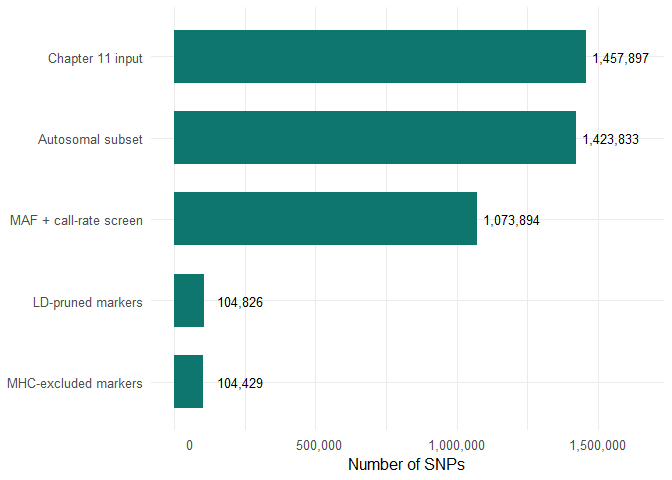
<figcaption aria-hidden="true">Figure 12.4 (VERIFIED). SNP counts
recorded in PLINK logs during construction of the relatedness
panel.</figcaption>
</figure>

# 12.8 Step 3 — Exclude the extended MHC and write the final IBD panel

We used the same exclusion file as Chapter 11, `QC11_MHC_exclusion.txt`,
containing one PLINK range record:

``` text
6 25000000 34000000 MHC
```

``` bash
./plink \
  --bfile QC12_relatedness_common \
  --extract QC12_relatedness_pruning.prune.in \
  --exclude range QC11_MHC_exclusion.txt \
  --make-bed \
  --out QC12_relatedness_final
```

`--extract` selects only SNP IDs from the LD-pruned list.
`--exclude range` removes markers in the specified chromosome interval.
`--make-bed` writes the reduced binary genotype panel.

**VERIFIED:** 104,826 markers extracted; **397** MHC-region SNPs
excluded; **104,429 SNPs and 163 individuals** retained; final panel
genotyping rate **0.9981**. Files created: `QC12_relatedness_final.bed`,
`.bim`, `.fam`, and `.log`.

**Limitations:** local LD pruning plus MHC exclusion does not guarantee
genome-wide independence. A stricter production workflow can use a
curated long-range LD exclusion list, ancestry-matched allele
frequencies, and independent relationship estimators as sensitivity
analyses.

# 12.9 Step 4 — Estimate pairwise IBD with PLINK

``` bash
./plink \
  --bfile QC12_relatedness_final \
  --genome full \
  --out QC12_IBD
```

`--genome` calculates pairwise IBS/IBD summary statistics; `full`
requests additional sharing statistics. PLINK used the **104,429-marker
panel** and **163 individuals**. The `.log` explicitly states
`IBD calculations complete` and `Finished writing QC12_IBD.genome`.

With $N=163$ individuals, the number of **unordered pairs of distinct
people** is:

$$\binom{163}{2}=\frac{163\times162}{2}=13,203.$$

We divide by two because A–B and B–A represent the same pair. **The
expected 13,203 is a mathematical pair count; the full `.genome` row
count was not separately checked in the supplied logs.**

Important `.genome` columns:

| Column | Beginner-friendly meaning |
|:---|:---|
| `FID1`, `IID1`, `FID2`, `IID2` | Family and individual IDs for both members of a pair |
| `RT` | Relationship category from the recorded pedigree; `UN` means unclassified by pedigree |
| `EZ` | Expected relatedness based on pedigree information when available |
| `Z0`, `Z1`, `Z2` | Estimated probabilities of 0, 1, or 2 IBD alleles |
| `PI_HAT` | Estimated genome-wide sharing: `Z1/2 + Z2` |
| `IBS0`, `IBS1`, `IBS2` | Counts of markers with 0, 1, or 2 alleles shared by state |
| `DST`, `PPC`, `RATIO`, `HOMHOM`, `HETHET` | Additional sharing/concordance diagnostics; consult PLINK documentation before interpreting them as clinical or biological measures |

**Caution:** the reported `Z` estimates are model-based, sensitive to
ancestry and marker allele frequencies. A pair’s `RT` value is not a
genotype-derived verdict. We compare both sources of evidence.

# 12.10 Step 5 — Screen potentially related pairs

We used a screening cutoff of `PI_HAT > 0.185`, often used to flag
approximately second-degree-or-closer relatedness in GWAS QC. It is **a
screening rule, not a strict biological boundary**. First cousins can
sometimes lie above or below an arbitrary threshold due to estimation
variability, and unrelated pairs may have elevated estimates if ancestry
is poorly modeled.

``` bash
awk 'NR==1 || $10 > 0.185' QC12_IBD.genome > QC12_related_pairs.txt
```

In the standard PLINK 1.9 `.genome` layout used here, column 10 is
`PI_HAT`. `NR==1` preserves the header. This command **filters a
report**; it does not remove any person or marker. Confirm the column
position whenever changing software or output format.

**VERIFIED from the actual uploaded `QC12_related_pairs.txt`:** **95
pairs** exceeded the threshold; **92** have `RT=PO` and **3** have
`RT=UN`. The `PO` label refers to a pedigree-recorded parent–offspring
relationship; the three `UN` pairs connect family 13291 and family 1454.

``` r
library(data.table)
library(ggplot2)
stopifnot(file.exists("D:/TOOLS/PLINK/QC12_related_pairs.txt"))
pairs <- fread("D:/TOOLS/PLINK/QC12_related_pairs.txt")
stopifnot(nrow(pairs)==95L, all(pairs$PI_HAT>0.185))
ggplot(pairs,aes(PI_HAT,fill=RT)) +
  geom_histogram(binwidth=.015,position="identity",alpha=.8,boundary=0) +
  geom_vline(xintercept=c(.25,.5),linetype="dashed",color="grey30") +
  labs(x="Estimated PI_HAT",y="Number of pairs",fill="Recorded relationship") +
  theme_minimal(base_size=12)
```

<figure>
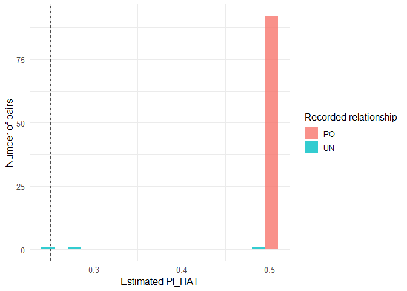
<figcaption aria-hidden="true">Figure 12.5 (OBSERVED). PI_HAT
distribution for the 95 screened related pairs. Requires
QC12_related_pairs.txt.</figcaption>
</figure>

``` r
library(data.table)
library(ggplot2)
pairs <- fread("D:/TOOLS/PLINK/QC12_related_pairs.txt")
ggplot(pairs,aes(Z0,Z2,color=RT)) + geom_point(size=2.8,alpha=.8) +
  geom_vline(xintercept=.25,linetype="dotted") +
  geom_hline(yintercept=.25,linetype="dotted") +
  annotate("text",x=.29,y=.27,label="Full-sibling expectation",hjust=0,size=3.4) +
  coord_cartesian(xlim=c(0,.65),ylim=c(0,.35)) +
  labs(x="Z0 (share zero alleles IBD)",y="Z2 (share two alleles IBD)",color="RT") +
  theme_minimal(base_size=12)
```

<figure>
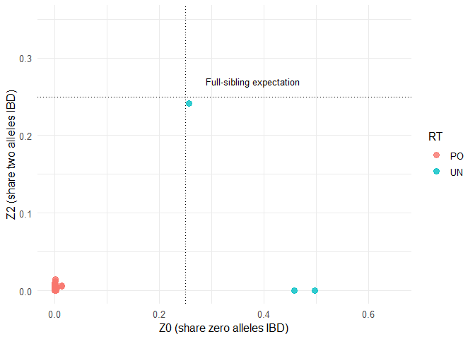
<figcaption aria-hidden="true">Figure 12.6 (OBSERVED). Z0 versus Z2 for
screened pairs, colored by recorded relationship; dotted lines mark
theoretical sibling expectation.</figcaption>
</figure>

# 12.11 Step 6 — Investigate unexpected cross-family relationships

Three screened pairs had `RT=UN`:

| Family / person 1 | Family / person 2 | Z0 | Z1 | Z2 | PI_HAT | Working interpretation |
|:---|:---|---:|---:|---:|---:|:---|
| 13291 / NA06997 | 1454 / NA12813 | 0.4982 | 0.5018 | 0.0000 | 0.2509 | Compatible with second-degree relationship |
| 13291 / NA07045 | 1454 / NA12813 | 0.2573 | 0.5014 | 0.2413 | 0.4920 | Strongly compatible with full siblings |
| 13291 / NA07045 | 1454 / NA12801 | 0.4587 | 0.5413 | 0.0000 | 0.2706 | Compatible with second-degree relationship |

The putative sibling pair illustrates why **`PI_HAT` alone is not
enough**. Its sharing profile (`Z0≈.25`, `Z1≈.50`, `Z2≈.25`) fits full
siblings much better than parent–offspring (`Z0≈0`, `Z1≈1`, `Z2≈0`). The
two other cross-family pairs could be **aunt–niece/nephew**
relationships if the sibling hypothesis is correct. These remain
**inferences**, not confirmed genealogy.

<figure>
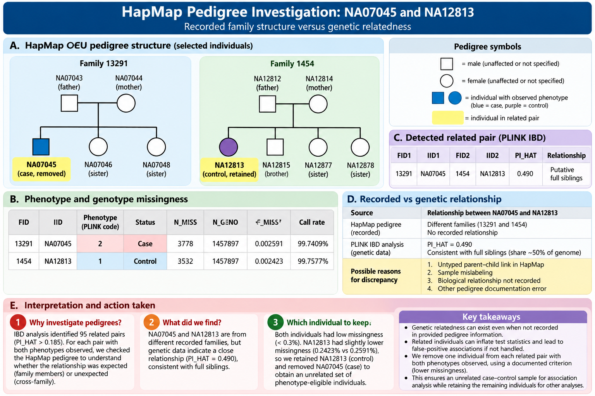
<figcaption aria-hidden="true">Figure 12.7. Observed parent-child
pedigree links and genetically inferred cross-family full-sibling
hypothesis. Case/control labels follow PLINK phenotype codes: 2=case,
1=control.</figcaption>
</figure>

## 12.11.1 Verify the recorded pedigree

PLINK `.fam` fields are `FID IID PID MID SEX PHENO`. `PID` is the
recorded father; `MID` is the recorded mother; `0` means no parent ID
recorded. `SEX=1` means male and `SEX=2` female. For **standard binary
phenotype coding**, `PHENO=1` is **control**, `PHENO=2` is **case**, and
`-9` (or configured missing codes) indicates missing phenotype. This is
**different** from common machine-learning conventions where 1 may
denote a positive case; always inspect the software’s coding.

``` r
library(data.table)
fam <- fread("D:/TOOLS/PLINK/QC12_relatedness_final.fam",header=FALSE)
setnames(fam,c("FID","IID","PID","MID","SEX","PHENO"))
fam[IID %in% c("NA06997","NA07045","NA12813","NA12801"),
    .(FID,IID,PID,MID,SEX,PHENO)]
```

    ##      FID     IID     PID     MID   SEX PHENO
    ##    <int>  <char>  <char>  <char> <int> <int>
    ## 1: 13291 NA06997 NA06986 NA07045     2    -9
    ## 2: 13291 NA07045       0       0     2     2
    ## 3:  1454 NA12813       0       0     2     1
    ## 4:  1454 NA12801 NA12812 NA12813     1    -9

**VERIFIED pedigree records:**

|   FID | IID     | PID     | MID     | SEX | PHENO |
|------:|:--------|:--------|:--------|----:|------:|
| 13291 | NA06997 | NA06986 | NA07045 |   2 |    -9 |
| 13291 | NA07045 | 0       | 0       |   2 |     2 |
|  1454 | NA12813 | 0       | 0       |   2 |     1 |
|  1454 | NA12801 | NA12812 | NA12813 |   1 |    -9 |

Thus NA07045 is a **case**, NA12813 is a **control**, and both are
recorded as founders despite strong evidence of cross-family
relatedness. NA06997 is a recorded child of NA07045, and NA12801 a
recorded child of NA12813. The hypothesized cross-family sibling
relationship coherently explains the two second-degree patterns. The
phenotype labels are **simulated** and should not be used to infer
familial disease biology.

``` r
library(ggplot2)
nodes <- data.frame(
  person=c("NA07045\nCase","NA12813\nControl","NA06997\nPhenotype missing","NA12801\nPhenotype missing"),
  x=c(1,3,1,3),y=c(2,2,1,1),
  role=c("Parent","Parent","Child","Child"))
ggplot() +
  geom_segment(aes(x=1,y=1.77,xend=1,yend=1.24),linewidth=.8,arrow=grid::arrow(length=grid::unit(.16,"cm"))) +
  geom_segment(aes(x=3,y=1.77,xend=3,yend=1.24),linewidth=.8,arrow=grid::arrow(length=grid::unit(.16,"cm"))) +
  geom_segment(aes(x=1.37,y=2,xend=2.63,yend=2),linewidth=1,linetype="dashed",color="#b45309") +
  geom_label(data=nodes,aes(x,y,label=person,fill=role),size=3.5,label.size=.4) +
  annotate("text",x=2,y=2.2,label="Putative full siblings: PI_HAT = 0.4920",size=3.3) +
  scale_fill_manual(values=c(Parent="#dbeafe",Child="#dcfce7")) +
  coord_cartesian(xlim=c(.3,3.7),ylim=c(.65,2.55)) +
  labs(title="Cross-family relationship hypothesis",subtitle="Recorded FIDs: 13291 (left), 1454 (right)") +
  theme_void(base_size=12) + theme(legend.position="none")
```

    ## Warning: The `label.size` argument of `geom_label()` is deprecated as of ggplot2 3.5.0.
    ## ℹ Please use the `linewidth` argument instead.
    ## This warning is displayed once per session.
    ## Call `lifecycle::last_lifecycle_warnings()` to see where this warning was
    ## generated.

<figure>
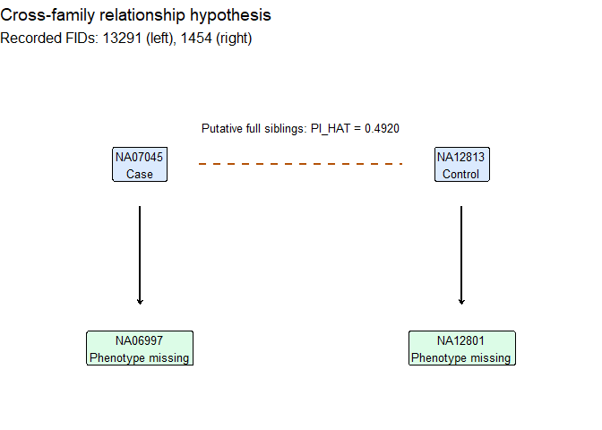
<figcaption aria-hidden="true">Figure 12.7 (INFERRED FROM VERIFIED
RECORDS). Solid arrows represent recorded mother–child relationships;
dashed link is a putative full-sibling relationship inferred from IBD,
not confirmed pedigree.</figcaption>
</figure>

# 12.12 Step 7 — Which related pairs matter for case–control GWAS?

Our original 163 individuals had **56 cases, 56 controls, and 51 missing
phenotypes**. Missing phenotype means the outcome is unknown, **not**
that the person’s genotypes are missing. We retain these individuals
during genotype-based QC and appropriate ancestry analyses, but standard
case–control logistic regression cannot use them as cases or controls.

Of the **95 screened related pairs**, **only one pair had observed
phenotypes for both people**: `13291 NA07045` (**case**) and
`1454 NA12813` (**control**). This was verified by merging the screened
pair list with `.fam` phenotype records. Most of the other 94 pairs
involve at least one person whose phenotype is missing. Their
relatedness is real information, but it does not automatically require
dropping phenotype-eligible relatives from the regression dataset.

``` r
library(data.table)
pairs <- fread("D:/TOOLS/PLINK/QC12_related_pairs.txt")
fam <- fread("D:/TOOLS/PLINK/QC12_relatedness_final.fam",header=FALSE)
setnames(fam,c("FID","IID","PID","MID","SEX","PHENO"))
joined <- merge(pairs,fam[,.(FID1=FID,IID1=IID,PHENO1=PHENO)],by=c("FID1","IID1"))
joined <- merge(joined,fam[,.(FID2=FID,IID2=IID,PHENO2=PHENO)],by=c("FID2","IID2"))
eligible_pairs <- joined[PHENO1 %in% c(1,2) & PHENO2 %in% c(1,2)]
stopifnot(nrow(pairs)==95L,nrow(eligible_pairs)==1L)
eligible_pairs[,.(FID1,IID1,PHENO1,FID2,IID2,PHENO2,Z0,Z1,Z2,PI_HAT)]
```

    ## Key: <FID2, IID2>
    ##     FID1    IID1 PHENO1  FID2    IID2 PHENO2     Z0     Z1     Z2 PI_HAT
    ##    <int>  <char>  <int> <int>  <char>  <int>  <num>  <num>  <num>  <num>
    ## 1: 13291 NA07045      2  1454 NA12813      1 0.2573 0.5014 0.2413  0.492

**Why not remove all 95 pairs?** A pair is not an individual, and the
same person can appear in multiple pairs. Deleting one person for every
pair would be logically wrong and could destroy a small study’s power.
We instead identify a **sample set** that satisfies the
analysis-specific relatedness rule, or use a relatedness-aware
association model.

# 12.13 Step 8 — Compare the two eligible samples and document selection

Both samples passed Chapter 11 QC. We calculated sample genotype
missingness across the **broader 1,457,897-marker post-sex-QC dataset**,
not merely the LD-pruned subset:

``` bash
./plink \
  --bfile QC11_sex_filtered \
  --missing \
  --out QC12_pair_missingness
```

The `.imiss` file reports `N_MISS` (number of missing genotype calls),
`N_GENO` (number of assessed genotypes), and `F_MISS=N_MISS/N_GENO`
(fraction missing). A **call rate** is `1-F_MISS`.

**VERIFIED from the user’s R output:**

| Individual | Phenotype | N_MISS |    N_GENO |   F_MISS | Call rate |
|:-----------|:----------|-------:|----------:|---------:|----------:|
| NA07045    | Case      |  3,778 | 1,457,897 | 0.002591 |  99.7409% |
| NA12813    | Control   |  3,532 | 1,457,897 | 0.002423 |  99.7577% |

Difference: **246 missing genotypes**, or approximately **0.0168
percentage points**. This difference is *very small*: it does not
demonstrate that NA07045 is poor quality. We used a **predeclared
deterministic tie-breaker for this educational analysis**: among
otherwise QC-passing related individuals, retain the sample with lower
genotype missingness. Thus we retained **NA12813** and removed
**NA07045**. In a larger real GWAS, the optimal rule may also consider
batch, ancestry, covariate completeness, phenotype balance, and maximal
independent sample size. An alternative mixed-model strategy could
retain both.

``` r
library(ggplot2)
comparison <- data.frame(IID=c("NA07045 (case)","NA12813 (control)"),
                         Missingness=c(.002591,.002423))
ggplot(comparison,aes(IID,Missingness*100,fill=IID)) +
  geom_col(width=.55) + geom_text(aes(label=sprintf("%.4f%%",Missingness*100)),vjust=-.5,size=4) +
  scale_y_continuous(limits=c(0,.30),breaks=seq(0,.30,.05)) +
  labs(x=NULL,y="Missing genotype calls (%)") +
  theme_minimal(base_size=12) + theme(legend.position="none")
```

<figure>
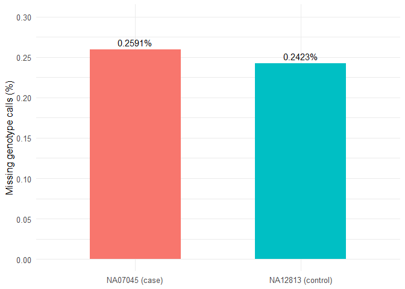
<figcaption aria-hidden="true">Figure 12.8 (VERIFIED). Missing genotype
fractions for the two phenotype-eligible related individuals; note the
deliberately narrow axis and small absolute difference.</figcaption>
</figure>

# 12.14 Step 9 — Remove one sample from the main QC dataset

We wrote a two-column exclusion file (`FID IID`):

``` bash
printf "13291 NA07045\n" > QC12_relatedness_remove.txt
```

Then applied it to the **full post-Chapter-11 marker dataset**, not the
temporary 104,429-marker IBD panel:

``` bash
./plink \
  --bfile QC11_sex_filtered \
  --remove QC12_relatedness_remove.txt \
  --make-bed \
  --out QC12_unrelated
```

**VERIFIED `QC12_unrelated.log`:** `--remove: 162 people remaining`;
**1,457,897 variants**, **162 people**, **111 founders**, **51
nonfounders**, and **55 cases / 56 controls / 51 missing phenotypes**.
The reported total genotyping rate was **0.997573**. The original marker
count is retained because `--remove` excluded an individual, not SNPs.
This operation does **not** prove the entire 162-person dataset is free
of relatives; it only resolves the detected pair with two known
phenotypes under our chosen criterion.

**Warning recorded:** `225 het. haploid genotypes present` (file
`QC12_unrelated.hh`). PLINK treats many such calls as missing. This
warning also occurred earlier and does not invalidate the autosomal IBD
analysis; it must be documented and handled in a dedicated
sex-chromosome QC workflow. Do not silently ignore or interpret it as a
new sample-level exclusion.

## 12.14.1 Verify PLINK’s phenotype coding and counts

``` r
library(data.table)
fam_final <- fread("D:/TOOLS/PLINK/QC12_unrelated.fam",header=FALSE)
setnames(fam_final,c("FID","IID","PID","MID","SEX","PHENO"))
print(fam_final[, .N, by=PHENO][order(PHENO)])
```

    ##    PHENO     N
    ##    <int> <int>
    ## 1:    -9    51
    ## 2:     1    56
    ## 3:     2    55

``` r
stopifnot(nrow(fam_final)==162L,
          sum(fam_final$PHENO==1L)==56L,
          sum(fam_final$PHENO==2L)==55L,
          sum(fam_final$PHENO==-9L)==51L,
          !any(fam_final$FID==13291 & fam_final$IID=="NA07045"))
```

**VERIFIED by user:** `-9: 51`, `1: 56`, `2: 55`. Therefore **111**
people have known simulated case/control status. The 51
missing-phenotype individuals are **not controls** and must not be
imputed arbitrarily.

# 12.15 Step 10 — Confirm zero screened related pairs among eligible people

We intersected the **original 95 screened pairs** with the **111
phenotype-eligible people remaining** in `QC12_unrelated.fam`. This is a
verification against the original pairwise IBD estimates; it does not
require re-estimating all IBD coefficients after removing one person.

``` r
library(data.table)
pairs <- fread("D:/TOOLS/PLINK/QC12_related_pairs.txt")
fam <- fread("D:/TOOLS/PLINK/QC12_unrelated.fam",header=FALSE)
setnames(fam,c("FID","IID","PID","MID","SEX","PHENO"))
eligible <- fam[PHENO %in% c(1,2),.(FID,IID)]
remaining <- merge(pairs,eligible[,.(FID1=FID,IID1=IID)],by=c("FID1","IID1"))
remaining <- merge(remaining,eligible[,.(FID2=FID,IID2=IID)],by=c("FID2","IID2"))
cat("Remaining phenotype-eligible pairs above threshold:",nrow(remaining),"\n")
```

    ## Remaining phenotype-eligible pairs above threshold: 0

``` r
stopifnot(nrow(remaining)==0L)
```

**VERIFIED by user: 0.** Interpretation: among the **111
phenotype-eligible individuals**, there are **no remaining pairs with
`PI_HAT>0.185` in the original screen**. This is not a claim of zero
distant kinship, zero residual population structure, or absolute
statistical independence.

# 12.16 How relatedness changes GWAS estimates: a worked teaching example

Consider a simple association test comparing genotype frequencies
between cases and controls. If close relatives are counted as completely
independent, we may overstate the amount of independent information. A
standard error (SE) describes uncertainty in an effect estimate; a
smaller SE generally produces a larger test statistic `Z = beta/SE` and
smaller p-value. When correlation is ignored, **type I error** (false
positive rate) may increase, though actual effects depend on the design
and model.

**ILLUSTRATIVE ONLY:** suppose the estimated log-odds effect is
$\widehat\beta=0.20$. If an independence-based analysis reports
$SE=0.05$, then $Z=4$. If appropriate dependence adjustment instead
gives $SE=0.08$, then $Z=2.5$. The corresponding two-sided
normal-approximation p-values are about $6.3\times10^{-5}$ and $0.0124$.
These numbers are **not HapMap results** and do not claim that
relatedness always produces this particular SE change.

``` r
library(ggplot2)
beta <- .20
se <- c(.05,.08)
toy <- data.frame(Model=c("Naive independence","Illustrative adjusted SE"),
                  Estimate=beta,SE=se)
toy$Lower <- toy$Estimate-1.96*toy$SE
toy$Upper <- toy$Estimate+1.96*toy$SE
toy$P <- 2*pnorm(-abs(toy$Estimate/toy$SE))
ggplot(toy,aes(Model,Estimate,ymin=Lower,ymax=Upper)) +
  geom_pointrange(linewidth=.7,color="#0f766e") +
  geom_hline(yintercept=0,linetype="dashed") +
  coord_flip() +
  labs(x=NULL,y="Illustrative log-odds coefficient (95% normal CI)",
       subtitle=paste(sprintf("Two-sided p-values: %.4g",toy$P),collapse=" vs ")) +
  theme_minimal(base_size=12)
```

<figure>
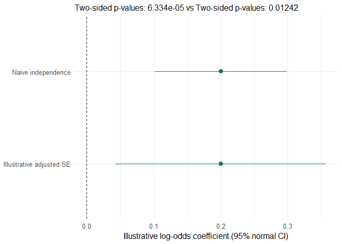
<figcaption aria-hidden="true">Figure 12.9 (ILLUSTRATIVE). The same
effect estimate can have different uncertainty when within-family
correlation is accounted for; not an observed GWAS result.</figcaption>
</figure>

**Relatedness and power:** excluding relatives decreases sample size,
which can reduce **statistical power** (probability of detecting a true
association). A **linear mixed model** or **logistic mixed model** can
account for a genetic relationship matrix (GRM) and sometimes retain
more individuals. However, relatedness-aware methods also require
careful ancestry adjustment, model assumptions, and appropriate
software. For this introductory case–control tutorial we choose a
transparent unrelated-eligible subset rather than claiming a mixed model
was performed.

# 12.17 Full methods record: inputs, outputs, decisions, and warnings

| Step | Input | Command / parameter | Verified output or decision |
|:---|:---|:---|:---|
| Starting data | `QC11_sex_filtered` | Chapter 11 output | 163 people; 1,457,897 markers |
| Autosomal/common/call-rate panel | `QC11_sex_filtered` | `--chr 1-22 --maf 0.05 --geno 0.02` | `QC12_relatedness_common`: 1,073,894 markers; 163 people |
| LD pruning | `QC12_relatedness_common` | `--indep-pairwise 50 5 0.2` | 104,826 in `.prune.in`; 969,068 pruned |
| MHC exclusion | Pruned markers + `QC11_MHC_exclusion.txt` | `--exclude range` | 397 markers removed; 104,429 remain |
| IBD estimation | `QC12_relatedness_final` | `--genome full` | `QC12_IBD.genome` created |
| Related-pair screen | `QC12_IBD.genome` | `PI_HAT > 0.185` | 95 pairs: 92 `PO`, 3 `UN` |
| Pedigree inspection | `QC12_relatedness_final.fam` | Inspect four IDs | Cross-family putative sibling pair |
| Phenotype eligibility | Related pairs + `.fam` | Both phenotypes in `{1,2}` | One eligible related pair |
| Missingness comparison | `QC11_sex_filtered` | `--missing` | NA07045: 0.002591; NA12813: 0.002423 |
| Sample exclusion | `QC11_sex_filtered` | `--remove 13291 NA07045` | `QC12_unrelated`: 162 people; full marker count |
| Final check | `.fam` + original screened pairs | R intersection | 111 eligible; **0** screened related pairs remain |

**Warnings and corrections.** (1) PLINK emitted **225 heterozygous
haploid genotype** warnings during full-genome `--make-bed`; this is not
a newly identified autosomal IBD failure. (2) Earlier discussion
temporarily reversed the case/control meaning of phenotype codes; the
verified correction is **1 = control, 2 = case**, confirmed by the final
PLINK log and `.fam` count. (3) The 51 **nonfounders** and 51 **missing
phenotypes** happen to have equal counts in the starting file, but the
categories are conceptually different and should never be assumed to
contain the same people without a cross-tabulation. (4) The
`PI_HAT > 0.185` threshold is a screening convention, not an exact
relationship classifier. (5) We have not proven the entire 162-person QC
dataset is unrelated.

## 12.17.1 Optional audit of founder status versus phenotype status

``` r
library(data.table)
fam <- fread("D:/TOOLS/PLINK/QC12_unrelated.fam",header=FALSE)
setnames(fam,c("FID","IID","PID","MID","SEX","PHENO"))
fam[,.(N=.N),by=.(Founder=(PID=="0" & MID=="0"),PHENO)][order(Founder,PHENO)]
```

    ##    Founder PHENO     N
    ##     <lgcl> <int> <int>
    ## 1:   FALSE    -9    51
    ## 2:    TRUE     1    56
    ## 3:    TRUE     2    55

## 12.17.2 Optional verify the 95-pair report itself

``` r
library(data.table)
pairs <- fread("D:/TOOLS/PLINK/QC12_related_pairs.txt")
stopifnot(nrow(pairs)==95L)
print(pairs[, .N, by=RT][order(RT)])
```

    ##        RT     N
    ##    <char> <int>
    ## 1:     PO    92
    ## 2:     UN     3

``` r
print(pairs[RT=="UN",.(FID1,IID1,FID2,IID2,Z0,Z1,Z2,PI_HAT)])
```

    ##     FID1    IID1  FID2    IID2     Z0     Z1     Z2 PI_HAT
    ##    <int>  <char> <int>  <char>  <num>  <num>  <num>  <num>
    ## 1: 13291 NA06997  1454 NA12813 0.4982 0.5018 0.0000 0.2509
    ## 2: 13291 NA07045  1454 NA12813 0.2573 0.5014 0.2413 0.4920
    ## 3: 13291 NA07045  1454 NA12801 0.4587 0.5413 0.0000 0.2706

``` r
stopifnot(all(abs(pairs$Z0+pairs$Z1+pairs$Z2-1)<.002),
          all(abs(pairs$PI_HAT-(pairs$Z1/2+pairs$Z2))<.001))
```

# 12.18 Practical pitfalls, interpretation, and alternative approaches

**Mistake: equating IBS and IBD.** Allele matches are not automatically
evidence of recent common ancestry. **Fix:** examine
allele-frequency-aware genome-wide IBD estimates and pedigree context.

**Mistake: classifying all pairs with PI_HAT≈0.5 as parent–offspring.**
Full siblings share the same expected PI_HAT. **Fix:** examine
`Z0/Z1/Z2`, IBS0, and pedigree consistency.

**Mistake: treating founder as unrelated.** A founder merely lacks
recorded parents. **Fix:** evaluate genotypes even across different
FIDs.

**Mistake: treating missing phenotypes as controls.** `-9` is not a
control label. **Fix:** preserve genotype-based QC samples but
explicitly restrict phenotype-dependent analyses.

**Mistake: removing every person in any related pair.** This can cause
unnecessary power loss. **Fix:** define analysis-specific eligibility,
select an unrelated subset systematically, or use a suitable mixed
model.

**Mistake: interpreting 0 remaining pairs as no relatedness anywhere.**
The verification applies only to **known-phenotype individuals** and the
selected threshold. **Fix:** state the scope and sensitivity of the
screen.

**Mistake: using the LD-pruned panel as the final GWAS genotype
dataset.** LD pruning is intended here for relationship estimation, not
association discovery. **Fix:** perform sample exclusion on the original
post-Chapter-11 genotype dataset.

**Mistake: ignoring ancestry.** Allele-frequency differences and
admixture can bias some relatedness estimators. **Fix:** conduct
PCA/ancestry checks (Chapter 13), and consider ancestry-aware
relatedness estimation for production analyses.

**Mistake: overclaiming a pedigree.** The cross-family sibling
hypothesis is strongly supported but not genealogically confirmed.
**Fix:** call it a *putative full-sibling relationship* and document
uncertainty.

# 12.19 End-of-chapter sample flow and transition to PCA

``` r
library(ggplot2)
flow <- data.frame(
  Stage=factor(c("Post-Chapter-11 QC","Post-relatedness QC","Phenotype-eligible"),
               levels=rev(c("Post-Chapter-11 QC","Post-relatedness QC","Phenotype-eligible"))),
  N=c(163,162,111))
ggplot(flow,aes(Stage,N)) + geom_col(fill="#0f766e",width=.6) +
  geom_text(aes(label=N),hjust=-.25,size=4.5) +
  coord_flip() + expand_limits(y=180) +
  labs(x=NULL,y="Individuals",subtitle="163 → 162 after one exclusion → 111 with observed phenotype") +
  theme_minimal(base_size=12)
```

<figure>
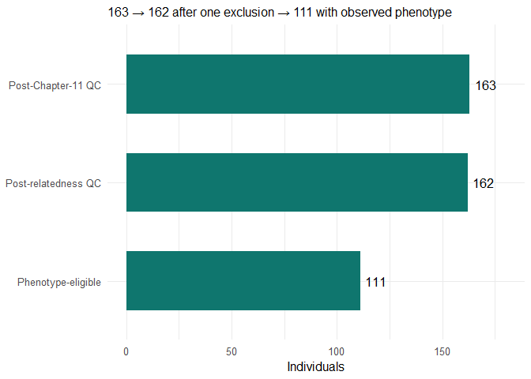
<figcaption aria-hidden="true">Figure 12.9 (VERIFIED). Sample retention
and phenotype eligibility after Chapter 12. Missing-phenotype
individuals remain in the QC dataset but do not enter conventional
case–control regression.</figcaption>
</figure>

**Final verified result:** `QC12_unrelated` contains **162 individuals**
and **1,457,897 variants**. Its `.fam` records **55 cases**, **56
controls**, and **51 individuals with missing phenotype**. The **111
phenotype-eligible individuals** have **zero** pairs exceeding
`PI_HAT>0.185` in the original IBD screen. This is our working
**post-relatedness QC dataset**, not the final ancestry-adjusted GWAS
sample.

**Chapter 13: Population Structure and Principal Component Analysis
(PCA).** PCA summarizes major axes of genetic variation. We must decide
carefully whether to estimate ancestry PCs using unrelated individuals
only, a relationship-aware method, or a suitable projection strategy,
because the 162-person QC dataset still contains recorded relatives with
missing phenotypes. We should not simply run ordinary PCA on all 162
people and assume the resulting PCs represent only ancestry. We will
preserve the exact sample list and rationale for subsequent steps.

# 12.20 Practice questions

1.  Two people share the same A allele at one SNP. Does that prove IBD?
    Explain.
2.  Why can full siblings and parent–offspring pairs both have
    `PI_HAT≈0.5`?
3.  Calculate PI_HAT if `Z0=.49`, `Z1=.50`, and `Z2=.01`.
4.  Why did we remove 969,068 SNPs during LD pruning without calling
    them low-quality variants?
5.  What does `RT=UN` mean, and what does it **not** mean?
6.  Why do 95 detected related pairs not imply 95 sample exclusions?
7.  Explain why `PHENO=-9` individuals remain useful for genotype QC but
    not conventional logistic case–control GWAS.
8.  What evidence supports a putative full-sibling relationship between
    NA07045 and NA12813?
9.  Why was NA07045 removed, and what are the limitations of that
    decision?
10. What exactly does the final result of zero remaining related pairs
    establish?

**Answer guide:** (1) No, IBS need not imply recent IBD. (2) Same
average sharing, different Z-state patterns. (3) `.50/2+.01=.26`. (4) To
reduce correlated marker redundancy. (5) No recognized recorded pedigree
relationship, not necessarily genetically unrelated. (6) Pairs overlap
and analysis eligibility matters. (7) Outcome missing, genotypes still
present. (8) `PI_HAT=.492`, `Z0=.2573`, `Z1=.5014`, `Z2=.2413`,
cross-family FIDs. (9) Slightly greater missingness in an otherwise
QC-passing sample; arbitrary tie-breaker alternatives exist. (10) No
pair among the 111 known-phenotype people exceeded the specified
threshold in the original screen.

# References and further reading

1.  Marees AT, et al. (2018). *A tutorial on conducting genome-wide
    association studies: Quality control and statistical analysis*.
    International Journal of Methods in Psychiatric Research.
    <doi:10.1002/mpr.1608>.
2.  Purcell S, et al. (2007). *PLINK: A tool set for whole-genome
    association and population-based linkage analyses*. American Journal
    of Human Genetics. <doi:10.1086/519795>.
3.  PLINK 1.9 documentation: [Identity by
    descent](https://www.cog-genomics.org/plink/1.9/ibd), [LD
    pruning](https://www.cog-genomics.org/plink/1.9/ld), [Input
    filtering](https://www.cog-genomics.org/plink/1.9/filter).
4.  KING software and kinship concepts: Manichaikul A, et al. (2010).
    *Robust relationship inference in genome-wide association studies*.
    Bioinformatics. <doi:10.1093/bioinformatics/btq559>.

------------------------------------------------------------------------

*Methods status: all numeric HapMap QC outcomes labeled VERIFIED are
based on the supplied PLINK logs, pair report, or user-reported R
outputs. Conceptual plots and the illustrative standard-error example
are explicitly labeled as teaching material. Optional data-dependent R
figures have not been executed unless the corresponding input files are
present and the YAML parameter is enabled.*
